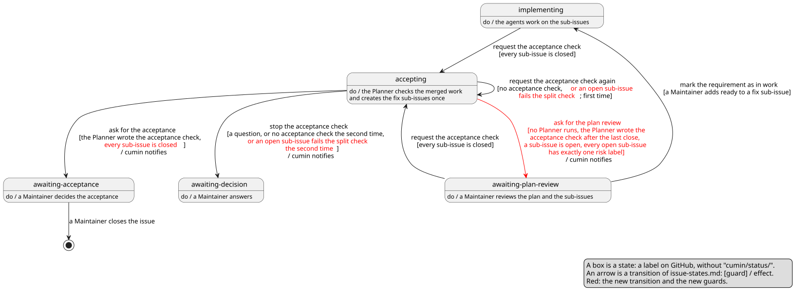

# 受け入れの確認での残りの仕分けの設計

- 状態: Draft
- 要件: [Issueのラベルと状態遷移](../requirements/workflow/issue-states.md) の要求Issueの遷移 (「ask for the plan review」、「ask for the acceptance」、「request the acceptance check again」、「stop the acceptance check」)、[Plannerの要件](../requirements/agents/planner.md) の受け入れの確認、要求Issue #839
- 事実の出どころ: GitHubのIssueとPull Requestを `gh api` で読んだ結果 (2026-10-17)。読んだIssueの番号を本文に書く。それ以外は、この文書での推論である。

受け入れの確認で、Plannerが残りの項目を3つの組に仕分ける決まりと、修正のsub-issueを1回だけ作る決まりと、それに合わせて変わる `issue-states.md` の行を決める。cuminの判定は今までどおり、GitHub上の事実 (sub-issueの開閉、riskのラベル、`## Acceptance check` のコメントの有無) だけを読む。仕分けの中身は読まない。

## 範囲

扱うこと:

- 受け入れの確認でPlannerが何をどの組に入れ、いつ修正のsub-issueを作るか。cuminが、受け入れの確認のあとに開いたsub-issueをどの遷移で扱うか。

扱わないこと:

- `issue-states.md` と `planner.md` の文言。Maintainerのsub-issue (#841) で直す。
- テンプレート、role、disciplineの文言。#843 で直す。
- `AcceptanceEnd` のコードとテストと、[定期確認の設計](poll.md) の「要求Issueのコメントの読み取り」 (開いているsub-issueがあるときも、`cumin/status/accepting` ではコメントを読む)。#842 で直す。
- Reviewerが指摘をblockingとnon-blockingに分ける決まり。#839 の範囲の外である。

## 設計

図の元ファイル: [acceptance-check.puml](acceptance-check.puml)

赤い矢印は、受け入れの確認が修正のsub-issueを作ったときの新しい遷移である。赤い条件は、今の遷移に足す条件である。

- 採らなかった案: cuminが受け入れの確認のコメントの組を読んで、次の状態を決める方法。cuminがAgentの書いた見出し以外の文を読むことになり、#839 の Constraints に反する。

### 残りの項目の3つの組

- 残りの項目とは、表の `Fail` の行、開いたままのnon-blockingの指摘、mergeされたPull Requestの「Follow-up」の項目、フォローアップノートが名指す作業である。Plannerは、項目ごとに、次の順に問い、最初に当てはまった組に入れる。1つの項目は、ちょうど1つの組に入る。

  | 順 | 問い | 当てはまれば |
  |---|---|---|
  | 1 | 作業が要らないか。あとのPull Requestで済んだ、別の項目と重なる、または今の設計を説明するだけの指摘か | No action |
  | 2 | 要求の範囲を変えるか、または選択が要るか。どのRequirementsの行にも当たらない振る舞い、案が2つ以上ある、`docs/ja/requirements/` の変更が要る | Needs a decision |
  | 3 | それ以外。要求の範囲の中の不具合、小さな修正、文書とコードのずれ | Fix in this requirement |

- 順を決めるのは、範囲を広げる誤りを防ぐためである。迷ったら、Needs a decision に入れる。Maintainerが1つ選べば済み、要らない実装のsub-issueができない。
- 例 (#757 の Pull Request #785 の指摘から):
  - Fix in this requirement: 「待ちの記録が利用枠の名前のままで、4つのコメントが今も "only for the quota" と言う」。ツールの確認を足したあとの、文書とコードのずれである。
  - Needs a decision: 「`cumin status` に、新しいオプションを足すとよい」のような、設定や出力を増やす提案。要件の表にない振る舞いなので、選択が要る。
  - No action: 「確認は、スナップショットを読んだあと、判定の前に動く」という note。今の設計を説明するだけで、作業を求めない。
- Fix in this requirement の項目ごとに、Plannerは実装Issueを1つ、要求Issueのsub-issueとして作る。分割と同じテンプレートで書き、`risk/*` のラベルをちょうど1つ付ける。状態ラベルは付けない。
- Needs a decision の項目には、行き先 (新しい要求Issueか、`backlog.md` の行) と、その文の下書きを書く。Plannerは、要求Issueも `backlog.md` も書かない。
- 受け入れたこと: 問い1〜3の当てはめは、Plannerの判断である。cuminは確かめない。誤った組は、Maintainerが分割結果の確認か受け入れのときに直す。
- 採らなかった案: `Fail` の行だけを Fix にする方法。#839 の Why のとおり、多くの項目は範囲の中の小さな不具合で、Maintainerが手で仕分けることが残る。

### 修正のsub-issueを1回だけ作る決まり

- Plannerは、要求Issueのコメントを読み、自分のAppのbot (`<slug>[bot]`) が書いた `## Acceptance check` のコメントで、閉じたsub-issueのうち最後に閉じたものより前に書かれたものを探す。
  - あれば、後の確認である。前の確認が修正のsub-issueを作ったかどうかによらない。残りの項目は Needs a decision か No action にだけ入れる。Fix に当たる項目は、理由「修正のsub-issueは1回だけ作る」を添えて Needs a decision に入れる。
  - なければ、最初の確認である。修正のsub-issueを作ってよい。
- 同じ確認のやり直し (「request the acceptance check again」) は、最初の確認と同じ扱いになる。前の実行のコメントがあっても、最後に閉じたsub-issueより後に書かれているためである。Plannerは、最後のsub-issueが閉じたあとに自分のAppが作ったsub-issueを読み、本文の出どころの印 (元の指摘のコメント、`Fail` の行、または「Follow-up」の項目へのリンク) が同じものは作らず、足りない分だけを作る。やり直しは新しいセッションで始まることがあり、同じ項目を違う題で書きうるためである。riskのラベルがちょうど1つでないものは、ラベルを直す。分割の「やり直しに備えること」と同じ決まりである。
- Plannerは、修正のsub-issueを全て作ってから、コメントを書く。コメントが、確認が終わった印だからである。途中で実行が切れても、コメントがなければcuminがやり直しを依頼し、やり直しは足りない分だけを作る。コメントには、作ったsub-issueの番号を書く。
- 理由: 判定に使う事実 (コメントの作成者、作成の時刻、sub-issueの `closedAt`) は、cuminが今も読んでいるものである ([定期確認の設計](poll.md) の「要求Issueのコメントの読み取り」)。新しい印を持たないので、状態ファイルを失っても結果は変わらない。
- 受け入れた不利益: 最初の確認が修正のsub-issueを作らなかったときも、2回目からは作れない。Maintainerが差し戻しで足したsub-issueのあとの確認も、後の確認になる。どちらも、Maintainerが Needs a decision から選んでsub-issueを足せる。
- 採らなかった案: 修正のsub-issueにラベルか題の印を付けて数える方法。新しいラベルが要り、Maintainerが手で作ったsub-issueと区別が要る。
- 採らなかった案: Hostの状態ファイルに「作った」を持つ方法。失うと、修正のsub-issueがもう一度作られる。

### 変わる `issue-states.md` の行

| 遷移 | 変更 | 理由 |
|---|---|---|
| ask for the plan review | `accepting` → `awaiting-plan-review` を足す。条件: Plannerが動いていない。最後に閉じたsub-issueより後に書かれた受け入れの確認のコメントがある。開いているsub-issueがあり、開いているsub-issueの全てにriskのラベルがちょうど1つ付いている | 修正のsub-issueを、分割のsub-issueと同じ確認に回す |
| ask for the acceptance | 条件に「sub-issueが全て閉じている」を足す。閉じたsub-issueのriskのラベルは見ない | 修正のsub-issueが開いている間は、受け入れに進めない |
| request the acceptance check again | 条件に「または、コメントはあるが、riskのラベルがちょうど1つでない、開いているsub-issueがある」を足す | 分割の「request the split again」と同じく、1回だけ直させる |
| stop the acceptance check | 条件に「または、やり直しのあとも、riskのラベルがちょうど1つでない、開いているsub-issueがある」を足す | 分割の「stop the split」と同じく、Maintainerに戻す |

- riskのラベルを見るのは、開いているsub-issueだけである。開いているsub-issueがなければ「ask for the acceptance」だけが、あれば他の3つのどれか1つだけが成り立つ。「request the acceptance check again」と「ask for the acceptance」は、同時に成り立たない。Maintainerが差し戻しで足し、ラベルの誤ったまま閉じたsub-issueは、受け入れを止めない。
- そのあとは、今の行のままで進む。Maintainerが修正のsub-issueに `cumin/status/ready` を付けると「mark the requirement as in work」が、全て閉じると「request the acceptance check」が成り立つ。最初の確認のコメントは最後のsub-issueが閉じるより前に書かれたので、後の確認が依頼される。
- `planner.md` のテスト7と8 (「Issueは作られない」) は、最初の確認で修正のsub-issueを作る形に変わる。文言は #841 で直す。

### 修正のsub-issueの `cumin/status/ready`

- Maintainerが、分割結果の確認 (「ask for the plan review」の通知) で付ける。Plannerは付けない。
- 理由: 分割のsub-issueと同じく、Maintainerがriskと範囲を見てから着手させるためである。Planner が付けると、Maintainerの見ないまま実装が始まる。
- 受け入れた不利益: 修正が小さくても、Maintainerの操作が1回要る。

### Implementerがnon-blockingの指摘をどこまで直すか

閉じた要求Issueのうち新しい5つで、mergeされたPull Requestに付いたReviewerの `(non-blocking)` の指摘を数えた (2026-10-17)。「開いたまま」は、Implementerが `Fixed` と返していない指摘である。

| 要求Issue | mergeされたPull Requestの数 | non-blocking | うち `Fixed` | 開いたまま |
|---|---|---|---|---|
| #757 ツールが欠けたリポジトリでAgentを起動しない | 9 | 22 | 7 | 15 |
| #729 `cumin status` でpollを示し、`install.sh` で置き換える | 6 | 7 | 0 | 7 |
| #717 セットアップのスクリプトでラベルを揃える | 3 | 5 | 0 | 5 |
| #711 #315 と #656 の受け入れの確認の残り | 5 | 2 | 0 | 2 |
| #669 分割結果の確認の間に受け入れの確認を依頼する | 3 | 6 | 0 | 6 |
| 合計 | 26 | 42 | 7 | 35 |

- 開いたままの指摘は、要求Issueごとに2〜15件あり、合計35件である。#711 は、前の2つの要求Issueの残りを直すための要求Issueである。
- 決めたこと: Maintainerが要求Issue #845 で決めた。Reviewerは、Implementerが全てのnon-blockingの指摘に返事をしてから `APPROVE` する。Implementerは、non-blockingの指摘ごとに「Fix in this pull request」(`Fixed`)、「Needs a decision」(`Deferred`)、「No action」(`Not changed`) に仕分けて返事をする。上の数は、その根拠である。
- 理由: 開いたままの指摘の多くは、同じPull Requestで直せる小さな修正だった。Pull Requestの中で直せば、受け入れの確認に届くのは、選択の要る項目と作業の要らない項目が主になる。
- 受け入れた不利益: レビューのラウンドが増え、ラウンドの上限に近づく。#845 は `max_review_rounds` の初期値を4にする。
- 受け入れの確認の仕分けは、#845 のあとも要る。フォローアップノートは、`Fixed` か `Answer` で始まらない返事の指摘を今までどおり載せるので、`Deferred` と `Not changed` の項目は、受け入れの確認がこの文書の3つの組に仕分ける。
- 採らなかった案: Implementerの決まりを今のまま (数行で、Issueの範囲の中のものだけを直す) にし、残りを受け入れの確認でまとめてsub-issueにする方法。Maintainerが #845 で、Pull Requestの中で答える方を選んだ。

## まだ決めていないこと

| 決める、または確かめること | どこで |
|---|---|
| 変わる行の文言と、`planner.md` のテスト7と8 | #841 |

## 後回しにしたこと

なし
