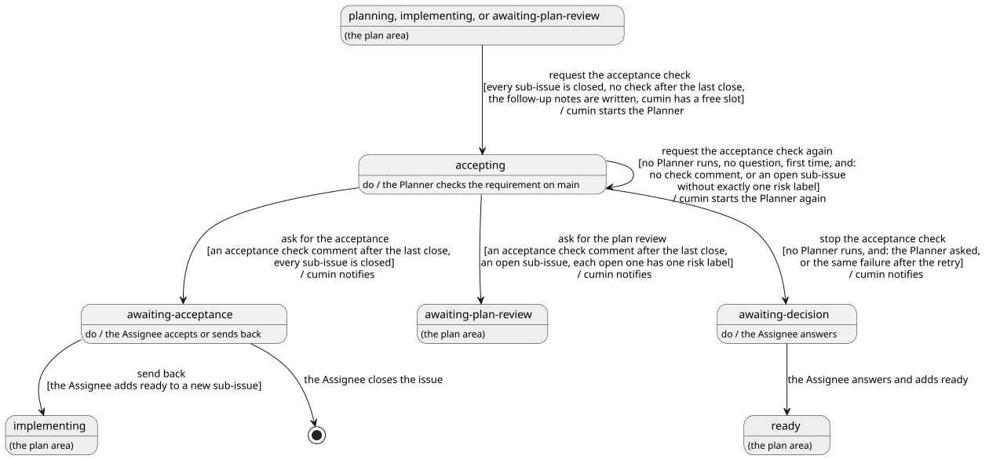

# 受け入れ

要求Issueの sub-issue がすべて閉じてから、要求Issueが閉じるまでの流れを決める。cumin が Planner に受け入れ確認を頼み、Planner が残りの項目を仕分け、cumin がその結果を GitHub で確かめて、Assignee の受け入れか差し戻しを待つまでである。sub-issue に `cumin/status/ready` を付けたときの要求Issueの状態は [計画](../plan/index.md)、フォローアップノートは [マージ](../merge/index.md)、Agent起動に共通のことは [Agent](../agent/index.md) で決める。

## 全体像

要求Issueが受け入れでたどる状態を示す。灰色の状態は、ほかのカテゴリで決める。

図の元ファイル: [overview.puml](overview.puml)

このページで「Planner が動いていない」とは、この cumin が、その要求Issueの Planner の実行を今持っていないことである。

受け入れ確認は、sub-issue をすべて合わせた main ブランチの上で、要求Issueの要求が満たされているかを、Planner が1項目ずつ確かめることである。Pull Request は1つずつしか確かめられないので、全体を確かめる役がほかにいない。計画が正しいことは、Assignee が計画結果の確認で見ている。受け入れ確認は、その計画を前提に、まとめた結果が1つの振る舞いとして正しいかを見る。

Planner は、受け入れ確認で、残りの項目を「この要求で直す」「判断が要る」「対応しない」の3つに仕分ける (`CWK-ACCEPT-011`)。この要求で直すものは、Planner が修正の sub-issue として作る。Assignee が残りの項目を手で仕分けなくても、要求Issueを閉じられるようにするためである。修正の sub-issue は、計画の sub-issue と同じく、計画結果の確認を通って実装される。

cumin が読むのは、受け入れ確認のコメントがあるか、sub-issue が開いているか、開いている sub-issue のリスクのラベル、という GitHub の事実だけである。コメントの中の結果や仕分けは読まない。cumin が途中で止まっても、次の定期確認が、同じ事実から同じアクションを決める。

## 要件

### 受け入れ確認の Agent起動

#### `CWK-ACCEPT-001` 受け入れ確認を始める

要求Issueが次のすべてを満たすとき、cumin は状態を `cumin/status/accepting` に替えてから、新しいセッションで Planner を起動し、受け入れ確認を頼む。通知はしない。

- 状態が `cumin/status/implementing` か `cumin/status/awaiting-plan-review` である。または `cumin/status/planning` で、Planner が動いておらず、計画が完了している ([計画](../plan/index.md) の `CWK-PLAN-004`)
- その状態ラベルを、cumin が扱う ([権限](../access/index.md) の `CWK-ACCESS-004`)
- sub-issue が1つ以上あり、すべて閉じている
- 最後の sub-issue が閉じたあとの受け入れ確認のコメント (`CWK-ACCEPT-002`) が、まだない
- 閉じた sub-issue のフォローアップノートを書き終えている ([マージ](../merge/index.md) の `CWK-MERGE-018`)
- cumin に空きがある

`cumin/status/awaiting-plan-review` から始まるのは、Assignee が手で行う作業の sub-issue (`cumin/type/owner-task`) か、要らなくなった sub-issue を、Assignee が最後に閉じたときである。sub-issue がすべて閉じた要求Issueが `cumin/status/implementing` のまま残っているときは、空きを待っている。

- 検証: `test` 最後の sub-issue の Pull Request がマージされると、要求Issueが `cumin/status/accepting` になり、Planner の Agent起動が新しいセッションで1回だけ起きる。通知は起きない
- 検証: `test` 最後の sub-issue を Assignee が閉じた `cumin/status/awaiting-plan-review` の要求Issueでも、受け入れ確認が始まる
- 検証: `test` 計画中に sub-issue がすべて閉じていた要求Issueでも、フォローアップノートが付き、空きができてから受け入れ確認が始まる

---

### 受け入れ確認の完了判断

#### `CWK-ACCEPT-002` 受け入れ確認の完了を判断する

cumin は、`cumin-planner` が要求Issueに書いた、`## Acceptance check` で始まるコメントが、最後に閉じた sub-issue より後に書かれているとき、受け入れ確認が完了したと判断する。それより前のコメントは、前の受け入れ確認のものなので数えない。cumin は、コメントの中の結果と仕分けを読まない。Planner が返した結果も使わない。

- 検証: `test` 最後の sub-issue が閉じる前の受け入れ確認のコメントしかない要求Issueでは、受け入れ確認が完了したと判断しない

---

#### `CWK-ACCEPT-003` 受け入れを求める

`cumin/status/accepting` の要求Issueで、Planner が動いておらず、受け入れ確認が完了し、sub-issue がすべて閉じているとき、cumin は状態を `cumin/status/awaiting-acceptance` に替えて、受け入れられることを通知する。コメントに `Fail` があっても同じである。

- 検証: `test` 修正の sub-issue を作らずに受け入れ確認のコメントが付くと、要求Issueが `cumin/status/awaiting-acceptance` になり、通知は1回だけである

---

#### `CWK-ACCEPT-004` 修正の sub-issue の確認を求める

`cumin/status/accepting` の要求Issueで、Planner が動いておらず、受け入れ確認が完了し、開いている sub-issue があり、開いている sub-issue のすべてにリスクのラベルが1つだけ付いているとき、cumin は状態を `cumin/status/awaiting-plan-review` に替えて、通知する。通知は、計画結果の確認を求めるときと同じである ([計画](../plan/index.md) の `CWK-PLAN-005`)。

そのあとは、計画の sub-issue と同じに進む。Assignee が修正の sub-issue に `cumin/status/ready` を付けると要求Issueが `cumin/status/implementing` になり ([計画](../plan/index.md) の `CWK-PLAN-008`)、すべて閉じると、受け入れ確認がもう一度始まる (`CWK-ACCEPT-001`)。閉じた sub-issue のリスクのラベルは見ない。

- 検証: `test` Planner が修正の sub-issue を2つ作って受け入れ確認のコメントを書くと、要求Issueが `cumin/status/awaiting-plan-review` になり、通知は1回だけである。`cumin/status/awaiting-acceptance` にはならない
- 検証: `test` 修正の sub-issue に `cumin/status/ready` を付けて、それらが閉じると、受け入れ確認の Agent起動がもう一度起きる

---

#### `CWK-ACCEPT-005` 受け入れ確認をやり直す

`cumin/status/accepting` の要求Issueで、Planner が動いておらず、Planner の質問のコメントがなく、次のどちらかが成り立つとき、cumin は Planner をもう一度起動する。やり直すのは、1つの `cumin/status/accepting` の間に1回だけである。状態は替えない。

- 受け入れ確認のコメントがない
- 受け入れ確認のコメントはあるが、リスクのラベルがないか2つ以上ある、開いている sub-issue がある

2つめは、計画のやり直し ([計画](../plan/index.md) の `CWK-PLAN-006`) と同じく、修正の sub-issue のラベルを Planner に1回だけ直させるためである。

- 検証: `test` コメントを書かずに終わった Planner のあとで、Planner の Agent起動がもう一度だけ起き、状態は `cumin/status/accepting` のままである
- 検証: `test` リスクのラベルのない修正の sub-issue を作って終わった Planner のあとで、Planner の Agent起動がもう一度だけ起きる

---

#### `CWK-ACCEPT-006` 受け入れ確認を止める

`cumin/status/accepting` の要求Issueで、Planner が動いておらず、次のどちらかが成り立つとき、cumin は状態を `cumin/status/awaiting-decision` に替えて、通知する。質問のコメントでないときは、止めた理由を要求Issueのコメントに書く。

- Planner の質問のコメントが、要求Issueが `cumin/status/accepting` になったあとに書かれている
- やり直し (`CWK-ACCEPT-005`) のあとも、`CWK-ACCEPT-005` の2つの条件のどちらかが成り立つ

Assignee は、答えをコメントに書き、要求Issueに `cumin/status/ready` を付ける。Planner は要求Issueを読み直し ([計画](../plan/index.md) の `CWK-PLAN-001`)、足りない sub-issue があれば作って計画結果の確認に進み、作るものがなければ受け入れ確認に戻る (`CWK-ACCEPT-001`)。

- 検証: `test` Planner が `blocked` を返すと、やり直さずに `cumin/status/awaiting-decision` になる
- 検証: `test` やり直しのあとも受け入れ確認のコメントがないと、理由のコメントが付いて `cumin/status/awaiting-decision` になる

---

### Assignee の受け入れと差し戻し

#### `CWK-ACCEPT-007` 受け入れ

要求Issueの Assignee は、受け入れ確認のコメントを読み、要求Issueを閉じて受け入れる。判断が要る項目 (`CWK-ACCEPT-014`) は、Assignee が選んで、新しい要求Issueかバックログに書く。cumin は、閉じた要求Issueに何もしない。Agent を起動せず、ラベルを替えず、フォローアップノートも書かない ([マージ](../merge/index.md) の `CWK-MERGE-017`)。

- 検証: `test` `cumin/status/awaiting-acceptance` の要求Issueを閉じたあとの定期確認で、その要求Issueに対するアクションが起きない

---

#### `CWK-ACCEPT-008` 差し戻し

要求Issueの Assignee は、受け入れずに差し戻すとき、要求Issueに sub-issue を足して `cumin/status/ready` を付ける。判断が要る項目の下書きを、そのまま sub-issue に写してもよい。要求Issueは `cumin/status/implementing` になり ([計画](../plan/index.md) の `CWK-PLAN-008`)、足した sub-issue がすべて閉じると、受け入れ確認がもう一度始まる (`CWK-ACCEPT-001`)。前の受け入れ確認のコメントは、最後の sub-issue が閉じる前のものなので、完了に数えない (`CWK-ACCEPT-002`)。

- 検証: `test` `cumin/status/awaiting-acceptance` の要求Issueに sub-issue を足して `cumin/status/ready` を付けると、要求Issueが `cumin/status/implementing` になり、その sub-issue が閉じると受け入れ確認の Agent起動がもう一度起きる

---

### Planner の成果物

#### `CWK-ACCEPT-009` 受け入れ確認のコメント

Planner は、要求Issueに受け入れ確認のコメントを1つ書く。形式は [acceptance-check.md](../../../../templates/acceptance-check.md) に従い、最初の見出しは `## Acceptance check` にする。Planner は、main ブランチの最新の内容で、要求Issueの要求と制約を1項目ずつ確かめ、項目ごとに、結果 (`Pass` か `Fail`)、証拠、対応した Pull Request を書く。証拠は、実行したコマンドとその結果、または読んだファイルと行である。Assignee が、本当の失敗と確かめ方の誤りを見分けられるようにするためである。

- 検証: `demo` sub-issue がすべて閉じた要求Issueで受け入れ確認を頼むと、決められた形式のコメントが1つ付き、要求の項目ごとに結果と証拠がある

---

#### `CWK-ACCEPT-010` Planner が読むもの

Planner は、受け入れ確認で、sub-issue を閉じた Pull Request とその説明、要求Issueのフォローアップノート、自分が前に書いた計画の全体像のコメント ([計画](../plan/index.md) の `CWK-PLAN-017`) を読む。計画の全体像で「含めない」とした項目は、受け入れ確認のコメントにも書く。

- 検証: `demo` 計画の全体像に「含めない」項目がある要求Issueで、受け入れ確認のコメントに同じ項目がある

---

#### `CWK-ACCEPT-011` 残りの項目を仕分ける

Planner は、残りの項目のすべてを、次の3つの組のどれか1つに入れ、項目ごとに1行の理由を付けて、受け入れ確認のコメントに書く。残りの項目とは、`Fail` の行、フォローアップノートに載った項目 (Pull Request の `Follow-up`、直されなかった提案、元からある問題。[マージ](../merge/index.md) の `CWK-MERGE-015`)、`Follow-up` 以外の場所に書かれた範囲の外の作業である。

- この要求で直す: 要求の範囲の中の不具合、小さな修正、文書とコードのずれ
- 判断が要る: 要求の範囲を変えるもの、選択が要るもの
- 対応しない: 作業が要らないもの

##### `CWK-ACCEPT-011.1` 仕分けの順

Planner は、項目ごとに次の順に問い、最初に当てはまった組に入れる。迷ったら「判断が要る」に入れる。範囲を広げる誤りを防ぐためである。Assignee が1つ選べば済み、要らない sub-issue ができない。

1. 作業が要らないか。あとの Pull Request で済んだもの、ほかの項目と重なるもの、今の設計を説明するだけのものは、「対応しない」
2. 要求の範囲を変えるか、選択が要るか。どの要求にも当たらない振る舞い、案が2つ以上あるもの、要件の文書の変更が要るものは、「判断が要る」
3. それ以外は、「この要求で直す」

- 検証: `demo` あとの Pull Request で済んだ項目、新しい設定を足す提案、文書とコードのずれが1つずつある要求Issueで、それぞれ「対応しない」「判断が要る」「この要求で直す」に入り、理由が1行ずつある

---

#### `CWK-ACCEPT-012` 修正の sub-issue

Planner は、「この要求で直す」の項目ごとに、実装Issueを1つ、要求Issueの sub-issue として作る。計画の実装Issueと同じ形式で書き ([計画](../plan/index.md) の `CWK-PLAN-010`)、リスクのラベルを1つだけ付ける。状態ラベルは付けない。Assignee がリスクと範囲を見てから着手させるためである。本文には、元の項目 (指摘のコメント、`Fail` の行、`Follow-up` の項目) へのリンクを書く。

Planner は、修正の sub-issue をすべて作ってから、受け入れ確認のコメントを書き、コメントに作った sub-issue の番号を書く。コメントが、受け入れ確認が終わった印だからである。

- 検証: `demo` 文書とコードのずれが1つある要求Issueで受け入れ確認を頼むと、元の項目へのリンクとリスクのラベルが1つある、状態ラベルのない sub-issue が1つでき、受け入れ確認のコメントにその番号がある

---

#### `CWK-ACCEPT-013` 修正の sub-issue は1回だけ作る

Planner が修正の sub-issue を作るのは、1つの要求Issueで、最初の受け入れ確認のときだけである。修正のあとの受け入れ確認でまた修正が見つかると、受け入れ確認と修正が止まらずに往復するためである。

Planner は、`cumin-planner` が書いた受け入れ確認のコメントで、最後に閉じた sub-issue より前に書かれたものがあれば、後の受け入れ確認だと判断する。後の受け入れ確認では、残りの項目を「判断が要る」か「対応しない」にだけ入れる。「この要求で直す」に当たる項目は、「修正の sub-issue は1回だけ作る」という理由を付けて「判断が要る」に入れる。前の受け入れ確認が修正の sub-issue を作ったかどうかは問わない。判断に使う事実が、コメントの書き手と時刻と sub-issue が閉じた時刻だけで済み、手元に何も持たなくてよいためである。

- 検証: `demo` 修正の sub-issue が閉じたあとの受け入れ確認で、文書とコードのずれが見つかっても、sub-issue は作られず、その項目が理由付きで「判断が要る」に入る

---

#### `CWK-ACCEPT-014` 判断が要る項目

Planner は、「判断が要る」の項目ごとに、行き先 (新しい要求Issueか、バックログの項目) と、その文の下書きを書く。Planner は、要求Issueもバックログも書かない。元からある問題 ([レビュー](../review/index.md) の `CWK-REVIEW-013`) も、同じ3つの組に仕分ける。

- 検証: `demo` 範囲を変える提案が1つある要求Issueで、その項目に行き先と下書きがあり、Issue とバックログは変わっていない

---

#### `CWK-ACCEPT-015` 直さない

Planner は、受け入れ確認で、コードを直さず、要求Issueの本文とラベルを変えない。作ってよい Issue は、修正の sub-issue (`CWK-ACCEPT-012`) だけである。受け入れるか差し戻すかは、Assignee が決める。

- 検証: `demo` `Fail` のある受け入れ確認のあとで、コードと要求Issueの本文とラベルが変わっておらず、増えた Issue は修正の sub-issue だけである

---

#### `CWK-ACCEPT-016` やり直しで二重に作らない

やり直しの Planner は、最後の sub-issue が閉じたあとに `cumin-planner` が作った sub-issue を読み、元の項目へのリンクが同じものは作らず、足りない分だけを作る。リスクのラベルが1つだけでない sub-issue は、ラベルを直す。やり直しは新しいセッションで始まることがあり、同じ項目を違う題で書くことがあるためである。

受け入れ確認のコメントがすでにあれば、それが最後の sub-issue が閉じたあとに書かれたものであるときだけ、書き直す。それより古いコメントしかなければ、新しく書く。古いコメントを書き直しても、cumin は書いた時刻で完了を判断するので (`CWK-ACCEPT-002`)、完了に数えられず、受け入れ確認が繰り返されるためである。

- 検証: `demo` 修正の sub-issue を1つ作ったところで止まった受け入れ確認をやり直すと、同じ sub-issue は作られず、足りない sub-issue とコメントだけが足される
- 検証: `demo` 前の受け入れ確認のコメントがある要求Issueで受け入れ確認を頼むと、古いコメントは変わらず、新しいコメントが1つ付く

---

## 受け入れテスト

| # | 場面 | 期待する結果 |
|---|---|---|
| 1 | 要求Issueの最後の sub-issue の Pull Request がマージされ、すべての要求が満たされ、直すものがない | フォローアップノートが付いてから受け入れ確認が始まり (`CWK-ACCEPT-001`)、仕分けのあるコメントが付いて (`CWK-ACCEPT-009`、`CWK-ACCEPT-011`)、`cumin/status/awaiting-acceptance` になり通知が1回届く (`CWK-ACCEPT-003`)。Assignee が閉じると、何も起きない (`CWK-ACCEPT-007`) |
| 2 | 受け入れ確認で、文書とコードのずれと、範囲を変える提案が見つかる | ずれは修正の sub-issue になり (`CWK-ACCEPT-012`)、提案は行き先と下書きが書かれる (`CWK-ACCEPT-014`)。要求Issueが `cumin/status/awaiting-plan-review` になり (`CWK-ACCEPT-004`)、Assignee が `cumin/status/ready` を付けて修正の sub-issue が閉じると、受け入れ確認がもう一度行われ、そこでは sub-issue を作らない (`CWK-ACCEPT-013`) |
| 3 | 受け入れ確認で要求の1つが `Fail` になり、Assignee が判断が要る項目から sub-issue を足して差し戻す | 差し戻すと要求Issueが `cumin/status/implementing` になり (`CWK-ACCEPT-008`)、足した sub-issue が閉じると新しいコメントで受け入れ確認がもう一度行われる (`CWK-ACCEPT-002`、`CWK-ACCEPT-016`) |
| 4 | 受け入れ確認で Planner が質問して止まる。Assignee が答えを書き、要求Issueに `cumin/status/ready` を付ける | `cumin/status/awaiting-decision` になり (`CWK-ACCEPT-006`)、Planner が要求Issueを読み直して、作るものがなければ受け入れ確認に戻る (`CWK-ACCEPT-001`) |
| 5 | 最後に残った、Assignee が手で行う作業の sub-issue を、Assignee が閉じる | `cumin/status/awaiting-plan-review` から受け入れ確認が始まる (`CWK-ACCEPT-001`) |

## 未決事項

- 「Planner が動いていない」の意味は、ほかのページと同じく、[Agent](../agent/index.md) か [定期確認](../poll/index.md) に移す。
