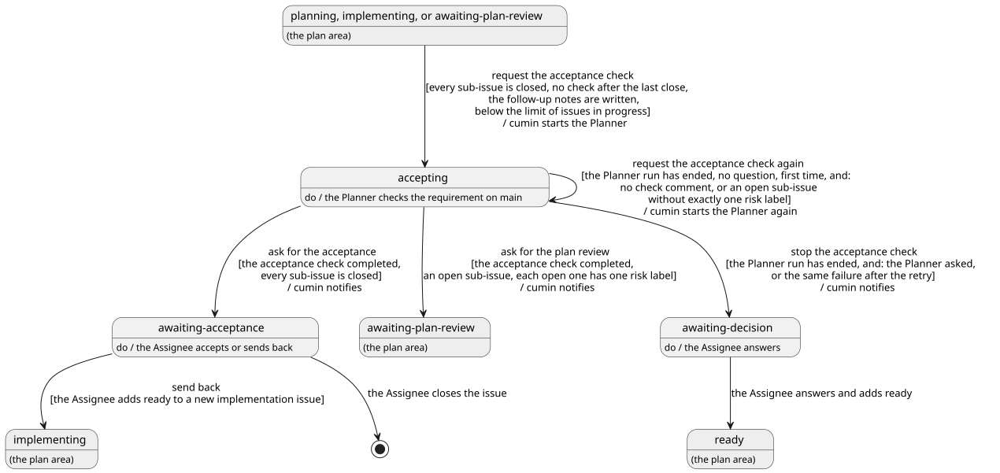

# 受け入れ

要求Issueのsub-issueがすべて閉じてから、要求Issueが閉じるまでの流れを決める。Plannerの受け入れ確認、残りの項目の仕分け、Assigneeの受け入れと差し戻しを扱う。sub-issueに`cumin/status/ready`を付けたときの要求Issueの状態は[計画](../plan/index.md)、フォローアップノートは[マージ](../merge/index.md)で決める。

## 全体像

要求Issueが受け入れでたどる状態を示す。灰色の状態は、ほかのカテゴリで決める。

図の元ファイル: [overview.puml](overview.puml)

受け入れ確認では、Plannerが、すべてのsub-issueを合わせたmainブランチで、要求Issueの要求を1項目ずつ確かめる。Pull Requestは1つずつしか確かめられていないためである。Plannerは、残りの項目も仕分け、この要求で直すものをsub-issueにする。

cuminが読むのは、受け入れ確認のコメントがあるか、sub-issueが開いているか、開いているsub-issueのリスクのラベルだけである。コメントの中身は読まない。

## 要件

### 受け入れ確認のAgent起動

#### `CWK-ACCEPT-001` 受け入れ確認を始める

要求Issueが次のすべてを満たすとき、cuminは状態を`cumin/status/accepting`に替えてから、新しいセッションでPlannerに受け入れ確認を頼む。

- 状態が`cumin/status/implementing`か`cumin/status/awaiting-plan-review`である。または`cumin/status/planning`で、計画が完了している（[計画](../plan/index.md)の`CWK-PLAN-003`）
- その状態ラベルを、`cumin-core`のGitHub Appが付けている（[権限](../access/index.md)の`CWK-ACCESS-012`）
- sub-issueが1つ以上あり、すべて閉じている
- 最後のsub-issueが閉じたあとの受け入れ確認のコメント（`CWK-ACCEPT-002`）がない
- フォローアップノートを書き終えている（[マージ](../merge/index.md)の`CWK-MERGE-018`）
- そのリポジトリで同時に進めるIssueの数に余裕がある（[定期確認](../poll/index.md)の`CWK-POLL-005`）

- 検証: `test` GitHub mockとCLI mockでテスト

---

### 受け入れ確認の完了判断

#### `CWK-ACCEPT-002` 受け入れ確認の完了を判断する

cuminは、`cumin-planner`が要求Issueに書いた`## Acceptance check`で始まるコメントが、最後のsub-issueが閉じたあとにあるとき、受け入れ確認が完了したと判断する。それより前のコメントは使わない。Plannerが返した結果も使わない。

- 検証: `test` GitHub mockとCLI mockでテスト

---

#### `CWK-ACCEPT-003` 受け入れを求める

`cumin/status/accepting`の要求Issueで、Plannerの実行が終わっていて、受け入れ確認が完了し、sub-issueがすべて閉じているとき、cuminは状態を`cumin/status/awaiting-acceptance`に替えて、通知する。`Fail`があっても同じである。

- 検証: `test` GitHub mockとCLI mockでテスト

---

#### `CWK-ACCEPT-004` 修正のsub-issueの確認を求める

`cumin/status/accepting`の要求Issueで、Plannerの実行が終わっていて、受け入れ確認が完了し、開いているsub-issueがあり、そのすべてにリスクのラベルが1つだけ付いているとき、cuminは状態を`cumin/status/awaiting-plan-review`に替えて、通知する。そのあとは、計画のsub-issueと同じに進む（[計画](../plan/index.md)の`CWK-PLAN-007`）。

- 検証: `test` GitHub mockとCLI mockでテスト

---

#### `CWK-ACCEPT-005` 受け入れ確認をやり直す

`cumin/status/accepting`の要求Issueで、Plannerの実行が終わっていて、質問のコメントがなく、次のどちらかが成り立つとき、cuminはPlannerをもう一度起動する。やり直すのは、1つの`cumin/status/accepting`の間に1回だけである。

- 受け入れ確認のコメントがない
- コメントはあるが、リスクのラベルが1つだけでない、開いているsub-issueがある

- 検証: `test` GitHub mockとCLI mockでテスト

---

#### `CWK-ACCEPT-006` 受け入れ確認を止める

`cumin/status/accepting`の要求Issueで、Plannerの実行が終わっていて、次のどちらかが成り立つとき、cuminは状態を`cumin/status/awaiting-decision`に替えて、通知する。質問のコメントでないときは、理由をコメントに書く。

- Plannerの質問のコメントが、`cumin/status/accepting`になったあとにある
- やり直しのあとも、`CWK-ACCEPT-005`の条件が成り立つ

Assigneeが答えを書いて要求Issueに`cumin/status/ready`を付けると、Plannerが要求Issueを読み直す（[計画](../plan/index.md)の`CWK-PLAN-001`）。

- 検証: `test` GitHub mockとCLI mockでテスト

---

### Assigneeの受け入れと差し戻し

#### `CWK-ACCEPT-007` 受け入れ

Assigneeは、要求Issueを閉じて受け入れる。判断が要る項目（`CWK-ACCEPT-014`）は、Assigneeが新しい要求Issueかバックログに書く。cuminは、閉じた要求Issueに何もしない。

- 検証: `test` GitHub mockでテスト

---

#### `CWK-ACCEPT-008` 差し戻し

Assigneeは、要求Issueにsub-issueを足し、足したsub-issueに`cumin/status/ready`を付けて差し戻す。足したsub-issueがすべて閉じると、受け入れ確認がもう一度始まる。

- 検証: `test` GitHub mockでテスト

---

### Plannerの成果物

#### `CWK-ACCEPT-009` 受け入れ確認のコメント

Plannerは、要求Issueに受け入れ確認のコメントを1つ書く。形式は[acceptance-check.md](../../../../templates/acceptance-check.md)に従う。mainブランチの最新の内容で、要求と制約を1項目ずつ確かめ、項目ごとに結果（`Pass`か`Fail`）、証拠、対応したPull Requestを書く。証拠は、実行したコマンドと結果、または読んだファイルと行である。

- 検証: `demo` テスト用の実リポジトリでPlannerを動かして確認

---

#### `CWK-ACCEPT-010` Plannerが読むもの

Plannerは、sub-issueを閉じたPull Requestとその説明、フォローアップノート、自分の計画の全体像のコメント（[計画](../plan/index.md)の`CWK-PLAN-016`）を読む。計画の全体像で「含めない」とした項目は、受け入れ確認のコメントにも書く。

- 検証: `demo` テスト用の実リポジトリでPlannerを動かして確認

---

#### `CWK-ACCEPT-011` 残りの項目を仕分ける

Plannerは、残りの項目のすべてを、次の3つのどれか1つに入れ、1行の理由を付ける。残りの項目とは、`Fail`の行、フォローアップノートの項目、`Follow-up`以外に書かれた範囲の外の作業である。

- この要求で直す: 要求の範囲の中の不具合、小さな修正、文書とコードのずれ
- 判断が要る: 要求の範囲を変えるもの、選択が要るもの
- 対応しない: 作業が要らないもの

##### `CWK-ACCEPT-011.1` 仕分けの順

Plannerは、次の順に問い、最初に当てはまった組に入れる。迷ったら「判断が要る」に入れる。

1. 作業が要らないか（済んだもの、重なるもの、設計を説明するだけのもの）。当てはまれば「対応しない」
2. 範囲を変えるか、選択が要るか（要求にない振る舞い、案が2つ以上、要件の文書の変更）。当てはまれば「判断が要る」
3. それ以外は「この要求で直す」

- 検証: `demo` テスト用の実リポジトリでPlannerを動かして確認

---

#### `CWK-ACCEPT-012` 修正のsub-issue

Plannerは、「この要求で直す」の項目ごとに、要求Issueのsub-issueを1つ作る。計画の実装Issueと同じ形式で書き（[計画](../plan/index.md)の`CWK-PLAN-009`）、リスクのラベルを1つ付け、状態ラベルは付けない。本文には元の項目へのリンクを書く。sub-issueをすべて作ってから、コメントを書く。コメントには、作ったsub-issueの番号を書く。

- 検証: `demo` テスト用の実リポジトリでPlannerを動かして確認

---

#### `CWK-ACCEPT-013` 修正のsub-issueは1回だけ作る

修正のsub-issueを作るのは、1つの要求Issueで最初の受け入れ確認のときだけである。受け入れ確認と修正が止まらずに往復しないためである。

Plannerは、最後のsub-issueが閉じる前に`cumin-planner`が書いた受け入れ確認のコメントがあれば、2回目以降だと判断する。2回目以降は、「この要求で直す」に当たる項目も、理由を付けて「判断が要る」に入れる。

- 検証: `demo` テスト用の実リポジトリでPlannerを動かして確認

---

#### `CWK-ACCEPT-014` 判断が要る項目

Plannerは、「判断が要る」の項目ごとに、行き先（新しい要求Issueか、バックログ）と、その文の下書きを書く。要求Issueもバックログも、Plannerは書かない。

- 検証: `demo` テスト用の実リポジトリでPlannerを動かして確認

---

#### `CWK-ACCEPT-015` 直さない

Plannerは、受け入れ確認でコードを直さず、要求Issueの本文とラベルを変えない。作ってよいIssueは、修正のsub-issueだけである。

- 検証: `demo` テスト用の実リポジトリでPlannerを動かして確認

---

#### `CWK-ACCEPT-016` やり直しで二重に作らない

やり直しのPlannerは、同じ元の項目へのリンクを持つsub-issueを作らず、足りない分だけを作る。リスクのラベルが1つだけでないsub-issueは、ラベルを直す。

受け入れ確認のコメントは、最後のsub-issueが閉じたあとのものだけを書き直す。それより古いコメントしかなければ、新しく書く。古いコメントを書き直しても、完了と判断されないためである（`CWK-ACCEPT-002`）。

- 検証: `demo` テスト用の実リポジトリでPlannerを動かして確認

---

## 未決事項

なし
