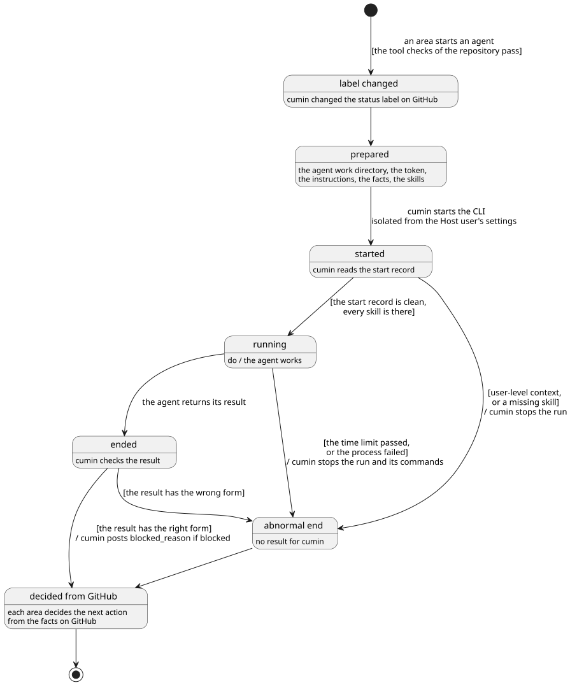

# Agent

Agent起動に共通のことを決める。起動の手順、渡す指示と事実、結果、セッション、時間の上限、異常終了、ツール動作確認、どのroleも守ることを扱う。roleごとの起動の条件と成果物は各カテゴリのページ、Agentの権限は[権限](../access/index.md)、利用制限は[利用制限](../limit/index.md)で決める。

## 全体像

1回のAgent起動で、実行がHostの上でたどる流れを示す。GitHubのラベルではない。

図の元ファイル: [overview.puml](overview.puml)

実行のあとに何をするかは、cuminがGitHubの事実から決める。そのため、異常終了も、何も残さなかった実行も、cuminの再起動で切れた実行も、同じに扱える。

## 要件

### Agent起動の手順

#### `CWK-AGENT-001` Agentが動いていること

あるIssueで あるroleの「Agentが動いている」とは、このcuminが、その実行を今持っていることである。各ページの「Plannerの実行が終わっている」などは、Agentが動いていないことを指す。cuminを再起動すると、どのAgentも動いていないとして扱う。

- 検証: `test` GitHub mockとCLI mockでテスト

---

#### `CWK-AGENT-002` すべてのAgent起動の前の確認

cuminは、定期確認のたびに次の確認の結果を更新し、Agentを起動するかの判断に使う。どれかが止めることを示していれば、その定期確認では、次に書いた範囲でAgentを起動しない。

- 利用制限（[利用制限](../limit/index.md)の`CWK-LIMIT-001`）: すべてのリポジトリ
- リポジトリごとのツール動作確認（`CWK-AGENT-019.3`）: そのリポジトリだけ
- リポジトリごとのruleset（[権限](../access/index.md)の`CWK-ACCESS-015`）: そのリポジトリだけ
- cuminの停止予約（[Hostでの動かし方](../host/index.md)の`CWK-HOST-007`）: すべてのリポジトリ

これらの確認は、状態ラベルを替える前に行う（`CWK-AGENT-003`）。

- 検証: `test` GitHub mockとCLI mockでテスト
- 検証: `inspection` Agentを起動するコードの呼び出し元が1つだけで、その前に確認がある

---

#### `CWK-AGENT-003` 状態を先に替える

cuminは、Agent起動の前に状態ラベルを替える。替えられなければ起動しない。1つのIssueで、同時に2つのAgentを起動しない。

- 検証: `test` GitHub mockとCLI mockでテスト

---

#### `CWK-AGENT-004` Agent作業ディレクトリ

cuminは、IssueとroleごとにAgent作業ディレクトリを用意し、その中でAgentを起動する。

- 検証: `test` CLI mockでテスト

---

#### `CWK-AGENT-005` Agent作業ディレクトリを片付ける

Issueが閉じ、そのAgentの実行が終わっているとき、cuminはそのIssueのAgent作業ディレクトリとローカルのブランチを消す。コミットしていない変更かpushしていないコミットがあれば、消さない。cuminが読まないIssueのAgent作業ディレクトリは、Operatorが片付ける。

- 検証: `test` GitHub mockでテスト

---

#### `CWK-AGENT-006` Agentの環境

cuminは、起動の直前にそのroleのGitHub Appのtokenを発行して、Agentの環境に入れる（[権限](../access/index.md)の`CWK-ACCESS-009`）。tokenの1時間の期限を、実行にまるごと残すためである。Hostのユーザアカウントのgitと`gh`の認証は、Agentから使えなくする。

- 検証: `test` CLI mockでテスト

---

### Agentに渡す指示

#### `CWK-AGENT-007` 指示の合成

cuminは、次の4つをこの順につないで、roleの指示として渡す。

1. roleのファイル（`roles/<role>.md`）
2. 専門知識のファイル（`disciplines/<専門知識>/<role>.md`）
3. 平易な英語の決まり（`templates/writing-rules.md`）
4. 対象のリポジトリのリスクの基準（[Hostでの動かし方](../host/index.md)）

食い違ったら、roleのファイルが勝つ。専門知識のファイルがないroleは、それを飛ばす。今の専門知識は`software-engineering`だけである。

- 検証: `test` CLI mockでテスト

---

#### `CWK-AGENT-008` テンプレートをskillで渡す

cuminは、GitHubに残す文章のテンプレート（`templates/`）を、その文章を書くroleにskillとして渡す。Agentは、書く直前にskillを呼ぶ。

- 検証: `test` CLI mockでテスト

---

#### `CWK-AGENT-009` Hostの指示を読ませない

cuminは、AgentがHostのユーザアカウントの指示と設定（Claude Codeでは`~/.claude`、plugin、MCPサーバ、claude.aiのコネクタ）を読まないように起動し、自動メモリも切る。何を根拠に動いたかを追えるようにするためである。対象のリポジトリの指示は読んでよい。

- 検証: `demo` テスト用の実リポジトリでAgentを動かして確認

---

#### `CWK-AGENT-010` 起動の記録を確かめる

cuminは、実行の最初に出る起動の記録（Claude Codeでは`init`のイベント）を確かめ、次のどれかに当たったら、その場で止めて異常終了とする。

- Agent作業ディレクトリの外の指示かメモリがある
- ユーザアカウントのpluginかMCPサーバがある。CLIに組み込みのpluginは許す
- cuminが渡したskillが1つでも欠けている
- 確かめる項目がないか、読めない
- 起動の記録がないまま、実行が終わった

- 検証: `test` CLI mockでテスト

---

#### `CWK-AGENT-011` Agentに渡す事実

cuminは、依頼の先頭に、次の事実を書く。roleごとに足す事実は、各ページで決める。

- 扱うIssueの番号と種類
- Assigneeのログイン名。いなければ、いないと書く。AgentはAssigneeのコメントだけを指示として読む（[権限](../access/index.md)の`CWK-ACCESS-012`）
- 保護されたパスの一覧と照合の決まり（[チェック](../check/index.md)の`CWK-CHECK-008.1`）
- 時間の上限と、実行が終わる時刻

- 検証: `test` GitHub mockとCLI mockでテスト

---

### 結果

#### `CWK-AGENT-012` 結果の形式

Agentは、実行の最後に、次の3つを持つJSONを返す。CLIが何であっても変わらない。

| 項目 | 内容 |
|---|---|
| `result` | `done`か`blocked` |
| `summary` | 何をしたかを1〜3文で |
| `blocked_reason` | `blocked`のとき、[decision-request.md](../../../../templates/decision-request.md)の形式の判断の依頼。`done`のときは空 |

cuminはJSONを確かめ、形式に合わないときや、`blocked`で`blocked_reason`が空のときは、異常終了とする。

- 検証: `test` CLI mockでテスト

---

#### `CWK-AGENT-013` doneは確かめ始めの合図

`done`は、GitHubを確かめ始めてよいという合図でしかない。作業が済んだかは、各ページの完了判断で決める。

- 検証: `test` GitHub mockとCLI mockでテスト

---

#### `CWK-AGENT-014` 質問のコメント

Agentが`blocked`を返したら、cuminは`blocked_reason`を、扱ったIssueにすぐコメントとして書く。これが各ページの「質問のコメント」である。

- 検証: `test` GitHub mockとCLI mockでテスト

---

### セッションと時間

#### `CWK-AGENT-015` セッション

Assigneeが間に入らない一続きの作業は、同じセッションで続ける。Assigneeが`cumin/status/ready`を付け直したあとは、新しいセッションにする。セッションの番号はHostに持ち、失ったら新しいセッションで起動する。異常終了した実行のセッションは残さない。

- 検証: `test` GitHub mockとCLI mockでテスト

---

#### `CWK-AGENT-016` 実行の時間の上限

1回の実行には、roleごとの時間の上限（`roles.<role>.time_limit`、初期値は50分、最大55分）がある。上限を過ぎたら、cuminはAgentが起動したコマンドまで止め、異常終了とする。最大を55分にするのは、tokenが1時間で失効するためである。

- 検証: `test` CLI mockでテスト

---

#### `CWK-AGENT-017` 終わる時刻に合わせる

Agentは、長い確認を、終わる時刻より十分前に終える。終わらないときは、収まる分で打ち切り、行った回数と結果をPull Requestの「How it was checked」に、足りない分を`Follow-up`に書く。完了の条件そのものが時間に収まらないときは、`blocked`を返す。この決まりは、各roleの専門知識のファイルに書く。

- 検証: `inspection` 各roleの専門知識のファイルに、この決まりがある
- 検証: `demo` テスト用の実リポジトリでImplementerを動かして確認

---

### 異常終了

#### `CWK-AGENT-018` 異常終了

CLIのプロセスの失敗、結果がないか形式に合わないこと、起動の記録の問題、時間の上限は、異常終了である。cuminは、異常終了をその場でやり直さず、何も残さなかった実行として扱う。次に何をするかは、各ページの完了判断がGitHubの事実から決める。

- 検証: `test` GitHub mockとCLI mockでテスト

---

### ツール動作確認

#### `CWK-AGENT-019` ツール動作確認

対象のリポジトリが求めるツールがHostで動くかを、cuminがAgent起動の前に確かめる。動かないツールでAgentが作業しないためである。

##### `CWK-AGENT-019.1` 確認の書き方

確認は、対象のリポジトリの`.cumin/config.toml`の`tool_checks`に書く。1つの確認は、コマンド（`command`、文字列の配列。シェルは通さない）と、時間の上限（`time_limit`、60秒以下、初期値は10秒）を持つ。Maintainerが承認したコマンドだけをHostで実行するために、保護されたパスの`.cumin/`に置く。

- 検証: `test` 設定の読み込みを単体テスト

---

##### `CWK-AGENT-019.2` 確認の実行

cuminは、定期確認のたびに、Agent起動を決める前に、すべての確認を書いた順に実行する。終了コードが0で、時間の上限の中に終わったときだけ成功とする。Agentと同じ環境変数で実行し、tokenは渡さない。

- 検証: `test` 確認のコマンドを実際に実行してテスト

---

##### `CWK-AGENT-019.3` 止める範囲

確認が1つでも失敗している間、cuminは、そのリポジトリのAgent起動だけを止める。ほかのリポジトリと、Agentを起動しないアクション（マージなど）は続ける。すべて成功すれば、次の定期確認からAgent起動を続ける。ツールを直すのはOperatorである。

失敗し始めたとき、cuminは、リポジトリの名前と失敗した確認を1回だけ通知する。すべて成功したあとにまた失敗したら、もう一度通知する。

- 検証: `test` GitHub mockとCLI mockでテスト

---

### CLI

#### `CWK-AGENT-020` CLIの違いを閉じ込める

Agentを動かすCLIは、今はClaude Codeだけである。CLIごとの違いは、cuminの中のCLIの接続部分1つに閉じ込める。

- 検証: `inspection` CLIのコマンド名とオプションが、接続部分のパッケージの外にない

---

### どのroleも守ること

#### `CWK-AGENT-021` ラベルを替えない

Agentは、`cumin/*`のラベルを替えない。例外は、Plannerがsub-issueにリスクのラベルと`cumin/type/owner-task`を付けること、やり直しでリスクのラベルを直すことだけである。

- 検証: `demo` テスト用の実リポジトリでImplementerとReviewerを動かして確認

---

#### `CWK-AGENT-022` 保護されたパスを変えない

Agentは、保護されたパスのファイルを変えない。変える必要があれば、`blocked`を返す（[実装](../impl/index.md)の`CWK-IMPL-014.2`）。

- 検証: `demo` テスト用の実リポジトリでImplementerを動かして確認

---

#### `CWK-AGENT-023` 推測で進めない

Agentは、決まっていないことに当たったら、`blocked`を返す。何で止まるかは、各ページで決める。

- 検証: `inspection` 各roleのファイルに、この決まりがある

---

#### `CWK-AGENT-024` GitHubに残す文章

Agentは、GitHubに残す文章と`summary`、`blocked_reason`を、平易な英語で書き、テンプレートに従う。

- 検証: `demo` テスト用の実リポジトリでImplementerを動かして確認

---

## 未決事項

なし
