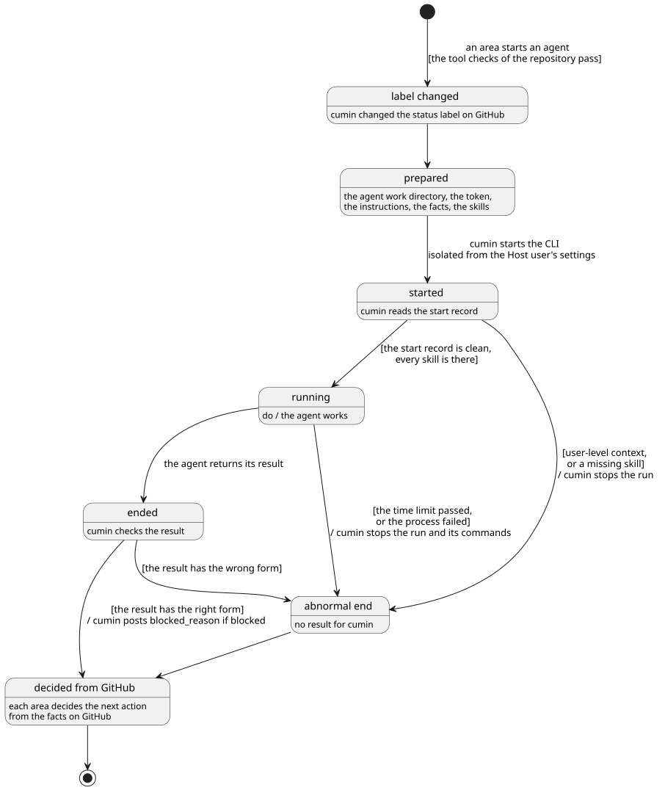

# Agent

Agent起動に共通のことを決める。起動の手順、渡す指示と事実、結果、セッション、時間の上限、異常終了、ツール動作確認、どの role も守ることを扱う。role ごとの起動の条件と成果物は各カテゴリのページ、Agent の権限は [権限](../access/index.md)、利用制限は [利用制限](../limit/index.md) で決める。

## 全体像

1回の Agent起動で、実行が Host の上でたどる流れを示す。GitHub のラベルではない。

図の元ファイル: [overview.puml](overview.puml)

実行のあとに何をするかは、cumin が GitHub の事実から決める。そのため、異常終了も、何も残さなかった実行も、cumin の再起動で切れた実行も、同じに扱える。

## 要件

### Agent起動の手順

#### `CWK-AGENT-001` Agent が動いていること

ある Issue で ある role の「Agent が動いている」とは、この cumin が、その実行を今持っていることである。各ページの「Planner が動いていない」などは、この意味である。cumin を再起動すると、どの Agent も動いていないとして扱う。

- 検証: `test` 実行の途中で cumin を再起動すると、次の定期確認で各ページのやり直しが起きる

---

#### `CWK-AGENT-024` すべての Agent起動の前の確認

cumin は、どの Agent起動の前にも、同じ1つの確認を行う。確認するのは、利用制限 (`CWK-LIMIT-007`)、そのリポジトリのツール動作確認 (`CWK-AGENT-018.3`)、止める予約 (`CWK-HOST-007`) である。新しい種類の Agent起動を足しても、この確認を飛ばせない。

- 検証: `test` 利用制限に達している間は、どの種類の Agent起動も起きない
- 検証: `inspection` Agent を起動するコードの呼び出し元が1つだけで、その前に確認がある

---

#### `CWK-AGENT-002` 状態を先に替える

cumin は、Agent起動の前に状態ラベルを替える。替えられなければ起動しない。1つの Issue で、同時に2つの Agent を起動しない。

- 検証: `test` 状態ラベルの書き込みが失敗すると、Agent起動は起きない
- 検証: `test` Agent が動いている Issue に、同じ Agent起動は起きない

---

#### `CWK-AGENT-003` Agent作業ディレクトリ

cumin は、Issue と role ごとに Agent作業ディレクトリを用意し、その中で Agent を起動する。

- 検証: `test` 同じ実装Issueの Implementer と Reviewer が、別の Agent作業ディレクトリで起動される

---

#### `CWK-AGENT-004` Agent作業ディレクトリを片付ける

Issue が閉じ、その Agent が動いていないとき、cumin はその Issue の Agent作業ディレクトリとローカルのブランチを消す。コミットしていない変更か push していないコミットがあれば、消さない。cumin が読まない Issue の Agent作業ディレクトリは、Operator が片付ける。

- 検証: `test` マージされて閉じた実装Issueの Agent作業ディレクトリが、次の定期確認で消える
- 検証: `test` push していないコミットがあると、消えない

---

#### `CWK-AGENT-005` Agent の環境

cumin は、起動の直前にその role の GitHub App の token を発行して、Agent の環境に入れる ([権限](../access/index.md) の `CWK-ACCESS-011`)。token の1時間の期限を、実行にまるごと残すためである。Host のユーザアカウントの git と `gh` の認証は、Agent から使えなくする。

- 検証: `test` Agent のプロセスで、Host のユーザアカウントの git と `gh` の認証が使われない

---

### Agent に渡す指示

#### `CWK-AGENT-006` 指示の合成

cumin は、次の4つをこの順につないで、role の指示として渡す。

1. role のファイル (`roles/<role>.md`)
2. 専門知識のファイル (`disciplines/<専門知識>/<role>.md`)
3. 平易な英語の決まり (`templates/writing-rules.md`)
4. 対象のリポジトリのリスクの基準 ([Host での動かし方](../host/index.md))

食い違ったら、role のファイルが勝つ。専門知識のファイルがない role は、それを飛ばす。今の専門知識は `software-engineering` だけである。

- 検証: `test` 渡す指示が4つの部分をこの順に含む。専門知識のファイルがない role では3つになる

---

#### `CWK-AGENT-007` テンプレートを skill で渡す

cumin は、GitHub に残す文章のテンプレート (`templates/`) を、その文章を書く role に skill として渡す。Agent は、書く直前に skill を呼ぶ。

- 検証: `test` Implementer の Agent作業ディレクトリに、Implementer が書く文章の skill がある

---

#### `CWK-AGENT-008` Host の指示を読ませない

cumin は、Agent が Host のユーザアカウントの指示と設定 (Claude Code では `~/.claude`、plugin、MCP サーバ、claude.ai のコネクタ) を読まないように起動し、自動メモリも切る。何を根拠に動いたかを追えるようにするためである。対象のリポジトリの指示は読んでよい。

- 検証: `demo` Host のユーザアカウントに置いた `CLAUDE.md` が、Agent に効かない

---

#### `CWK-AGENT-009` 起動の記録を確かめる

cumin は、実行の最初に出る起動の記録 (Claude Code では `init` のイベント) を確かめ、次のどれかに当たったら、その場で止めて異常終了とする。

- Agent作業ディレクトリの外の指示かメモリがある
- ユーザアカウントの plugin か MCP サーバがある。CLI に組み込みの plugin は許す
- cumin が渡した skill が1つでも欠けている
- 確かめる項目がないか、読めない
- 起動の記録がないまま、実行が終わった

- 検証: `test` ユーザアカウントの MCP サーバか、組み込みでない plugin があると、異常終了になる
- 検証: `test` skill が1つ欠けていると、異常終了になる

---

#### `CWK-AGENT-010` Agent に渡す事実

cumin は、依頼の先頭に、次の事実を書く。role ごとに足す事実は、各ページで決める。

- 扱う Issue の番号と種類
- Assignee のログイン名。いなければ、いないと書く。Agent は Assignee のコメントだけを指示として読む ([権限](../access/index.md) の `CWK-ACCESS-002`)
- 保護されたパスの一覧と照合の決まり ([チェック](../check/index.md) の `CWK-CHECK-008.1`)
- 時間の上限と、実行が終わる時刻

- 検証: `test` どの role の依頼にも、4つの事実がある。Assignee のいない Issue では、いないと書いてある

---

### 結果

#### `CWK-AGENT-011` 結果の形式

Agent は、実行の最後に、次の3つを持つ JSON を返す。CLI が何であっても変わらない。

| 項目 | 内容 |
|---|---|
| `result` | `done` か `blocked` |
| `summary` | 何をしたかを1〜3文で |
| `blocked_reason` | `blocked` のとき、[decision-request.md](../../../../templates/decision-request.md) の形式の判断の依頼。`done` のときは空 |

cumin は JSON を確かめ、形式に合わないときや、`blocked` で `blocked_reason` が空のときは、異常終了とする。

- 検証: `test` 項目の足りない JSON と、`blocked_reason` が空の `blocked` は、異常終了になる

---

#### `CWK-AGENT-012` done は確かめ始めの合図

`done` は、GitHub を確かめ始めてよいという合図でしかない。作業が済んだかは、各ページの完了判断で決める。

- 検証: `test` `done` を返したが何も残さなかった Agent のあとで、各ページのやり直しが起きる

---

#### `CWK-AGENT-013` 質問のコメント

Agent が `blocked` を返したら、cumin は `blocked_reason` を、扱った Issue (Reviewer では Pull Request) にすぐコメントとして書く。これが各ページの「質問のコメント」である。

- 検証: `test` `blocked` のあとで、`blocked_reason` がコメントになり、`cumin/status/awaiting-decision` になって、通知が1回届く

---

### セッションと時間

#### `CWK-AGENT-014` セッション

Assignee が間に入らない一続きの作業は、同じセッションで続ける。Assignee が `cumin/status/ready` を付け直したあとは、新しいセッションにする。セッションの番号は Host に持ち、失ったら新しいセッションで起動する。異常終了した実行のセッションは残さない。

- 検証: `test` チェックの修正は直前のセッションで、`cumin/status/ready` の付け直しのあとは新しいセッションで起動する
- 検証: `test` セッションの番号を消すと、続きが新しいセッションで起動する

---

#### `CWK-AGENT-015` 実行の時間の上限

1回の実行には、role ごとの時間の上限 (`roles.<role>.time_limit`、初期値は50分、最大55分) がある。上限を過ぎたら、cumin は Agent が起動したコマンドまで止め、異常終了とする。最大を55分にするのは、token が1時間で失効するためである。

- 検証: `test` 上限を過ぎた実行は止まり、Agent が起動したコマンドも残らない
- 検証: `test` 55分を超える `time_limit` は、設定の誤りになる

---

#### `CWK-AGENT-016` 終わる時刻に合わせる

Agent は、長い確認を、終わる時刻より十分前に終える。終わらないときは、収まる分で打ち切り、行った回数と結果を Pull Request の「How it was checked」に、足りない分を `Follow-up` に書く。完了の条件そのものが時間に収まらないときは、`blocked` を返す。この決まりは、各 role の専門知識のファイルに書く。

- 検証: `inspection` 各 role の専門知識のファイルに、この決まりがある
- 検証: `demo` 時間に収まらない繰り返しを求める実装Issueで、打ち切った回数と結果が Pull Request にある

---

### 異常終了

#### `CWK-AGENT-017` 異常終了

CLI のプロセスの失敗、結果がないか形式に合わないこと、起動の記録の問題、時間の上限は、異常終了である。cumin は、異常終了をその場でやり直さず、何も残さなかった実行として扱う。次に何をするかは、各ページの完了判断が GitHub の事実から決める。

- 検証: `test` 異常終了した Implementer のあとで、やり直しが1回だけ起き、2回目も異常終了すると `cumin/status/awaiting-decision` になる

---

### ツール動作確認

#### `CWK-AGENT-018` ツール動作確認

対象のリポジトリが求めるツールが Host で動くかを、cumin が Agent起動の前に確かめる。動かないツールで Agent が作業しないためである。

##### `CWK-AGENT-018.1` 確認の書き方

確認は、対象のリポジトリの `.cumin/config.toml` の `tool_checks` に書く。1つの確認は、コマンド (`command`、文字列の配列。シェルは通さない) と、時間の上限 (`time_limit`、60秒以下、初期値は10秒) を持つ。Maintainer が承認したコマンドだけを Host で実行するために、保護されたパスの `.cumin/` に置く。

- 検証: `test` 空の `command` と、60秒を超える `time_limit` は、設定の誤りになる

---

##### `CWK-AGENT-018.2` 確認の実行

cumin は、定期確認のたびに、Agent起動を決める前に、すべての確認を書いた順に実行する。終了コードが0で、時間の上限の中に終わったときだけ成功とする。Agent と同じ環境変数で実行し、token は渡さない。

- 検証: `test` 見つからないコマンド、0でない終了コード、時間の上限を過ぎたコマンドは、失敗になる

---

##### `CWK-AGENT-018.3` 止める範囲

確認が1つでも失敗している間、cumin は、そのリポジトリの Agent起動だけを止める。ほかのリポジトリと、Agent を起動しないアクション (マージなど) は続ける。すべて成功すれば、次の定期確認から Agent起動を続ける。ツールを直すのは Operator である。

失敗し始めたとき、cumin は、リポジトリの名前と失敗した確認を1回だけ通知する。すべて成功したあとにまた失敗したら、もう一度通知する。

- 検証: `test` 失敗する確認があるリポジトリでは Agent を起動しないが、マージは行う。ほかのリポジトリでは起動する
- 検証: `test` 失敗したまま定期確認を3回行っても、通知は1回だけである

---

### CLI

#### `CWK-AGENT-019` CLI の違いを閉じ込める

Agent を動かす CLI は、今は Claude Code だけである。CLI ごとの違いは、cumin の中の CLI の接続部分1つに閉じ込める。

- 検証: `inspection` CLI のコマンド名とオプションが、接続部分のパッケージの外にない

---

### どの role も守ること

#### `CWK-AGENT-020` ラベルを替えない

Agent は、`cumin/*` のラベルを替えない。例外は、Planner が sub-issue にリスクのラベルと `cumin/type/owner-task` を付けること、やり直しでリスクのラベルを直すことだけである。

- 検証: `demo` Implementer と Reviewer の実行のあとで、ラベルが Agent によって変わっていない

---

#### `CWK-AGENT-021` 保護されたパスを変えない

Agent は、保護されたパスのファイルを変えない。変える必要があれば、`blocked` を返す ([実装](../impl/index.md) の `CWK-IMPL-014.2`)。

- 検証: `demo` `CLAUDE.md` の変更を求める実装Issueで、Implementer は変更せずに `blocked` を返す

---

#### `CWK-AGENT-022` 推測で進めない

Agent は、決まっていないことに当たったら、`blocked` を返す。何で止まるかは、各ページで決める。

- 検証: `inspection` 各 role のファイルに、この決まりがある

---

#### `CWK-AGENT-023` GitHub に残す文章

Agent は、GitHub に残す文章と `summary`、`blocked_reason` を、平易な英語で書き、テンプレートに従う。

- 検証: `demo` Implementer の Pull Request の説明が、英語で、テンプレートの見出しをすべて持つ

---

## 受け入れテスト

| # | 場面 | 期待する結果 |
|---|---|---|
| 1 | cumin が Agent を起動する | 先に状態ラベルが替わり (`CWK-AGENT-002`)、専用の Agent作業ディレクトリで、role の token だけを持ち (`CWK-AGENT-003`、`CWK-AGENT-005`)、4つの部分の指示と事実を受け取る (`CWK-AGENT-006`、`CWK-AGENT-010`) |
| 2 | Host のユーザアカウントに MCP サーバがある状態で起動する | 起動の記録で止まって異常終了になり (`CWK-AGENT-009`)、やり直しのあとも同じなら止まって通知が届く (`CWK-AGENT-017`) |
| 3 | Agent が `blocked` を返す | 質問のコメントになり、やり直さずに止まる (`CWK-AGENT-013`) |
| 4 | 実行が時間の上限を過ぎる | コマンドまで止まり (`CWK-AGENT-015`)、各ページのやり直しが起きる (`CWK-AGENT-017`) |
| 5 | ツール動作確認が失敗する | そのリポジトリの Agent起動だけが止まる (`CWK-AGENT-018.3`) |
| 6 | 実装Issueがマージされて閉じる | Agent作業ディレクトリが片付く (`CWK-AGENT-004`) |

## 未決事項

なし
