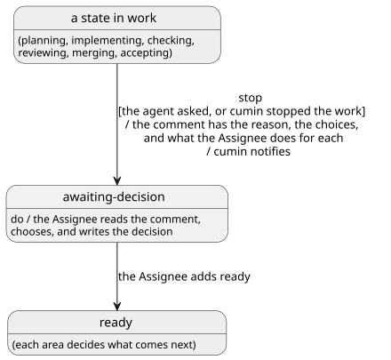

# 判断の依頼

IssueをAssigneeの判断に返すときの決まりを決める。Agentが自分で止まったときも、cuminが止めたときも、同じ決まりに従う。どの場面で`cumin/status/awaiting-decision`に替えるかは各カテゴリで、通知は[通知](../notify/index.md)で決める。

## 全体像

図の元ファイル: [overview.puml](overview.puml)

## 要件

### 判断を求めるコメント

#### `CWK-ASK-001` 判断を求めるコメント

cuminは、Issueを`cumin/status/awaiting-decision`に替えるとき、そのIssueに、Assigneeが判断するためのコメントがあるようにする。コメントには、次のことを書く。

- 何が起きて止めたか。止める理由が重なれば、すべて書く
- Assigneeが選べること
- 選ぶごとに、Assigneeがすること（どのIssueやPull Requestを閉じるか、どこに`cumin/status/ready`を付けるか）

- 検証: `test` GitHub mockでテスト

---

#### `CWK-ASK-002` コメントを書く人

Agentが判断を求めて止まったときは、Agentが[decision-request.md](../../../../templates/decision-request.md)の形式で書いた文が、このコメントになる。`blocked_reason`は、cuminがIssueにコメントとして書く（[Agent](../agent/index.md)の`CWK-AGENT-016`）。それ以外でcuminが止めたときは、cuminが[stop-note.md](../../../../templates/stop-note.md)の形式で書く。1回止めるごとに、コメントは1つである。

- 検証: `test` GitHub mockとCLI mockでテスト
- 検証: `demo` テスト用の実リポジトリでAgentを動かして確認

---

### 再開

#### `CWK-ASK-003` 判断のあとの再開

Assigneeは、判断をIssueのコメントに書き、`cumin/status/ready`を付ける（[ラベル](../label/index.md)の`CWK-LABEL-004`）。そのあとcuminが何をするかは、各カテゴリの要件で決める。

- 検証: `test` GitHub mockとCLI mockでテスト

---

## 未決事項

なし
