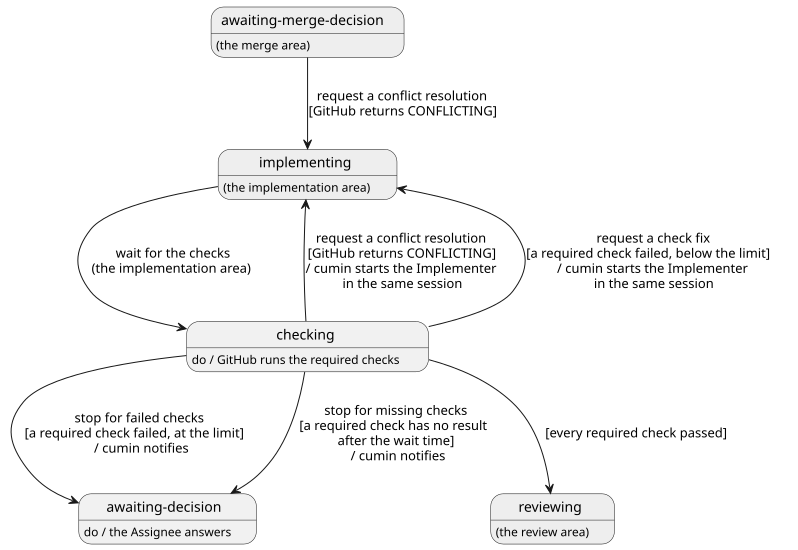

# チェック

実装Issueの Pull Request で、必須チェックが通るまでの流れを決める。cumin が必須チェックの結果を待ち、失敗と衝突を Implementer に直させ、通ったらレビューに進めるまでである。cumin が対象のリポジトリに置く、保護されたパスのチェックもここで決める。Implementer の作業は [実装](../impl/index.md)、レビューは [レビュー](../review/index.md) で決める。

## 全体像

実装Issueがチェックでたどる状態を示す。灰色の状態は、ほかのカテゴリで決める。

図の元ファイル: [overview.puml](overview.puml)

`cumin/status/checking` は、「Implementer の作業が済み、チェックが動いている」ことを GitHub に残すための状態である。`cumin/status/implementing` のままだと、Implementer が修正の途中なのか、チェックを待っているのかを、GitHub の事実から見分けられない。チェックが動いている間は Agent が動いていないので、利用制限を使わない。Pull Request が開いただけでは、レビューに進まない。

## 要件

### 必須チェック

#### `CWK-CHECK-001` 必須チェックの一覧

必須チェックは、main ブランチに効く ruleset の "Require status checks to pass before merging" に登録されたチェックである。cumin は、その一覧を GitHub の ruleset から読む。今そのコミットに付いているチェックの一覧では決めない。push の直後はチェックがまだ1つも現れておらず、チェックがないのか、これから現れるのかを見分けられないためである。

- 検証: `test` ruleset に登録したチェックだけを待ち、登録していないチェックの失敗では止まらない

---

#### `CWK-CHECK-002` 必須チェックが通る

必須チェックが通るとは、一覧のすべてのチェックが、Pull Request の先頭のコミットで、結論 `success`、`skipped`、`neutral` のどれかを返したことである。GitHub も、この3つをマージを止めない結論として扱う。一覧が空なら、すぐに通る。

- 検証: `test` 3つの結論はどれも通ったと扱い、ほかの結論は通ったと扱わない。一覧が空のリポジトリでは、`cumin/status/checking` を通って、次の定期確認でレビューに進む

---

#### `CWK-CHECK-003` 判定の順番

`cumin/status/checking` の実装Issueでは、1回の定期確認で、衝突の解消 (`CWK-CHECK-007`)、チェックの結果 (レビューに進む、`CWK-CHECK-004`、`CWK-CHECK-005`)、`CWK-CHECK-006` の順に判定し、最初に成り立ったものだけを行う。

- 検証: `test` 衝突していて、チェックの待ち時間も過ぎた実装Issueでは、衝突の解消だけが起きる

---

#### `CWK-CHECK-004` チェックの失敗を修正する

`cumin/status/checking` の実装Issueで、必須チェックのどれかが失敗し、チェックの修正を頼んだ回数が設定の上限 (`max_check_fix_requests`、初期値は3回) に達していないとき、cumin は状態を `cumin/status/implementing` に替えて、Implementer の直前のセッションで修正を頼む。失敗したチェックの内容を添える。

- 検証: `test` 必須チェックが失敗すると、失敗したチェックの内容を添えて、直前のセッションで Implementer の Agent起動が1回起きる

---

#### `CWK-CHECK-005` チェックの失敗で止める

`cumin/status/checking` の実装Issueで、必須チェックのどれかが失敗し、チェックの修正を頼んだ回数が上限に達しているとき、cumin は状態を `cumin/status/awaiting-decision` に替えて、通知する。コメントと通知には、失敗したチェックの名前と、頼んだ回数を書く。

- 検証: `test` 上限までチェックの修正を頼んでも失敗すると、`cumin/status/awaiting-decision` になり、通知は1回だけである

---

#### `CWK-CHECK-006` チェックが来ないときに止める

`cumin/status/checking` の実装Issueで、設定の待ち時間 (`checks_wait_time`、初期値は60分) を過ぎても、必須チェックのどれかが先頭のコミットで結果を返していないとき、cumin は状態を `cumin/status/awaiting-decision` に替えて、通知する。

- 待ち時間は、実装Issueに最新の `cumin/status/checking` が付いた時刻と、先頭のコミットの時刻のうち、遅いほうから数える。待っている間に誰かがブランチに push すると、そこから数え直す。
- 実装Issueを閉じる開いている Pull Request がないときも、ラベルの時刻から待ち時間を過ぎたら止める。
- コメントと通知には、先頭のコミット、結果を返していない必須チェック、待った時間を書く。Pull Request がないときは、そのことと待った時間を書く。チェックが来ない理由は調べない。理由は Maintainer が調べる。

- 検証: `test` 待ち時間を過ぎても結果を返さない必須チェックがあると、先頭のコミット、そのチェック、待った時間を添えて、通知が1回だけ届く
- 検証: `test` 開いている Pull Request がなくなった実装Issueでも、待ち時間を過ぎると、そのことを添えて止まる

---

### 衝突の解消

#### `CWK-CHECK-007` 衝突の解消

`cumin/status/checking` か `cumin/status/awaiting-merge-decision` の実装Issueで、GitHub が Pull Request をその base (ふつうは main ブランチ。[実装](../impl/index.md) の `CWK-IMPL-015` で始めた Pull Request では、blocked by の Issue のブランチ) と衝突していると返したとき (GraphQL の `mergeable` が `CONFLICTING`)、cumin は状態を `cumin/status/implementing` に替えて、Implementer の直前のセッションで衝突の解消を頼む。`cumin/status/merging` からの衝突の解消は、[マージ](../merge/index.md) で決める。

- `mergeable` が `UNKNOWN` のときは、GitHub がまだ計算しているので、その定期確認では判定しない。`UNKNOWN` のまま待ち時間を過ぎたら、`CWK-CHECK-006` で止まる。
- 衝突の解消は、チェックの修正の回数に数えない。衝突は Implementer の誤りではなく、並行して進むほかの Pull Request のマージで起きるためである。
- 衝突したまま待たないのは、GitHub が衝突のある Pull Request では `pull_request` のワークフローを動かさず、チェックがいつまでも結果を返さないためである。

- 検証: `test` 衝突した Pull Request の実装Issueで、Implementer に衝突の解消を1回だけ頼み、チェックの修正の回数は増えない
- 検証: `test` `mergeable` が `UNKNOWN` の間は、衝突の解消を頼まない

---

### 保護されたパスのチェック

保護されたパスは、Agent が変えてはいけないファイルのパスである。Agent は渡された一覧のファイルを変えない ([Agent](../agent/index.md) の `CWK-AGENT-021`) が、それを守らせるのはこのチェックである。

#### `CWK-CHECK-008` 保護されたパスのチェック

保護されたパスが変わっていないことは、cumin ではなく、GitHub Actions のチェックで確かめる。チェックが失敗したときは、ほかの必須チェックと同じく `CWK-CHECK-004` に進む。

##### `CWK-CHECK-008.1` 保護されたパスの一覧

保護されたパスの一覧は、対象のリポジトリの `.cumin/config.toml` の `protected_paths` に書く。ファイルかキーがなければ、初期値の `.cumin/`、`CLAUDE.md`、`AGENTS.md`、`.claude/`、`REVIEW.md` を使う。`REVIEW.md` を含めるのは、Agent が書き換えると、Reviewer の判断が変わるためである ([レビュー](../review/index.md) の `CWK-REVIEW-017`)。

- 検証: `test` `protected_paths` のないリポジトリで、`REVIEW.md` を変える bot の Pull Request のチェックが失敗する

---

##### `CWK-CHECK-008.2` 変更ファイルと突き合わせる

対象のリポジトリに GitHub Actions のワークフローを置く。ワークフローは、Pull Request の変更ファイルの一覧を保護されたパスの一覧と突き合わせ、1つでも当たれば失敗する。

- 検証: `demo` 保護されたパスを変える Pull Request を bot が開くと、チェックが失敗する

---

##### `CWK-CHECK-008.3` 必須チェックにする

このチェックを、main ブランチの ruleset で必須チェックに登録する。

- 検証: `inspection` 対象のリポジトリの ruleset に、このチェックが必須チェックとして登録されている

---

##### `CWK-CHECK-008.4` bot の Pull Request だけに掛ける

チェックの job は、Pull Request の作成者が bot (GitHub App など) のときだけ動く。作成者が人のときは job が飛ばされ、GitHub は `skipped` として扱うので、人の Pull Request はこのチェックで止まらない。条件に GitHub App の名前は使わない。名前を間違えると job が飛ばされて通った扱いになり、保護が黙って効かなくなるためである。

- 検証: `demo` 人が保護されたパスを変える Pull Request を開くと、チェックが `skipped` になる
- 検証: `inspection` ワークフローの条件が、GitHub App の名前ではなく、作成者が bot かどうかで決まっている

---

##### `CWK-CHECK-008.5` main ブランチの一覧を読む

ワークフローは、保護されたパスの一覧を、Pull Request のブランチではなく main ブランチから読む。一覧のある `.cumin/` も、保護されたパスに含める。Implementer は、自分のブランチなら保護されたパスのファイルもコミットできる。保護は、このチェックが失敗してマージできないことで効く。Pull Request のブランチから一覧を読むと、Implementer が同じ Pull Request で一覧から `.cumin/` と自分の変更を外せば、書き換えた一覧で判定されて、チェックが通ってしまう。`.cumin/` を一覧に含めるのは、一覧を書き換える Pull Request がマージされて、後の Pull Request の保護が弱まることを防ぐためである。

- 検証: `demo` Pull Request のブランチで一覧から自分の変更を外しても、チェックが失敗する

---

## 受け入れテスト

| # | 場面 | 期待する結果 |
|---|---|---|
| 1 | 必須チェックが失敗し、Implementer が直す | 同じセッションで修正を頼み (`CWK-CHECK-004`)、同じ Pull Request に修正が積まれ ([実装](../impl/index.md) の `CWK-IMPL-009`)、`cumin/status/checking` に戻ってチェックが通る |
| 2 | `cumin/status/checking` の間に、ほかの Pull Request のマージで衝突する | `UNKNOWN` の間は待ち、`CONFLICTING` になると衝突の解消を1回だけ頼む (`CWK-CHECK-007`)。チェックの修正の回数は増えない |
| 3 | 必須チェックが待ち時間を過ぎても結果を返さない | `cumin/status/awaiting-decision` になり、先頭のコミット、そのチェック、待った時間を添えて通知が1回届く (`CWK-CHECK-006`) |

## 未決事項

なし
