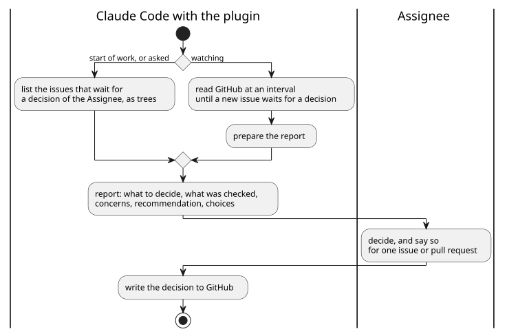

# 判断

AssigneeがClaude Codeと一緒に判断するときに、Claude Codeがすることを決める。ここでのClaude Codeは、plugin `cumin-maintainer`（[plugin](../plugin/index.md)）を入れて人が使うもので、Agentではない。判断を決めるのはAssigneeで、Claude Codeは判断の材料をそろえ、Assigneeの言葉を受けてからGitHubに書く。cuminとAgentが判断のためにGitHubに書くことは、それぞれのカテゴリで決める。

## 全体像

図の元ファイル: [overview.puml](overview.puml)

## 要件

### 判断に共通のこと

#### `CWK-DECIDE-001` 判断を1件ずつ確かめてからGitHubに書く

Claude Codeは、GitHubに判断を書く前に（`APPROVE`、`REQUEST_CHANGES`、`cumin/status/ready`、受け入れ、差し戻し、判断の依頼への答え）、IssueかPull Requestの番号を示して、Assigneeの言葉を得る。1つの言葉で書く判断は1つである。

- 検証: `demo` 判断を書く前に、毎回Assigneeに聞くことを確認

---

#### `CWK-DECIDE-002` 判断を待つIssueをツリー形式で示す

Claude Codeは、作業の始めと、頼まれたときに、Claude Codeを使う人がAssigneeである`awaiting-`の状態のIssueのうち、判断を待つもの（`awaiting-plan-review`、`awaiting-merge-decision`、`awaiting-acceptance`、`awaiting-decision`）をGitHubから読んで示す。要求Issue、sub-issue、Pull Requestのツリー形式で、それぞれに短い意味、状態、判断を待っている時間を付ける。

- 検証: `demo` 待っている判断があるリポジトリで動かして確認

---

#### `CWK-DECIDE-003` 新しく判断を待つIssueが出たら報告する

Claude Codeは、頼まれたら、新しく判断を待つIssueが出るのをGitHubから定期的に読んで待ち受ける。出たら、そのIssueを報告する（`CWK-DECIDE-004`）。[通知](../notify/index.md)とは別の仕組みで、どちらかが止まっても、もう一方は届く。

- 検証: `demo` 待ち受けている間に判断を待つIssueを作り、報告が届くことを確認

---

#### `CWK-DECIDE-004` 判断のための報告に書くこと

Claude Codeは、判断ごとに、決めること、確かめたこと、気になる点、おすすめ、選べることを、スマホで読める長さで報告する。GitHubやコードで確かめたことと、Claude Codeの推測は、分けて書く。

- 検証: `demo` 判断の種類ごとに報告させて確認

---

### 判断の種類ごと

#### `CWK-DECIDE-005` 計画結果の確認で確かめること

Claude Codeは、計画結果の確認では、sub-issueを要求Issueと比べ、満たす要求、抜け、リスクのラベル、順番を確かめる。計画を変えたほうがよいときは、Plannerへの指示の文案を出す。

- 検証: `demo` 計画結果の確認を待つ要求Issueで動かして確認

---

#### `CWK-DECIDE-006` マージ判断で確かめること

Claude Codeは、マージ判断では、先頭のコミット、必須チェック、保護されたパスの変更、テスト以外の差分、Reviewerの指摘への返答を確かめる。

- 検証: `demo` マージ判断を待つPull Requestで動かして確認

---

#### `CWK-DECIDE-007` 受け入れで確かめること

Claude Codeは、受け入れでは、受け入れ確認のコメントを要件の検証の行と比べ、残課題の仕分けを確かめる。

- 検証: `demo` 受け入れを待つ要求Issueで動かして確認

---

#### `CWK-DECIDE-008` 判断の依頼で確かめること

Claude Codeは、判断の依頼では、選べることごとに影響をまとめ、おすすめと、答えの文案を出す。

- 検証: `demo` 判断の依頼で止まったIssueで動かして確認

---

## 未決事項

なし
