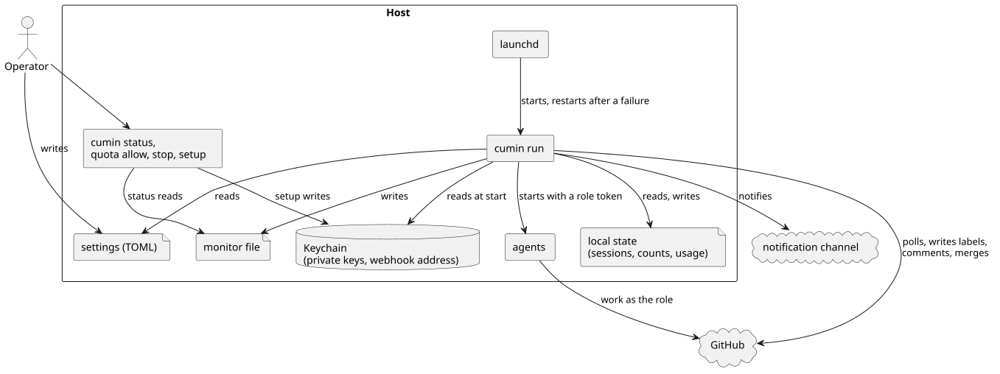

# Host での動かし方

cumin を Host でどう動かし、どう止め、何で設定するかを決める。Host の上の操作は Operator が受け持つ ([権限](../access/index.md) の `CWK-ACCESS-003`)。

## 全体像

cumin は、Host のユーザアカウントで常駐し、自分から GitHub を確かめて作業を進める。Host に置くものは、次の4種類である。

図の元ファイル: [overview.puml](overview.puml)

- 設定: Operator が書く。秘密の値は含めない。
- 秘密の値: macOS の Keychain に置く。
- 手元の状態: cumin が書く。失っても作業を失わない ([定期確認](../poll/index.md) の `CWK-POLL-003`)。
- モニターファイル: cumin が書き、cumin を外から見る道具が読む。

## 要件

### 常駐

#### `CWK-HOST-001` 常駐する

cumin は、Host のユーザアカウントの launchd の LaunchAgent として常駐する。0 以外の終了コードで終わったときだけ、launchd が起動し直す。

- 検証: `demo` cumin のプロセスを異常終了させると launchd が起動し直し、SIGTERM で止めたときは起動し直さない

---

#### `CWK-HOST-002` ログ

cumin は、ログを JSON の構造化ログとして標準出力に出す。秘密の値 (token、秘密鍵、webhook のアドレス) は、どのレベルのログにも出さない。

- 検証: `test` Agent起動とマージを含む定期確認のログが、すべて JSON の行で、秘密の値を含まない

---

### コマンド

#### `CWK-HOST-003` コマンドの一覧

Operator は、次のコマンドを使う。

| コマンド | すること |
|---|---|
| `cumin run` | 常駐して動く。launchd から起動する |
| `cumin status` | 今の状態を表示する (`CWK-HOST-004`) |
| `cumin quota allow` | 今の5時間制限を使い切ってよいと許可する ([利用制限](../limit/index.md) の `CWK-LIMIT-006`) |
| `cumin stop --after-current-runs` | 動いている Agent の実行が終わるのを待ってから止める (`CWK-HOST-007`) |
| `cumin setup github-apps` | role ごとの GitHub App を登録し、秘密鍵を Keychain に入れる。もう一度実行すると、足りない GitHub App だけを登録する |
| `cumin setup launchd` | LaunchAgent の定義を書く (`CWK-HOST-005`) |
| `cumin setup notify --discord-webhook` | 通知の webhook のアドレスを標準入力から受け取り、Keychain に入れる |
| `cumin --version` | cumin の版を表示する |

- 検証: `inspection` `cumin --help` の一覧が、この表と一致する

---

#### `CWK-HOST-004` 状態の表示

`cumin status` は、次のことを表示する。GitHub のラベルとモニターファイル (`CWK-HOST-014`) から読み、GitHub に書き込まない。

- 作業中の Agent と、人の番を待つ Issue
- 5時間制限と週間制限の使用率、読んだ時刻、今の上限、Agent起動を止めているかとその原因
- 止める予約があるか
- 失敗しているツール動作確認と、全部を読めない Issue
- 最後の定期確認の時刻と、そのエラー。モニターファイルがないか古ければ、そのこと

- 検証: `test` 使用率で Agent起動を止めているとき、`cumin status` がその原因の制限を表示する
- 検証: `test` モニターファイルがないとき、そのことを1行で表示し、ほかの表示は続ける

---

#### `CWK-HOST-005` LaunchAgent の定義を書く

`cumin setup launchd` は、実行中の cumin の絶対パスと、コマンドを実行したシェルの `PATH` を使って、LaunchAgent の定義を書く。書く前に、cumin 自身が起動するコマンド (role ごとの Agent の CLI と `git`) が、その `PATH` にあるかを確かめる。1つでもなければ、その名前を示して、何も書かずに失敗で終わる。すでにある定義と違うときは、差分を示して、上書きしない。

- 検証: `test` Agent の CLI が `PATH` にないと、その名前を示して、定義を書かずに失敗で終わる

---

### 止め方

#### `CWK-HOST-006` すぐに止める

`cumin run` は、SIGINT と SIGTERM ですぐに止まる。新しい Agent起動をせず、動いている Agent も止める。ラベルは替えない。終了コードは 0 なので、launchd は起動し直さない。次に起動すると、最初の定期確認が続きを決める。

- 検証: `test` Agent の実行中に SIGTERM を送ると、Agent のプロセスも残らずに、終了コード 0 で終わる。起動し直すと、その Issue のやり直しが起きる

---

#### `CWK-HOST-007` 実行を待ってから止める

`cumin stop --after-current-runs` を実行すると、cumin は新しい Agent起動をせず、動いている Agent の実行が終わるのを待ってから止まる。待つ間も、Agent を起動しないアクション (ラベルの付け替え、コメント、通知、マージ) は続ける。止める予約は、次の起動には残らない。cumin の版を入れ替える前に使う。

- 検証: `test` 予約のあと、動いている実行の結果はラベルに反映されるが、続きの Agent起動は起きず、終了コード 0 で終わる。起動し直すと、続きの Agent起動が1回だけ起きる

---

#### `CWK-HOST-008` スリープ

Host がスリープから戻ったとき、cumin と動いている Agent は続きから動く。戻ったことで起きた失敗 (通信の失敗、token の失効、時間の上限) は、Agent の異常終了として扱う ([Agent](../agent/index.md) の `CWK-AGENT-017`)。

- 検証: `demo` Agent の実行中に Host をスリープさせ、戻ったあと、その Issue が異常終了のやり直しで進む

---

### 設定

#### `CWK-HOST-009` 設定ファイル

設定は TOML のファイルに書く。値をコードに埋め込まない。Host の設定ファイルは、既定の場所にあり、`cumin run --config` で変えられる。知らないキー、型の違う値、範囲を外れた値があると、`cumin run` は起動せずに、そのキーを示して終わる。

- 検証: `test` 知らないキーと範囲を外れた値がある設定ファイルで、`cumin run` が起動せずに、それぞれのキーを示す

---

#### `CWK-HOST-010` リポジトリの設定

対象のリポジトリは、main ブランチの `.cumin/config.toml` で、一部の設定を自分で決められる。Pull Request のブランチの内容は効かない。`.cumin/` は保護されたパスなので、Maintainer が承認したものだけが効く。

- 優先順位は、初期値、Host の設定ファイル、リポジトリの設定の順に強くなる。
- リポジトリの設定に、Host だけのキー、知らないキー、範囲を外れた値があると、cumin はそのキーをログに出して、そのリポジトリの定期確認を飛ばす。ほかのリポジトリは続ける。

- 検証: `test` リポジトリの設定で `max_review_rounds` を変えると、そのリポジトリだけに効く
- 検証: `test` リポジトリの設定に `work_dir` があると、そのリポジトリの定期確認だけが飛ばされる

---

#### `CWK-HOST-011` 設定の一覧

設定のキーは、次のとおりである。「書く場所」の「Host」は Host の設定ファイルだけ、「両方」は Host の設定ファイルとリポジトリの設定、「リポジトリ」はリポジトリの設定だけに書けることを表す。

| キー | 内容 | 初期値 | 書く場所 |
|---|---|---|---|
| `repositories` | 対象のリポジトリの一覧 | なし (必須) | Host |
| `work_dir` | 作業ディレクトリ | なし (必須) | Host |
| `poll_interval` | 作業中のリポジトリの定期確認の間隔 (`CWK-POLL-004`) | 60秒 | Host |
| `idle_poll_interval` | 作業中でないリポジトリの定期確認の間隔。`poll_interval` 以上 (`CWK-POLL-004`) | 5分 | Host |
| `max_issues_in_progress` | リポジトリごとに同時に進める Issue の数 (`CWK-POLL-005`) | 1 | Host |
| `quota.five_hour.threshold` | 5時間制限のしきい値 (`CWK-LIMIT-004`) | 85% | Host |
| `quota.five_hour.bands` | 5時間制限の時間帯ごとのしきい値。同じ時刻を2つの時間帯に入れられない (`CWK-LIMIT-004`) | なし | Host |
| `quota.weekly.target` | 週間制限の目標 (`CWK-LIMIT-005`) | 85% | Host |
| `quota.weekly.lead` | 週間制限の前倒し。7日未満 (`CWK-LIMIT-005`) | 1日 | Host |
| `github_apps.<organization>.<app>` | GitHub App の Client ID。`cumin setup github-apps` が書く | なし | Host |
| `roles.<role>.time_limit` | 実行の時間の上限。55分以下 (`CWK-AGENT-015`) | 50分 | Host |
| `roles.<role>.cli_path` | Agent の CLI の実行ファイル | `claude` | Host |
| `roles.<role>.cli` | Agent を動かす CLI。今は Claude Code だけ (`CWK-AGENT-019`) | Claude Code | 両方 |
| `roles.<role>.model` | Agent を動かすモデル。空なら CLI の既定 | 空 | 両方 |
| `max_review_rounds` | レビューのラウンドの上限 ([レビュー](../review/index.md)) | 5 | 両方 |
| `max_check_fix_requests` | チェックの修正を頼む回数の上限 ([チェック](../check/index.md)) | 3 | 両方 |
| `checks_wait_time` | 必須チェックの結果を待つ時間 ([チェック](../check/index.md)) | 60分 | 両方 |
| `merge_method` | マージの方法。squash、merge、rebase のどれか ([マージ](../merge/index.md)) | squash | 両方 |
| `notify.discord.enabled` | 通知を送るか。リポジトリで決めると、そのリポジトリについての通知に効く ([通知](../notify/index.md)) | true | 両方 |
| `priority_labels` | 優先度のラベルの名前。高い順 (`CWK-LABEL-008`) | `cumin/priority/P0`〜`P3` | リポジトリ |
| `protected_paths` | 保護されたパス (`CWK-CHECK-008.1`) | `.cumin/`、`CLAUDE.md`、`AGENTS.md`、`.claude/`、`REVIEW.md` | リポジトリ |
| `tool_checks` | ツール動作確認 (`CWK-AGENT-018.1`) | なし | リポジトリ |
| `start_on_awaiting_merge_decision` | マージ判断を待つ Pull Request のブランチから始めるか (`CWK-IMPL-015`) | false | リポジトリ |

- `<role>` は `planner`、`implementer`、`reviewer` のどれか、`<app>` は `cumin-core` とこの3つのどれかである。
- 時間は、`"60s"` や `"50m"` のように、単位を付けて書く。
- リポジトリだけのキーは、Host の設定ファイルに書くと、知らないキーの誤りになる。
- 次の値は設定にせず、固定の値とする: GitHub の読み取りのやり直しの回数と間隔 (`CWK-POLL-007`)、sub-issue を読む数 (`CWK-POLL-011`)、続けて失敗したら知らせる回数 (`CWK-POLL-010`)、1回の定期確認で2つ以上マージするときの間に待つ秒数 (`CWK-MERGE-007`)。

- 検証: `test` この表のすべてのキーを書いた設定ファイルを、cumin が誤りなく読む
- 検証: `test` リポジトリだけのキーを Host の設定ファイルに書くと、知らないキーの誤りになる

---

#### `CWK-HOST-012` リスクの基準

リスクの基準は、TOML の値ではなく、Markdown のファイルで決める。cumin は中身を読まず、Planner と Reviewer への指示にそのまま入れる ([Agent](../agent/index.md) の `CWK-AGENT-006`)。

| 段 | 場所 |
|---|---|
| 初期値 | cumin に入っている `disciplines/software-engineering/risk-criteria.md` |
| Host | Host の設定ファイルと同じディレクトリの `risk-criteria.md` |
| リポジトリ | 対象のリポジトリの main ブランチの `.cumin/risk-criteria.md` |

強い段のファイルがあれば、弱い段の基準を丸ごと置き換える。中身が空白だけのファイルは、そのリポジトリの設定の誤りとする。

- 検証: `test` リポジトリに `.cumin/risk-criteria.md` があると、Planner への指示に、その中身だけが入る

---

### 秘密の値と外から見るためのファイル

#### `CWK-HOST-013` 秘密の値

GitHub App の秘密鍵と、通知の webhook のアドレスは、Host の macOS の Keychain に置く。設定ファイルとリポジトリには書かない。cumin は起動のときに読み、メモリにだけ持ち、手元の状態にもログにも書かない。

- 検証: `test` 秘密の値が、設定ファイル、手元の状態、ログのどれにも現れない

---

#### `CWK-HOST-014` モニターファイル

cumin は、定期確認のたびと Agent の実行が終わるたびに、モニターファイルを書き直す。中身は、最後の定期確認の時刻とエラー、止める予約、利用制限で止めているか、動いている Agent、人の番を待つ Issue である。cumin を外から見る道具と `cumin status` が読む。cumin 自身は読まず、ここからは何も決めない。

- 検証: `test` 定期確認のあと、モニターファイルに、その時刻と、人の番を待つ Issue がある
- 検証: `test` モニターファイルを消しても、cumin のアクションは変わらない

---

## 受け入れテスト

| # | 場面 | 期待する結果 |
|---|---|---|
| 1 | Host に cumin を入れ、`cumin setup github-apps`、`cumin setup launchd` を実行して、ログインする | cumin が常駐して、対象のリポジトリの定期確認を始める (`CWK-HOST-001`、`CWK-HOST-003`、`CWK-HOST-005`) |
| 2 | Agent の実行中に `cumin stop --after-current-runs` を実行し、cumin の版を入れ替えて起動する | 実行の結果が反映されてから止まり、起動のあとに続きから進む (`CWK-HOST-007`) |
| 3 | リポジトリの `.cumin/config.toml` に誤りのある値を足す | そのリポジトリの定期確認だけが飛ばされ、Maintainer が直すと次の定期確認から戻る (`CWK-HOST-010`) |
| 4 | Agent の CLI か `git` が `PATH` にない状態で `cumin setup launchd` を実行する | ないコマンドを示して、定義を書かずに失敗で終わる (`CWK-HOST-005`) |

## 未決事項

なし
