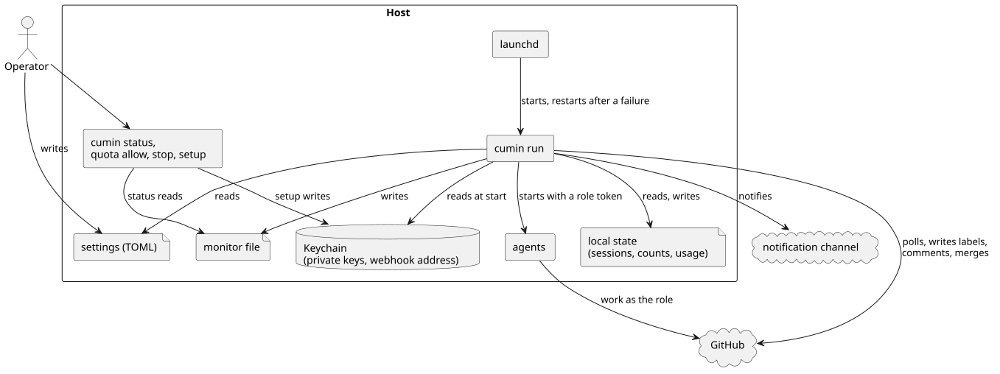

# Hostでの動かし方

cuminをHostでどう動かし、どう止め、何で設定するかを決める。Hostの上の操作はOperatorが受け持つ（[権限](../access/index.md)の`CWK-ACCESS-003`）。

## 全体像

cuminは、Hostのユーザアカウントで常駐し、自分からGitHubを確かめて作業を進める。Hostに置くものは、次の4種類である。



図の元ファイル: [overview.puml](overview.puml)

- 設定: Operatorが書く。秘密の値は含めない。
- 秘密の値: macOSのKeychainに置く
- cuminがローカルに持つ情報: cuminが書く。失っても作業を失わない（[定期確認](../poll/index.md)の`CWK-POLL-003`）。
- モニターファイル: cuminが書き、cuminを外から見る道具が読む

## 要件

### 常駐

#### `CWK-HOST-001` 常駐する

cuminは、HostのユーザアカウントのlaunchdのLaunchAgentとして常駐する。0以外の終了コードで終わったときだけ、launchdが起動し直す。

- 検証: `demo` Hostでcuminを動かして確認

---

#### `CWK-HOST-002` ログ

cuminは、ログをJSONの構造化ログとして標準出力に出す。秘密の値（token、秘密鍵、webhookのアドレス）は、どのレベルのログにも出さない。

- 検証: `test` GitHub mockとCLI mockでテスト

---

### コマンド

#### `CWK-HOST-003` コマンドの一覧

Operatorは、次のコマンドを使う。

| コマンド | すること |
|---|---|
| `cumin run` | 常駐して動く。launchdから起動する |
| `cumin status` | 今の状態を表示する（`CWK-HOST-004`）|
| `cumin quota allow` | 今の5時間制限を使い切ってよいと許可する（[利用制限](../limit/index.md)の`CWK-LIMIT-008`）|
| `cumin stop` | 動いているAgentの実行が終わるのを待ってから止める（`CWK-HOST-007`）|
| `cumin stop --force` | 動いているAgentも止めて、すぐに止める（`CWK-HOST-006`）|
| `cumin setup github-apps` | roleごとのGitHub Appを登録し、秘密鍵をKeychainに入れる。もう一度実行すると、足りないGitHub Appだけを登録する |
| `cumin setup launchd` | LaunchAgentの定義を書く（`CWK-HOST-005`）|
| `cumin setup notify --discord-webhook` | 通知のwebhookのアドレスを標準入力から受け取り、Keychainに入れる |
| `cumin --version` | cuminの版を表示する |

- 検証: `inspection` `cumin --help`の一覧が、この表と一致する

---

#### `CWK-HOST-004` 状態の表示

`cumin status`は、次のことを表示する。GitHubのラベル、cuminがローカルに持つ情報、モニターファイル（`CWK-HOST-013`）から読み、GitHubに書き込まない。

- 作業中のAgentと、`awaiting-`で始まる状態のIssue
- 5時間制限と週間制限の使用率、読んだ時刻、今の上限、Agent起動を止めているかとその原因
- cuminの停止予約があるか
- 失敗しているツール動作確認と、異常な状態のIssueとその理由
- 最後の定期確認の時刻と、そのエラー。モニターファイルがないとき、または最後の定期確認が`poll.interval`の3倍より古いときは、そのこと

モニターファイルの中身で、終了コードは変えない。

- 検証: `test` 表示を単体テスト

---

#### `CWK-HOST-005` LaunchAgentの定義を書く

`cumin setup launchd`は、実行中のcuminの絶対パスと、コマンドを実行したシェルの`PATH`を使って、LaunchAgentの定義を書く。書く前に、cumin自身が起動するコマンド（roleごとのAgentのCLIと`git`）が、その`PATH`にあるかを確かめる。1つでもなければ、その名前を示して、何も書かずに失敗で終わる。すでにある定義と違うときは、差分を示して、上書きしない。

- 検証: `test` 単体テスト

---

### 止め方

#### `CWK-HOST-006` すぐに止める

`cumin stop --force`を実行したとき、または`cumin run`がSIGINTかSIGTERMを受けたとき、cuminは動いているAgentも止めてすぐに終わる。ラベルは替えず、終了コードは0なのでlaunchdは起動し直さない。

- 検証: `test` CLI mockでテスト

---

#### `CWK-HOST-007` 実行を待ってから止める

`cumin stop`を実行すると、cuminの停止を予約できる。予約のあと、cuminは新しいAgent起動をせず、動いているAgentの実行が終わるのを待ってから止まる。待つ間も、Agentを起動しないアクション（ラベルの付け替え、コメント、通知、マージ）は続ける。cuminの停止予約は、次の定期確認から効く。

- 検証: `test` GitHub mockとCLI mockでテスト

---

#### `CWK-HOST-008` スリープ

Hostがスリープから戻ったとき、cuminと動いているAgentは続きから動く。戻ったことで起きた失敗（通信の失敗、tokenの失効、時間の上限）は、Agentの異常終了として扱う（[Agent](../agent/index.md)の`CWK-AGENT-021`）。

- 検証: `demo` Hostでcuminを動かして確認

---

### 設定

#### `CWK-HOST-009` 設定ファイル

設定はTOMLのファイルに書く。値をコードに埋め込まない。Hostの設定ファイルは`~/.config/cumin/config.toml`にあり、`cumin run --config`で変えられる。知らないキー、型の違う値、範囲を外れた値があると、`cumin run`は起動せずに、そのキーを示して終わる。

- 検証: `test` 設定の読み込みを単体テスト

---

#### `CWK-HOST-010` リポジトリの設定

対象のリポジトリは、mainブランチの`.cumin/config.toml`で、一部の設定を自分で決められる。Pull Requestのブランチの内容は効かない。`.cumin/`は保護されたパスなので、Maintainerが承認したものだけが効く。

- 優先順位は、初期値、Hostの設定ファイル、リポジトリの設定の順に強くなる
- リポジトリの設定に、Hostだけのキー、知らないキー、範囲を外れた値があると、cuminはそのキーをログに出して、そのリポジトリの定期確認を飛ばす。ほかのリポジトリは続ける。

- 検証: `test` GitHub mockでテスト

---

#### `CWK-HOST-011` 設定の一覧

設定のキーは、次のとおりである。

```toml
# 値は初期値である。かっこの中は書く場所で、「Host」はHostの設定ファイルだけ、
# 「両方」はHostの設定ファイルとリポジトリの設定、「リポジトリ」はリポジトリの設定だけに書ける。

# 対象のリポジトリの一覧。必須（Host）
repositories = ["<owner>/<repository>"]
# 作業ディレクトリ。必須（Host）
work_dir = "<path>"
# 保護されたパス（CWK-CHECK-008.1）（リポジトリ）
protected_paths = [".cumin/", "CLAUDE.md", "AGENTS.md", ".claude/", "REVIEW.md"]

[poll]
# 作業中のリポジトリの定期確認の間隔（CWK-POLL-004）（Host）
interval = "60s"
# 作業中でないリポジトリの定期確認の間隔。interval以上（CWK-POLL-004）（Host）
idle_interval = "5m"
# リポジトリごとに同時に進めるIssueの数（CWK-POLL-005）（Host）
max_issues_in_progress = 1

[quota]
# 使用率を読む最小の間隔（CWK-LIMIT-003）（Host）
read_interval = "5m"

[quota.five_hour]
# 5時間制限のしきい値。単位は%（CWK-LIMIT-006）（Host）
threshold = 85

[quota.weekly]
# 週間制限の目標。単位は%（CWK-LIMIT-007）（Host）
target = 85
# 週間制限の前倒し。7日未満（CWK-LIMIT-007）（Host）
lead = "24h"

# roleごとの設定。implementerのほかに、plannerとreviewerがある
[roles.implementer]
# Agentを動かすCLI。今はClaude Codeだけ（CWK-AGENT-023）（両方）
cli = "claude-code"
# AgentのCLIの実行ファイル（Host）
cli_path = "claude"
# Agentを動かすモデル。空ならCLIの既定（両方）
model = ""
# 実行の時間の上限。55分以下（CWK-AGENT-019）（Host）
time_limit = "50m"

[implementation]
# マージされていないblocked byのIssueのブランチから始めるときの、たどる数の上限。
# 0なら始めない（CWK-IMPL-008）（リポジトリ）
max_unmerged_blockers = 0

[pull_request_checks]
# 必須チェックの結果を待つ時間（CWK-CHECK-006）（両方）
wait_time = "60m"
# チェックの修正を頼む回数の上限（CWK-CHECK-004）（両方）
max_fix_requests = 3

[review]
# レビューのラウンドの上限（CWK-REVIEW-005）（両方）
max_rounds = 5

[merge]
# マージの方法。squash、merge、rebaseのどれか（CWK-MERGE-009）（両方）
method = "squash"
# Assigneeのマージ判断を求めるリスク。low、medium、highから選ぶ（CWK-MERGE-002）（リポジトリ）
decision_risks = ["medium", "high"]

[labels]
# 優先度のラベルの名前。高い順（CWK-LABEL-006）（リポジトリ）
priority = ["cumin/priority/P0", "cumin/priority/P1", "cumin/priority/P2", "cumin/priority/P3"]

[notify.discord]
# 通知を送るか。リポジトリで決めると、そのリポジトリについての通知に効く（CWK-NOTIFY-006）（両方）
enabled = true

# GitHub AppのClient ID。cumin setup github-appsが書く（Host）
[github_apps.<organization>]
cumin-core = "<Client ID>"
planner = "<Client ID>"
implementer = "<Client ID>"
reviewer = "<Client ID>"

# ツール動作確認。初期値はなし。1つの確認ごとに1つ書く（CWK-AGENT-022.1）（リポジトリ）
[[tool_checks]]
command = ["docker", "info"]
time_limit = "10s"

# Agentに渡すplugin。初期値はなし。1つのpluginごとに1つ書く（CWK-AGENT-011.1）（リポジトリ）
[[plugins]]
name = "<name>"
repository = "<owner>/<repository>"
path = "<path>"
commit = "<commit>"
roles = ["implementer"]
disciplines = ["software-engineering"]
```

- 時間は、`"60s"`や`"50m"`のように、単位を付けて書く
- リポジトリだけのキーは、Hostの設定ファイルに書くと、知らないキーの誤りになる
- 次の値は設定にせず、固定の値とする: GitHubの読み取りのやり直しの回数と間隔（`CWK-POLL-007`）、sub-issueを読む数（`CWK-POLL-011`）、続けて失敗したら知らせる回数（`CWK-POLL-010`）、1回の定期確認で2つ以上マージするときの間に待つ秒数（`CWK-MERGE-009`）

- 検証: `test` 設定の読み込みを単体テスト

---

### 秘密の値と外から見るためのファイル

#### `CWK-HOST-012` 秘密の値

GitHub Appの秘密鍵と、通知のwebhookのアドレスは、HostのmacOSのKeychainに置く。設定ファイルとリポジトリには書かない。cuminは起動のときに読み、メモリにだけ持ち、ローカルに持つ情報にもログにも書かない。

- 検証: `test` GitHub mockとCLI mockでテスト

---

#### `CWK-HOST-013` モニターファイル

cuminは、定期確認のたびとAgentの実行が終わるたびに、モニターファイル（`~/.local/state/cumin/monitor.json`）を書き直す。cuminを外から見る道具と`cumin status`が読む。cumin自身は読まず、ここからは何も決めない。中身は次のとおりである。説明のためにコメントを付けたが、実際のファイルにはコメントはない。

```jsonc
{
  // 形式の版。読む側が読めなくなる変更のときだけ上げる
  "version": 1,
  // 最後の定期確認
  "last_poll": {
    // 終わった時刻（UTC）
    "at": "2026-11-11T12:00:00Z",
    // 定期確認が失敗したリポジトリ
    "errors": [
      { "repository": "<owner>/<repository>", "message": "<理由>" }
    ]
  },
  // cuminの停止予約があるか（CWK-HOST-007）
  "stop_requested": false,
  // 利用制限（CWK-LIMIT-001）。使用率の数字は書かない
  "quota": {
    // open: 起動する、stopped: 上限で止めている、unread: 使用率を読めずに止めている
    "state": "stopped",
    // 上限に達した制限。"5h"と"weekly"
    "stopped_windows": ["5h"],
    // 次にAgent起動を試す時刻（UTC）。止めていないときはキーがない
    "next_try_at": "2026-11-11T15:00:00Z"
  },
  // 失敗しているツール動作確認（CWK-AGENT-022）
  "failed_tool_checks": [
    { "repository": "<owner>/<repository>", "commands": ["docker info"] }
  ],
  // 異常な状態のIssue。1つのIssueに理由が2つあれば、2つ書く
  "issue_problems": [
    { "repository": "<owner>/<repository>", "issue": 12, "title": "<タイトル>", "url": "<IssueのURL>",
      // 理由。下の表の値のどれか
      "reason": "partly_unreadable",
      // 理由の詳しい内容を1行で。例えば、超えた上限
      "detail": "<内容>" }
  ],
  // 動いているAgent
  "agents": [
    { "repository": "<owner>/<repository>", "issue": 34, "role": "implementer",
      "request": "<依頼の種類>", "title": "<タイトル>", "url": "<IssueのURL>" }
  ],
  // awaiting-で始まる状態のIssue。kindは状態ラベルからawaiting-を除いたもの
  "waiting": [
    { "repository": "<owner>/<repository>", "issue": 56, "kind": "merge-decision",
      "title": "<タイトル>", "url": "<Pull RequestのURL>" }
  ]
}
```

- 一覧は、空のときも`[]`と書く
- `waiting`の`url`は、`merge-decision`ではPull Request、ほかはIssueのURLである

`reason`は、次のどれかである。

| `reason` | 場面 | 要件 |
|---|---|---|
| `partly_unreadable` | 関連する情報の一部を読めないIssue | `CWK-POLL-012` |
| `unauthorized_change` | 権限外のアカウントが状態ラベルを付けたか、assigneeを替えた | `CWK-ACCESS-013` |
| `assignee_not_one_maintainer` | assigneeが1人のMaintainerでない | `CWK-ACCESS-013` |
| `no_assignee` | 要求IssueにAssigneeがいない | `CWK-PLAN-007` |

- 検証: `test` GitHub mockでテスト

---

## 未決事項

なし
