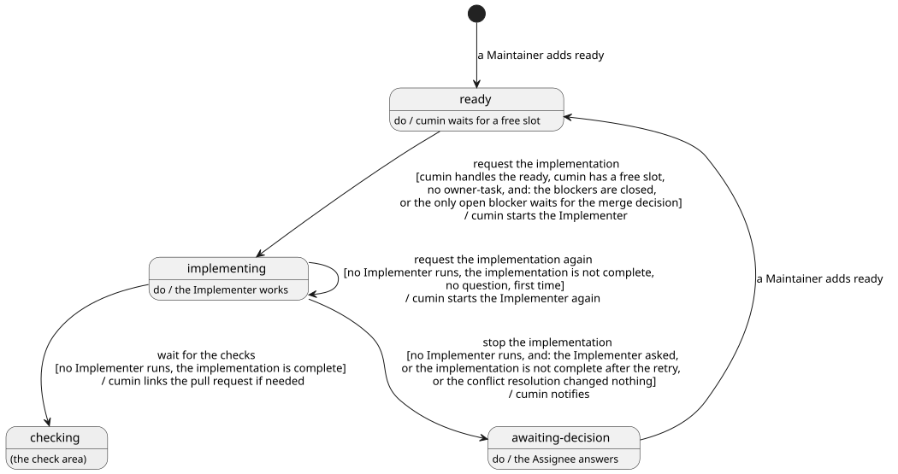

# 実装

実装IssueをPull Requestにまとめるまでの流れを決める。cuminがImplementerを起動し、Pull RequestをGitHubで確かめて、必須チェックを待つ状態に替えるまでである。必須チェックと修正は[チェック](../check/index.md)、レビューは[レビュー](../review/index.md)、マージは[マージ](../merge/index.md)、Agent起動に共通のことは[Agent](../agent/index.md)で決める。

## 全体像

実装Issueが実装でたどる状態を示す。灰色の状態は、ほかのカテゴリで決める。

図の元ファイル: [overview.puml](overview.puml)

「Implementerが動いていない」の意味は、[Agent](../agent/index.md)の`CWK-AGENT-001`で決める。

## 要件

### 実装のAgent起動

#### `CWK-IMPL-001` 実装を始める

`cumin/status/ready`の付いた実装Issueが次のすべてを満たすとき、cuminは状態を`cumin/status/implementing`に替えてから、新しいセッションでImplementerを起動する。実装IssueのPull Requestがすでにあれば、その続きから進めさせる。

- その`cumin/status/ready`を、cuminが扱う（[権限](../access/index.md)の`CWK-ACCESS-004`）
- blocked byのIssueがすべて閉じている（`CWK-IMPL-002`）。または`CWK-IMPL-015.1`の条件を満たす
- 空きがある
- `cumin/type/owner-task`が付いていない（`CWK-LABEL-004`）

- 検証: `test` 4つを満たす実装Issueで、Implementerの起動が新しいセッションで1回だけ起き、その前に状態が`cumin/status/implementing`になっている
- 検証: `test` Pull Requestがすでにある実装Issueでは、同じPull Requestの続きから進めさせる

---

#### `CWK-IMPL-002` 先の実装Issueを待つ

blocked byのIssueが1つでも開いている実装Issueには、cuminは着手しない。例外は`CWK-IMPL-015`である。

- 検証: `test` blocked byの実装Issueが閉じたあとの定期確認で、着手する

---

#### `CWK-IMPL-003` ブランチの名前

cuminは、実装Issueごとに`cumin/<実装Issueの番号>-<短い説明>`の形のブランチの名前を決めて、Implementerに渡す。

- 検証: `test` Implementerに渡す事実に、この形のブランチの名前がある

---

#### `CWK-IMPL-004` 回数を数え直す

`CWK-IMPL-001`で`cumin/status/implementing`に移るたびに、cuminはチェックの修正の回数（`CWK-CHECK-004`）を0に戻す。

- 検証: `test` チェックの修正の上限で止まった実装Issueに`cumin/status/ready`を付け直すと、また上限まで頼める

---

### 実装の完了判断

#### `CWK-IMPL-005` 実装の完了を判断する

cuminは、Implementerが動いていないとき、`CWK-IMPL-003`のブランチに`cumin-implementer`の作ったPull Requestが開いていて、先頭のコミットがpushされていれば、実装が完了したと判断する。Pull Requestは、本文の`Closes`ではなくブランチと作成者で見つける。GitHubが`Closes`からリンクを作らないことがあるからである。Implementerの結果は使わない。

- 検証: `test` `Closes`のリンクがないPull Requestでも、ブランチと作成者が合えば完了と判断する。作成者が違えば判断しない

---

#### `CWK-IMPL-006` チェックを待つ

`cumin/status/implementing`の実装Issueで、Implementerが動いておらず、実装が完了したとき、cuminは状態を`cumin/status/checking`に替える。実装IssueにそのPull Requestを閉じるリンクがなければ、先に`cumin-core`がリンクを付け、読み直して確かめる。ほかのアクションは、このリンクで実装IssueのPull Requestを見つける。

- 検証: `test` リンクのないPull Requestで、cuminがリンクを付けてから`cumin/status/checking`に替える。リンクがあれば付け直さない

---

#### `CWK-IMPL-007` 実装をやり直す

`cumin/status/implementing`の実装Issueで、Implementerが動いておらず、実装が完了しておらず、質問のコメントもないとき、cuminは状態を替えずにImplementerをもう一度起動して、続きから進めさせる。やり直しは、1つの`cumin/status/implementing`の間に1回だけである。

- 検証: `test` Pull Requestを開かずに終わると、Implementerがもう一度だけ起動され、状態は`cumin/status/implementing`のままである

---

#### `CWK-IMPL-008` 実装を止める

`cumin/status/implementing`の実装Issueで、Implementerが動いておらず、次のどれかが成り立つとき、cuminは状態を`cumin/status/awaiting-decision`に替えて、通知する。質問のコメントがないときは、止めた理由をコメントに書く。

- `cumin/status/implementing`になったあとに、Implementerの質問のコメントがある。質問ではやり直さない。要件が足りず、MaintainerがIssueを直す必要があることが多いからである
- やり直しのあとも、実装が完了していない
- 衝突の解消（`CWK-CHECK-007`）を頼んだあとも、先頭のコミットが変わっていない。先頭のコミットの時刻と、最新の`cumin/status/implementing`が付いた時刻を比べて決める

- 検証: `test` Implementerが`blocked`を返すと、やり直さずに`cumin/status/awaiting-decision`になる
- 検証: `test` やり直しのあとも完了しないと、理由のコメントが付いて`cumin/status/awaiting-decision`になる
- 検証: `test` 衝突の解消のあとも先頭のコミットが変わらないと、繰り返さずに`cumin/status/awaiting-decision`になる

---

### マージ判断を待つPull Requestのブランチから始める

blocked byのIssueのPull RequestがAssigneeのマージ判断を待つ間も、cuminはそのブランチから次の実装を始められる。そのPull Requestのマージを待つことと、マージのあとのことは[マージ](../merge/index.md)で決める。

#### `CWK-IMPL-015` マージ判断を待つPull Requestのブランチから始める

##### `CWK-IMPL-015.1` 着手の条件

`cumin/status/ready`の実装Issueが、blocked byのほかは`CWK-IMPL-001`の条件を満たし、次のすべてが成り立つとき、cuminはblocked byのIssueのPull Requestのブランチから実装を始める。

- 開いているblocked byのIssueが1つだけで、`cumin/status/awaiting-merge-decision`である
- そのPull Requestのbaseがmainブランチである。始めるのは1段だけである（[バックログ](../backlog.md)）
- 対象のリポジトリが、マージのあとにブランチを自動で消す（`deleteBranchOnMerge`）。GitHubは、ブランチが消えたときにだけ、それをbaseにするPull Requestのbaseをmainブランチに替える
- `.cumin/config.toml`で`start_on_awaiting_merge_decision = true`にしている（初期値は`false`）

有効にする前に、Maintainerは、必須チェックのワークフローが、baseがmainブランチでないPull Requestでも動くことを確かめる。動かないと、チェックが来ずに止まる（`CWK-CHECK-006`）。

- 検証: `test` 4つを満たせば着手する。blocked byのIssueが`cumin/status/reviewing`、そのbaseがmainブランチでない、`deleteBranchOnMerge`が偽、設定が`false`、開いているblocked byが2つ、のどれでも着手しない

---

##### `CWK-IMPL-015.2` ブランチとbase

cuminはImplementerにblocked byのIssueのブランチを渡す。Implementerはそこから新しいブランチを切り、Pull Requestのbaseもそのブランチにする。差分に、この実装Issueの変更だけを出すためである。

- 検証: `test` Implementerに渡す事実に、blocked byのIssueのブランチがある
- 検証: `demo` 開いたPull Requestのbaseがblocked byのIssueのブランチで、差分にこの実装Issueの変更だけがある

---

##### `CWK-IMPL-015.3` blocked byのIssueの変更は追わない

blocked byのIssueのPull Requestが変わっても、cuminはこの実装Issueのブランチを更新しない。衝突したときだけ、衝突の解消（`CWK-CHECK-007`）を頼む。変わるたびに更新すると、そのたびに実装とレビューが要るからである。

- 検証: `test` blocked byのIssueのPull Requestに新しいコミットが入っても、Agent起動は起きない。衝突したときだけ衝突の解消を頼む

---

### Implementerの成果物

#### `CWK-IMPL-009` Pull Request

Implementerは、1つの実装Issueにつき、渡された名前のブランチにPull Requestを1つ開く。説明は[pull-request.md](../../../../templates/pull-request.md)の形式で書き、本文に`Closes #<実装Issueの番号>`を書く。続きや修正では、同じPull Requestにコミットを足す。

- 検証: `demo` 実装すると、渡した名前のブランチにPull Requestが1つ開き、本文に`Closes #<番号>`がある
- 検証: `demo` チェックの修正と、Assigneeの`REQUEST_CHANGES`のあとで、新しいPull Requestは作られない

---

#### `CWK-IMPL-010` 範囲の外の作業

Implementerは、実装Issueの範囲の外に手を広げない。気づいた範囲の外の作業は、Pull Requestの説明の`Follow-up`に書き、Issueは作らない。マージのあとに、cuminがフォローアップノートに書く（[マージ](../merge/index.md)）。

- 検証: `inspection` レビューで、変更が範囲の中にあり、範囲の外の作業が`Follow-up`にあることを確かめる

---

#### `CWK-IMPL-011` Pull Requestの図

Implementerは、「Where this fits」の図を直すときは、直した図をブランチ`cumin/diagrams`に新しいファイルとして足す。Pull Requestのブランチに図のファイルを置くのは、設計文書の図を変えるときだけである。

- 検証: `demo` 位置づけが変わったPull Requestで、直した図が`cumin/diagrams`にあり、Pull Requestのブランチには設計文書の図のほかに図のファイルがない

---

#### `CWK-IMPL-012` Issueを変えない

Implementerは、実装Issueと要求Issueの本文を書き換えない。

- 検証: `demo` 実装のあとで、実装Issueと要求Issueの本文が変わっていない

---

#### `CWK-IMPL-013` 待たずに終わる

Implementerは、Pull Requestを開いてpushしたら、チェックもレビューも待たずに終わる。待つのはcuminである。

- 検証: `inspection` Implementerのroleのファイルに、この決まりがある

---

### Implementerが判断を求めるとき

#### `CWK-IMPL-014` 推測で実装しない

Implementerは、次のどれかに当たったら、推測で進めずに`blocked`を返す。cuminは、やり直さずに止める（`CWK-IMPL-008`）。

##### `CWK-IMPL-014.1` 足りない要件

実装に要る要件が足りないか、食い違っているときは、止まる。理由には、何が決まっていないかを書く。

- 検証: `demo` 要件の足りない実装Issueで実装すると、決まっていないことが理由に書いてある

---

##### `CWK-IMPL-014.2` 変えられないファイル

保護されたパスか`.github/workflows`の変更が要るときは、変えずに止まる。理由には、そのパスを書く。

- 検証: `demo` 保護されたパスの変更が要る実装Issueで実装すると、そのパスは変わらず、理由にそのパスが書いてある

---

##### `CWK-IMPL-014.3` 大きすぎる実装Issue

1つのPull Requestに収まらないと分かったときは、止まる。理由には、分け方を書く。

- 検証: `demo` 1つのPull Requestに収まらない実装Issueで実装すると、分け方が理由に書いてある

---

##### `CWK-IMPL-014.4` 足りない先の作業

blocked byのIssueで済んでいるはずの作業が足りないときは、止まる。`CWK-IMPL-015`で始めた実装Issueでは、blocked byのIssueのブランチにあるはずの作業である。

- 検証: `demo` 先の実装Issueの成果がmainブランチにない状態で実装すると、足りない作業が理由に書いてある

---

## 未決事項

なし
