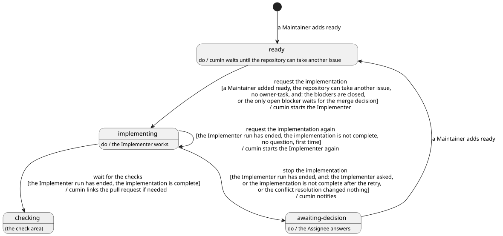
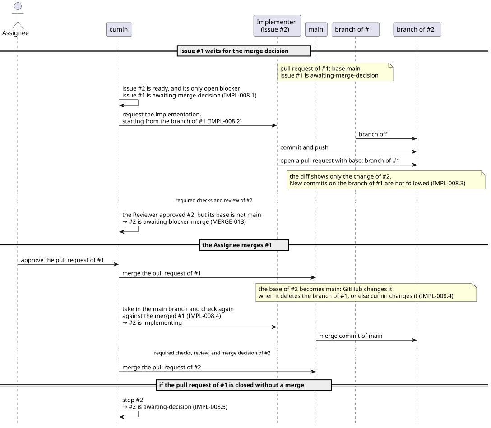

# 実装

実装IssueをPull Requestにまとめるまでの流れを決める。cuminがImplementerを起動し、Pull RequestをGitHubで確かめて、必須チェックを待つ状態に替えるまでである。必須チェックと修正は[チェック](../check/index.md)、レビューは[レビュー](../review/index.md)、マージは[マージ](../merge/index.md)、Agent起動に共通のことは[Agent](../agent/index.md)で決める。

## 全体像

実装Issueが実装でたどる状態を示す。灰色の状態は、ほかのカテゴリで決める。

図の元ファイル: [overview.puml](overview.puml)

## 要件

### 実装のAgent起動

#### `CWK-IMPL-001` 実装を始める

`cumin/status/ready`の付いた実装Issueが次のすべてを満たすとき、cuminは状態を`cumin/status/implementing`に替えてから、新しいセッションでImplementerを起動する。実装IssueのPull Requestがすでにあれば、その続きから進めさせる。

- 要求IssueのAssigneeか、その実装IssueのAssigneeが`cumin/status/ready`を付けている（[権限](../access/index.md)の`CWK-ACCESS-012`）
- `cumin/status/ready`のほかに状態ラベルがないか、ほかの状態ラベルが`cumin/status/awaiting-decision`である
- blocked byのIssueがすべて閉じている。または`CWK-IMPL-008.1`の条件を満たす
- 同時に進めるIssueの数に余裕がある
- `cumin/type/owner-task`が付いていない（`CWK-LABEL-001`）

- 検証: `test` GitHub mockとCLI mockでテスト

---

#### `CWK-IMPL-002` ブランチの名前

cuminは、実装Issueごとに`cumin/<実装Issueの番号>-<短い説明>`の形のブランチの名前を決めて、Implementerに渡す。

- 検証: `test` GitHub mockとCLI mockでテスト

---

#### `CWK-IMPL-003` 回数を数え直す

`CWK-IMPL-001`で`cumin/status/implementing`に移るたびに、cuminはチェックの修正の回数（`CWK-CHECK-004`）を0に戻す。

- 検証: `test` GitHub mockとCLI mockでテスト

---

### 実装の完了判断

#### `CWK-IMPL-004` 実装の完了を判断する

cuminは、次のすべてが成り立つとき、実装が完了したと判断する。

- Implementerの実行が終わっている
- `CWK-IMPL-002`のブランチに、`cumin-implementer`の作ったPull Requestが開いている
- 実装IssueのAgent作業ディレクトリの先頭のコミットが、そのPull Requestの先頭のコミットと同じである

Pull Requestは、本文の`Closes`ではなくブランチと作成者で見つける。GitHubが`Closes`からリンクを作らないことがあるからである。

- 検証: `test` GitHub mockとCLI mockでテスト

---

#### `CWK-IMPL-005` チェックを待つ

`cumin/status/implementing`の実装Issueで、実装が完了したとき、cuminは状態を`cumin/status/checking`に替える。

ラベルを替える前に、そのPull Requestがマージされると対象の実装Issueを閉じるように、GitHubで紐づいているかを確かめる。紐づいていなければ、`cumin-core`が紐づける。

- 検証: `test` GitHub mockでテスト

---

#### `CWK-IMPL-006` 実装をやり直す

次のすべてが成り立つとき、cuminは状態を替えずにImplementerをもう一度起動して、続きから進めさせる。

- 状態が`cumin/status/implementing`である
- Implementerの実行が終わっている
- 実装が完了していない
- 質問のコメントがない
- 今の`cumin/status/implementing`の間に、まだやり直していない

- 検証: `test` GitHub mockとCLI mockでテスト

---

#### `CWK-IMPL-007` 実装を止める

`cumin/status/implementing`の実装Issueで、Implementerの実行が終わっていて、次のどれかが成り立つとき、cuminは状態を`cumin/status/awaiting-decision`に替えて、通知する。質問のコメントがないときは、止めた理由をコメントに書く。

- `cumin/status/implementing`になったあとに、Implementerの質問のコメントがある。質問ではやり直さない。要件が足りず、AssigneeがIssueを直す必要があることが多いからである
- やり直しのあとも、実装が完了していない
- 衝突の解消（`CWK-CHECK-007`）を頼んだあとも、先頭のコミットが変わっていない。先頭のコミットの時刻と、最新の`cumin/status/implementing`が付いた時刻を比べて決める

- 検証: `test` GitHub mockとCLI mockでテスト

---

### マージ判断を待つPull Requestのブランチから始める

blocked byのIssueのPull RequestがAssigneeのマージ判断を待つ間も、cuminはそのブランチから次の実装を始められる。そのPull Requestのマージを待つことと、マージのあとのことは[マージ](../merge/index.md)で決める。

図の元ファイル: [start-from-awaiting-merge-decision.puml](start-from-awaiting-merge-decision.puml)

#### `CWK-IMPL-008` マージ判断を待つPull Requestのブランチから始める

##### `CWK-IMPL-008.1` 着手の条件

`cumin/status/ready`の実装Issueが、blocked byのほかは`CWK-IMPL-001`の条件を満たし、次のすべてが成り立つとき、cuminはblocked byのIssueのPull Requestのブランチから実装を始める。

- 開いているblocked byのIssueが1つだけで、`cumin/status/awaiting-merge-decision`か`cumin/status/awaiting-blocker-merge`である。2つ以上のときは始めない（[バックログ](../backlog.md)）
- マージされていないblocked byのIssueを、blocked byの向きに順にたどった数が、`.cumin/config.toml`の`max_unmerged_blockers`以下である

`max_unmerged_blockers`を1以上にする前に、Maintainerは、必須チェックのワークフローが、baseがmainブランチでないPull Requestでも動くことを確かめる。動かないと、チェックが来ずに止まる（`CWK-CHECK-006`）。

- 検証: `test` GitHub mockとCLI mockでテスト

---

##### `CWK-IMPL-008.2` ブランチとbase

cuminはImplementerにblocked byのIssueのブランチを渡す。Implementerはそこから新しいブランチを切り、Pull Requestのbaseもそのブランチにする。差分に、この実装Issueの変更だけを出すためである。

- 検証: `test` GitHub mockとCLI mockでテスト
- 検証: `demo` テスト用の実リポジトリでImplementerを動かして確認

---

##### `CWK-IMPL-008.3` blocked byのIssueの変更は追わない

blocked byのIssueのPull Requestが変わっても、cuminはこの実装Issueのブランチを更新しない。衝突したときだけ、衝突の解消（`CWK-CHECK-007`）を頼む。変わるたびに更新すると、そのたびに実装とレビューが要るからである。

- 検証: `test` GitHub mockとCLI mockでテスト

---

##### `CWK-IMPL-008.4` baseをmainブランチに替える

blocked byのIssueのPull Requestがマージされたあと、この実装IssueのPull Requestのbaseがまだblocked byのIssueのブランチなら、cuminはbaseをmainブランチに替える。GitHubがすでに替えていれば、何もしない。

- 検証: `test` GitHub mockでテスト

---

##### `CWK-IMPL-008.5` blocked byのIssueのマージのあとに確かめ直す

マージ前のblocked byのIssueのブランチから始めた実装Issueは、始めた時点のblocked byのIssueの上で作られている。blocked byのIssueは、そのあとも変わることがある。そこでcuminは、blocked byのIssueがマージされたら、衝突がなくても、最終的な中身と合わせて確かめ直させる。

次のすべてが成り立つとき、cuminは状態を`cumin/status/implementing`に替えて、Implementerの直前のセッションで、mainブランチの取り込みと確かめ直しを頼む。

- 状態が`cumin/status/awaiting-blocker-merge`か、[マージ](../merge/index.md)の`CWK-MERGE-001`か`CWK-MERGE-002`の条件のうち、blocked byのIssueを待たなくてよいこと（`CWK-MERGE-012`）のほかが成り立つ`cumin/status/reviewing`である
- baseがmainブランチで、blocked byのIssueがすべて閉じている
- この実装Issueのブランチが、まだblocked byのIssueのマージのあとのmainブランチを取り込んでいない（先頭のコミットが、blocked byのIssueを閉じたPull Requestのマージのコミットを含まない）
- `cumin/status/awaiting-blocker-merge`から替えるときは、同時に進めるIssueの数に余裕がある（[定期確認](../poll/index.md)の`CWK-POLL-005`）

cuminは、依頼に次の事実を足す。

- blocked byのIssueと、そのPull Requestの番号
- この実装Issueを始めた時点の、blocked byのIssueの先頭のコミット

Implementerは、次のことをする。

- その先頭のコミットから、マージされた中身までの差を読む
- この実装Issueの変更の前提が変わっていないかを確かめ、変わっていれば合わせて直す
- mainブランチを、強制pushをせずに、マージするコミットで取り込む

取り込んだあとは、必須チェックとレビューを経る。

- 検証: `test` GitHub mockとCLI mockでテスト
- 検証: `demo` テスト用の実リポジトリでImplementerを動かして確認

---

##### `CWK-IMPL-008.6` blocked byのIssueを待つ実装を止める

マージ前のblocked byのIssueのブランチから始めた実装Issueで、Agentの実行が終わっていて、次のどれかが成り立つとき、cuminは状態を`cumin/status/awaiting-decision`に替え、理由をコメントに書いて、通知する。

- blocked byのIssueのPull Requestが、マージされずに閉じた
- この実装IssueのPull Requestが、マージされずに閉じた
- blocked byのIssueのPull Requestがマージされたあと、baseをmainブランチに替えられない
- mainブランチの取り込みを頼んだあとも、先頭のコミットがマージのコミットを含まない

却下されたblocked byのIssueのコミットはブランチに残るので、Assigneeは、それを除くかPull Requestを閉じてから、`cumin/status/ready`を付ける。

- 検証: `test` GitHub mockとCLI mockでテスト

---

### Implementerの成果物

#### `CWK-IMPL-009` Pull Request

Implementerは、1つの実装Issueにつき、渡された名前のブランチにPull Requestを1つ開く。説明は[pull-request.md](../../../../templates/pull-request.md)の形式で書き、本文に`Closes #<実装Issueの番号>`を書く。続きや修正では、同じPull Requestにコミットを足す。

- 検証: `demo` テスト用の実リポジトリでImplementerを動かして確認

---

#### `CWK-IMPL-010` 範囲の外の作業

Implementerは、実装Issueの範囲の外に手を広げない。気づいた範囲の外の作業は、Pull Requestの説明の`Follow-up`に書き、Issueは作らない。マージのあとに、cuminがフォローアップノートに書く（[マージ](../merge/index.md)）。

- 検証: `inspection` レビューで、変更が範囲の中にあり、範囲の外の作業が`Follow-up`にあることを確かめる

---

#### `CWK-IMPL-011` Pull Requestの図

Implementerは、「Where this fits」の図を直すときは、直した図をブランチ`cumin/diagrams`に新しいファイルとして足す。Pull Requestのブランチに図のファイルを置くのは、設計文書の図を変えるときだけである。

- 検証: `demo` テスト用の実リポジトリでImplementerを動かして確認

---

#### `CWK-IMPL-012` Issueを変えない

Implementerは、実装Issueと要求Issueの本文を書き換えない。

- 検証: `demo` テスト用の実リポジトリでImplementerを動かして確認

---

#### `CWK-IMPL-013` 待たずに終わる

Implementerは、Pull Requestを開いてpushしたら、チェックもレビューも待たずに終わる。待つのはcuminである。

- 検証: `inspection` Implementerのroleのファイルに、この決まりがある

---

### Implementerが判断を求めるとき

#### `CWK-IMPL-014` 推測で実装しない

Implementerは、次のどれかに当たったら、推測で進めずに`blocked`を返す。`blocked_reason`は、[decision-request.md](../../../../templates/decision-request.md)の形式で、Assigneeに決めてほしいことを書く。cuminは、やり直さずに止める（`CWK-IMPL-007`）。

##### `CWK-IMPL-014.1` 足りない要件

実装に要る要件が足りないか、食い違っているときは、止まる。理由には、何が決まっていないかを書く。

- 検証: `demo` テスト用の実リポジトリでImplementerを動かして確認

---

##### `CWK-IMPL-014.2` 変えられないファイル

保護されたパスか`.github/workflows`の変更が要るときは、変えずに止まる。理由には、そのパスを書く。

- 検証: `demo` テスト用の実リポジトリでImplementerを動かして確認

---

##### `CWK-IMPL-014.3` 大きすぎる実装Issue

1つのPull Requestに収まらないと分かったときは、止まる。理由には、分け方を書く。

- 検証: `demo` テスト用の実リポジトリでImplementerを動かして確認

---

##### `CWK-IMPL-014.4` blocked byのIssueで足りない作業

blocked byのIssueで済んでいるはずの作業が足りないときは、止まる。マージ前のblocked byのIssueのブランチから始めた実装Issueでは、blocked byのIssueのブランチにあるはずの作業である。

- 検証: `demo` テスト用の実リポジトリでImplementerを動かして確認

---

##### `CWK-IMPL-014.5` blocked byのIssueの変更で変わった前提

blocked byのIssueのマージのあとの確かめ直し（`CWK-IMPL-008.5`）で、blocked byのIssueの変更によってこの実装Issueの前提が変わり、直しでは済まないときは、止まる。理由には、何が変わったかと、作り直すか、直して続けるかの案を書く。

- 検証: `demo` テスト用の実リポジトリでImplementerを動かして確認

---

## 未決事項

なし
