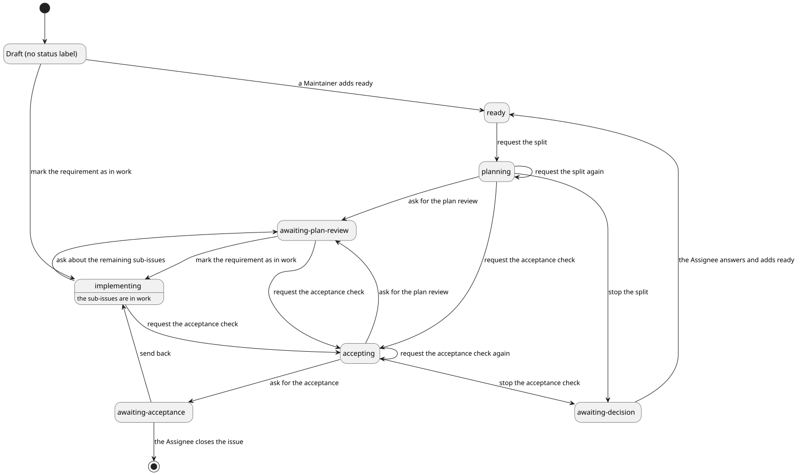
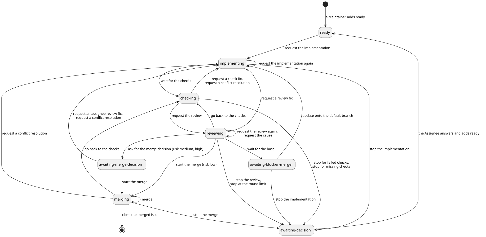

# 要求と要件

cumin-works の要求と要件の文書の入口。

## 全体

- [要求仕様書](overview.md): 解決したい課題、目的、指標、登場人物、範囲外、フェーズ
- [技術要素](technology.md): 使う技術と、選んだ理由
- [用語集](glossary.md): 語の意味と、使わない言い方
- [バックログ](backlog.md): 今のバージョンには入れないが、あとで取り入れたいこと
- [ソースコード全体構成](../architecture/overview.md): パッケージと、その役割と設計

## 全体像

要求Issueと実装Issueの状態がどう移るかを示す。状態の移り方は、各カテゴリの要件を合わせた結果であり、この図そのものは要件ではない。

図の元ファイル: [requirement-issue-states.puml](requirement-issue-states.puml)

図の元ファイル: [implementation-issue-states.puml](implementation-issue-states.puml)

図は旧版のものである。各カテゴリの要件を書いたあとで、今の語で描き直す。

## カテゴリごとの要件

IDの接頭辞は `CWK` である。カテゴリごとにディレクトリを分け、要件のページ (`index.md`) と図を置く。

<!-- カテゴリを足すときは、.cumin-trace.toml の areas に略号を足し、この表に1行を足す。 -->

| カテゴリ | ページ | 内容 |
|---|---|---|
| `LABEL` | [ラベル](label/index.md) | 状態、種類、リスクのラベルと、その決まり |
| `ACCESS` | [権限](access/index.md) | Maintainer、Assignee、Operator、cumin、Agent が、それぞれ何をしてよいか |
| `PLAN` | [計画](plan/index.md) | 計画の Agent起動、計画結果の確認、Planner の入力と出力 |
| `IMPL` | [実装](impl/index.md) | 実装の Agent起動、実装の完了判断、マージ判断を待つ Pull Request のブランチから始めること、Implementer の入力と出力 |
| `CHECK` | [チェック](check/index.md) | 必須チェックを待つこと、チェックの失敗の修正、衝突の解消、保護されたパスのチェック |
| `REVIEW` | [レビュー](review/index.md) | レビューの Agent起動、ラウンド、指摘の修正、Reviewer の入力と出力 |
| `MERGE` | [マージ](merge/index.md) | マージ判断、マージ判断に使うレビュー、マージ、実装Issueを閉じること、フォローアップノート |
| `ACCEPT` | [受け入れ](accept/index.md) | 受け入れ確認、残りの項目の仕分けと修正の sub-issue、受け入れ、差し戻し |
| `AGENT` | [Agent](agent/index.md) | Agent起動に共通のこと。結果の形式、指示の渡し方、権限、セッション、異常終了、ツール動作確認 |
| `LIMIT` | [利用制限](limit/index.md) | 5時間制限と週間制限、Agent起動を止めることと再開すること |
| `POLL` | [定期確認](poll/index.md) | 定期確認の間隔、着手の順番、GitHub の失敗、全部を読めない Issue、手元に持つ状態 |
| `HOST` | [Host での動かし方](host/index.md) | コマンド、launchd、止め方、設定、Keychain、モニターファイル |
| `NOTIFY` | [通知](notify/index.md) | いつ、何を知らせるか、待ち状態の通知 |

## 要件の外の文書

人が読む説明で、要件ではない。Agent が受け取るのは、`disciplines/` と `templates/` の英語の文である。

- [要求Issueの大きさの基準](../reference/requirement-sizing.md)
- [実装Issueの大きさの基準](../reference/issue-sizing.md)
- [GitHub に残す文章のテンプレート](../reference/writing-templates.md)
