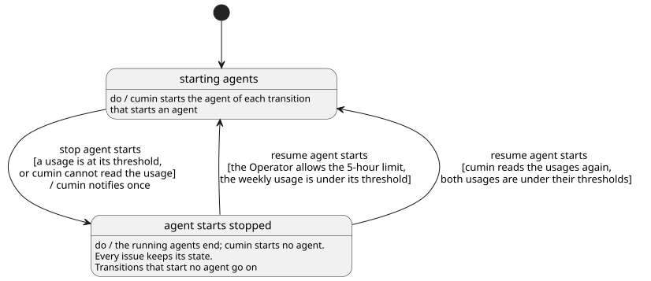

# 利用制限

Host上で動作するAgentの利用制限を、cuminがどう守るかを決める。

## 全体像

利用制限で変わるのは、Issueの状態ではなく、cuminがAgent起動を止めているかどうかである。cuminはこれを手元の状態に持ち、GitHubには書かない。cumin 1つにつき1つで、すべてのリポジトリに適用される。

図の元ファイル: [overview.puml](overview.puml)

Agent起動を止めている間も、Agentを起動しないアクション（ラベルの付け替え、コメント、通知、マージ、Issueを閉じること）は続ける。

## 要件

### 利用制限の確認

#### `CWK-LIMIT-001` Agent起動を止める判断

cuminは、次のどちらかのとき、利用制限によりAgent起動を止めると判断する。

- 5時間制限か週間制限の使用率がしきい値以上である
- 使用率を読めない

- 検証: `test` CLI mockでAgent起動判断を網羅的にテスト

---

#### `CWK-LIMIT-002` 使用率判断のために取得する情報

以下の情報を読んで、読んだ時刻とともに保存する。

- 5時間制限の使用率
- 5時間制限のリセット時刻
- 週間制限の使用率
- 週間制限のリセット時刻

- 検証: `demo` Claude Codeで要件の情報が取得できることを確認

---

#### `CWK-LIMIT-003` 使用率の情報更新タイミング

`quota.read_interval`（初期値は5分）で設定した時間内に使用率を取得しているときは、再度使用率を取得しない。

- 検証: `test` CLI mockでテスト

---

#### `CWK-LIMIT-004` 使用率がしきい値以上のときの情報更新タイミング

使用率がしきい値以上のとき、以下のタイミングまで再度使用率を取得しない。

- しきい値が時間で変動する場合は、使用率がしきい値を下回るとき
- 対象の利用制限がリセットされるとき

- 検証: `test` CLI mockでテスト

---

#### `CWK-LIMIT-005` 使用率によりAgent起動を止めたことを知らせる

cuminは、Agent起動を止めたときに、止めた原因を書いて通知する。
原因は5時間制限、週間制限、使用率を読めないことのどれかである。再開するまで、同じ原因について通知するのは1回だけである。再開したときは通知しない。

- 検証: `test` CLI mockでテスト

---

### しきい値

#### `CWK-LIMIT-006` 5時間制限のしきい値

5時間制限のしきい値は、`quota.five_hour.threshold`（初期値は85%）で決める。

- 検証: `test` しきい値の判定を単体テスト

---

#### `CWK-LIMIT-007` 週間制限のしきい値

週間制限のしきい値は、週の進み具合からcuminが算出する。
現時点のしきい値は目標 × min(1, (経過時間 + 前倒し) ÷ 7日)である。経過時間は週間制限のリセット時刻の7日前からの時間である。
目標は`quota.weekly.target`（初期値は85%）、前倒しは`quota.weekly.lead`（初期値は1日）で決める。しきい値は週の経過とともに上がり、目標を超えない。
リセット時刻は`CWK-LIMIT-002`で取得した情報を用いる。

- 検証: `test` しきい値の算出を単体テスト

---

#### `CWK-LIMIT-008` 5時間制限を使い切る許可

Operatorが`cumin quota allow`を実行すると、その5時間制限がリセットされるまで、5時間制限のしきい値を100%とする。
週間制限のしきい値は影響を受けない。週間制限は、使い切ったときに制限がかかる時間が長いため。

- 検証: `test` CLI mockでテスト

---

## 未決事項

なし
