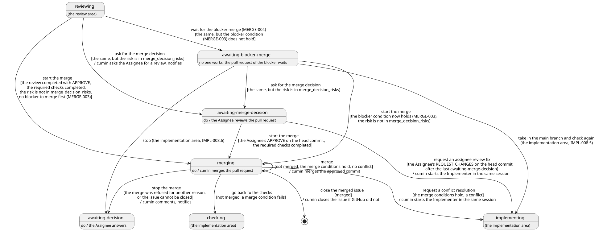

# マージ

Reviewerが承認したPull Requestをマージし、実装Issueを閉じるまでの流れを決める。マージ判断、マージ、実装Issueを閉じること、フォローアップノートを扱う。承認の前のレビューは[レビュー](../review/index.md)、`cumin/status/merging`の外での衝突の解消は[チェック](../check/index.md)、受け入れ確認は[受け入れ](../accept/index.md)で決める。

## 全体像

実装Issueがマージでたどる状態を示す。灰色の状態は、ほかのカテゴリで決める。

図の元ファイル: [overview.puml](overview.puml)

マージはAgentを起動しないので、利用制限でAgent起動を止めている間もマージする（[利用制限](../limit/index.md)）。

## 要件

### マージに進む

#### `CWK-MERGE-001` マージを始める

`cumin/status/reviewing`の実装Issueで、Reviewerが動いておらず、次のすべてが成り立つとき、cuminは状態を`cumin/status/merging`に替える。

- Reviewerの最新のレビューが、今の先頭のコミットへの`APPROVE`である
- 必須チェックが、今の先頭のコミットで完了している（[チェック](../check/index.md)の`CWK-CHECK-002`）
- リスクのラベルが`cumin/risk/low`である
- blocked byのIssueを待たなくてよい（`CWK-MERGE-022`）

- 検証: `test` GitHub mockでテスト

---

#### `CWK-MERGE-002` マージ判断を求める

`CWK-MERGE-001`の条件のうち、リスクのラベルだけが`cumin/risk/medium`か`cumin/risk/high`のとき、cuminは状態を`cumin/status/awaiting-merge-decision`に替え、Pull RequestでAssigneeにレビューを頼み、通知する。レビューを頼むのに失敗しても、ログに残すだけで、実装Issueは止めない。

- 検証: `test` GitHub mockでテスト

---

### マージ判断

cuminがマージ判断に使うのは、実装Issueの今のAssigneeのレビューのうち、`COMMENT`を除いた最新のものだけである（[権限](../access/index.md)の`CWK-ACCESS-012`）。古いコミットへのレビューは使わない。

#### `CWK-MERGE-003` Assigneeの承認でマージを始める

`cumin/status/awaiting-merge-decision`の実装Issueで、Assigneeの最新のレビューが今の先頭のコミットへの`APPROVE`で、必須チェックが完了していて、blocked byのIssueを待たなくてよい（`CWK-MERGE-022`）とき、cuminは状態を`cumin/status/merging`に替える。

- 検証: `test` GitHub mockでテスト

---

#### `CWK-MERGE-004` Assigneeの指摘を修正する

`cumin/status/awaiting-merge-decision`の実装Issueで、Assigneeの最新のレビューが今の先頭のコミットへの`REQUEST_CHANGES`で、実装Issueが最後に`cumin/status/awaiting-merge-decision`になったあとに出たものであるとき、cuminは状態を`cumin/status/implementing`に替えて、Implementerの直前のセッションで修正を頼む。

- 修正のあとは、必須チェックとレビューを経て、もう一度`CWK-MERGE-002`に進む
- この修正は、レビューのラウンドにもチェックの修正の回数にも含めない。`REQUEST_CHANGES`を出すのは毎回Assigneeなので、往復が止まらなくなることはない。
- 1つの`REQUEST_CHANGES`で頼むのは1回だけである。Implementerがコミットせずに答えたときは、Assigneeがもう一度判断する。

- 検証: `test` GitHub mockとCLI mockでテスト

---

#### `CWK-MERGE-005` 判定の順番

`cumin/status/awaiting-merge-decision`の実装Issueでは、`CWK-MERGE-003`、`CWK-MERGE-004`、衝突の解消（[チェック](../check/index.md)の`CWK-CHECK-007`）の順に判定し、最初に成り立ったものだけを行う。衝突していても、Assigneeの判断を先に進める。

- 検証: `test` GitHub mockでテスト

---

### マージ

#### `CWK-MERGE-006` マージの条件

cuminは、`cumin/status/merging`の実装IssueのPull Requestを、次のすべてが成り立つときだけマージする。マージを送るたびに確かめ直す。

- 必須チェックが、今の先頭のコミットで完了している
- リスクのラベルが1つだけ付いている
- Reviewerの最新のレビューが、今の先頭のコミットへの`APPROVE`である
- リスクが`cumin/risk/medium`か`cumin/risk/high`なら、Assigneeの最新のレビューも、今の先頭のコミットへの`APPROVE`である
- Pull Requestのbaseがmainブランチで、blocked byのIssueがすべて閉じている（`CWK-MERGE-022`）

- 検証: `test` GitHub mockでテスト

---

#### `CWK-MERGE-007` マージを送る

`cumin/status/merging`の実装Issueで、Pull Requestがマージされておらず、マージの条件が成り立ち、衝突していないとき、cuminはマージを送る。

- マージの方法は、設定`merge_method`（初期値はsquash）に従う
- 承認されたコミットだけをマージする。承認のあとにpushされたコミットは、マージしない。
- 答えが届かなかったときは、次の定期確認で、マージ済みかを読んでから決める。同じマージを2回送らない。
- 1回の定期確認で2つ以上マージするときは、1つごとに数秒待つ

- 検証: `test` GitHub mockでテスト

---

#### `CWK-MERGE-008` チェックに戻る

`cumin/status/merging`の実装Issueで、Pull Requestがマージされておらず、マージの条件が成り立たないとき、cuminは状態を`cumin/status/checking`に替える。

- 検証: `test` GitHub mockでテスト

---

#### `CWK-MERGE-009` マージの前の衝突を解消する

`cumin/status/merging`の実装Issueで、マージの条件が成り立ち、GitHubが衝突していると返したとき、または衝突でマージを断ったとき、cuminはマージを送らずに、状態を`cumin/status/implementing`に替えて、Implementerの直前のセッションで衝突の解消を頼む。チェックの修正の回数には含めない。

- 検証: `test` GitHub mockとCLI mockでテスト

---

#### `CWK-MERGE-010` mainブランチが変わってマージを断られたとき

GitHubが、mainブランチが変わったことを理由にマージを断ったとき（405、`Base branch was modified`）、cuminは`cumin/status/merging`のまま、次の定期確認でもう一度マージを送る。ほかのマージの直後に起きる、すぐに直る断り方だからである。

- 検証: `test` GitHub mockでテスト

---

#### `CWK-MERGE-011` マージを止める

`cumin/status/merging`の実装Issueで、次のどちらかが起きたとき、cuminは状態を`cumin/status/awaiting-decision`に替え、理由をコメントに書いて、通知する。

- GitHubが、衝突でもmainブランチの変更でもない理由で、マージを断った
- マージのあとで、実装Issueを閉じられない

- 検証: `test` GitHub mockでテスト

---

### blocked byのIssueを待つ

[実装](../impl/index.md)の`CWK-IMPL-015`で始めた実装IssueのPull Requestは、baseがblocked byのIssueのブランチである。blocked byのIssueのPull Requestがマージされると、GitHubはそのブランチを消し、このPull Requestのbaseをmainブランチに替える。

#### `CWK-MERGE-022` blocked byのIssueより先にマージしない

「blocked byのIssueを待たなくてよい」とは、次のすべてが成り立つことである。

- Pull Requestのbaseがmainブランチである
- blocked byのIssueがすべて閉じている
- 先頭のコミットが、blocked byのIssueを閉じたPull Requestのマージのコミットを含む

cuminは、これが成り立つときだけマージに進む。`cumin/risk/low`でも同じである。`cumin/status/merging`の中では、初めの2つを確かめる（`CWK-MERGE-006`）。

- 検証: `test` GitHub mockでテスト

---

#### `CWK-MERGE-020` blocked byのIssueを待つ

`cumin/status/reviewing`の実装Issueで、`CWK-MERGE-001`か`CWK-MERGE-002`の条件のうちblocked byのIssueを待たなくてよいことのほかが成り立ち、baseがmainブランチでないか、開いているblocked byのIssueがあるとき、cuminは状態を`cumin/status/awaiting-blocker-merge`に替える。この状態では、誰も作業しない。

- 検証: `test` GitHub mockとCLI mockでテスト

---

#### `CWK-MERGE-021` mainブランチを取り込む

実装Issueが次のすべてを満たすとき、cuminは状態を`cumin/status/implementing`に替えて、Implementerの直前のセッションで、mainブランチを取り込むよう頼む。

- `cumin/status/awaiting-blocker-merge`か、`CWK-MERGE-020`と同じ条件の`cumin/status/reviewing`である
- baseがmainブランチで、blocked byのIssueがすべて閉じている
- 先頭のコミットが、blocked byのIssueを閉じたPull Requestのマージのコミットを含まない

Implementerは強制pushをしないので、mainブランチをマージするコミットで取り込む。取り込んだあとは、必須チェックとレビューを経る。続きの作業なので、同時に進めるIssueの数に余裕ができるのを待たない。

- 検証: `test` GitHub mockとCLI mockでテスト

---

#### `CWK-MERGE-023` blocked byのIssueを待つ実装を止める

`CWK-IMPL-015`で始めた実装Issueで、Agentが動いておらず、次のどれかが成り立つとき、cuminは状態を`cumin/status/awaiting-decision`に替え、理由をコメントに書いて、通知する。

- blocked byのIssueのPull Requestが、マージされずに閉じた
- この実装IssueのPull Requestが、マージされずに閉じた
- `cumin/status/awaiting-blocker-merge`で、blocked byのIssueのPull Requestがマージされてから定期確認の間隔を過ぎても、baseがmainブランチにならない
- mainブランチの取り込みを頼んだあとも、先頭のコミットがマージのコミットを含まない

却下されたblocked byのIssueのコミットはブランチに残るので、Assigneeは、それを除くかPull Requestを閉じてから、`cumin/status/ready`を付ける。

- 検証: `test` GitHub mockとCLI mockでテスト

---

### 実装Issueを閉じる

#### `CWK-MERGE-012` マージした実装Issueを閉じる

`cumin/status/merging`の実装Issueで、Pull Requestがマージ済みになったとき、GitHubが実装Issueを閉じていなければ、cuminが閉じる。cuminが実装Issueを閉じるのは、このときだけである。そのため、Maintainerが開き直した実装Issueは開いたままになる。

- 検証: `test` GitHub mockでテスト

---

#### `CWK-MERGE-013` 人がマージしたとき

mainブランチのrulesetを迂回できるMaintainerは、Pull Requestを自分でマージしてもよい。そのあとは、cuminがマージしたときと同じに扱う。GitHubが実装Issueを閉じなければ、そのMaintainerが閉じる。

- 検証: `test` GitHub mockでテスト

---

### フォローアップノート

マージでPull Requestに埋もれる残りの作業を、cuminが要求Issueに書き写す。受け入れ確認で、Plannerがそれを扱う（[受け入れ](../accept/index.md)）。

#### `CWK-MERGE-014` フォローアップノートを書く

実装Issueが閉じ、それを閉じるPull Requestがマージ済みで、そのPull Requestのフォローアップノートがまだないとき、cuminは要求Issueにフォローアップノートを1つ書く。誰が閉じたかは問わない。状態は替えない。形式は[follow-up-note.md](../../../../templates/follow-up-note.md)に従う。

- 検証: `test` GitHub mockでテスト

---

#### `CWK-MERGE-015` フォローアップノートに書くもの

cuminは、次のものを決まった形式から機械的に拾う。何もなければ書かない。

- Pull Requestの説明の`Follow-up`の文章。そのまま写す
- Reviewerの提案のうち、Implementerの返答が`Fixed`でないもの（[レビュー](../review/index.md)の`CWK-REVIEW-021`）
- 元からある問題（[レビュー](../review/index.md)の`CWK-REVIEW-013`）

- 検証: `test` GitHub mockでテスト

---

#### `CWK-MERGE-016` 1つのPull Requestに1つ

フォローアップノートは、1つのPull Requestに1つだけ書く。あるかどうかは、コメントの目印でGitHubから読む。

- 検証: `test` GitHub mockでテスト

---

#### `CWK-MERGE-017` 開いている要求Issueだけに書く

閉じた要求Issueには、フォローアップノートを書かない。

- 検証: `test` GitHub mockでテスト

---

#### `CWK-MERGE-018` 受け入れ確認の前にそろえる

sub-issueがすべて閉じたとき、cuminは、フォローアップノートを書き終えてから受け入れ確認を頼む（[受け入れ](../accept/index.md)）。

- 検証: `test` GitHub mockとCLI mockでテスト

---

#### `CWK-MERGE-019` Issueにしない

cuminは、フォローアップノートからIssueを作らない。

- 検証: `test` GitHub mockでテスト

---

## 未決事項

なし
