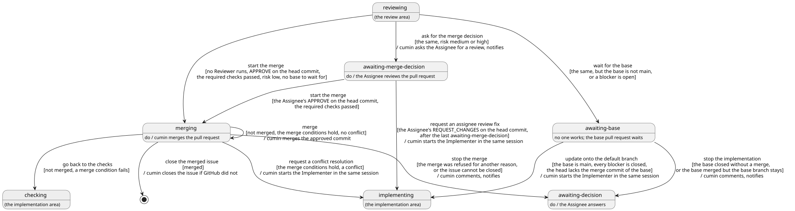

# マージ

Reviewer が承認した Pull Request をマージし、実装Issueを閉じるまでの流れを決める。マージ判断、マージ、実装Issueを閉じること、フォローアップノートを扱う。承認の前のレビューは [レビュー](../review/index.md)、`cumin/status/merging` の外での衝突の解消は [チェック](../check/index.md)、受け入れ確認は [受け入れ](../accept/index.md) で決める。

## 全体像

実装Issueがマージでたどる状態を示す。灰色の状態は、ほかのカテゴリで決める。

図の元ファイル: [overview.puml](overview.puml)

「Reviewer が動いていない」の意味は、[Agent](../agent/index.md) の `CWK-AGENT-001` で決める。

マージは Agent を起動しないので、利用制限で Agent起動を止めている間もマージする ([利用制限](../limit/index.md))。

## 要件

### マージに進む

#### `CWK-MERGE-001` マージを始める

`cumin/status/reviewing` の実装Issueで、Reviewer が動いておらず、次のすべてが成り立つとき、cumin は状態を `cumin/status/merging` に替える。

- Reviewer の最新のレビューが、今の先頭のコミットへの `APPROVE` である
- 必須チェックが、今の先頭のコミットで完了している ([チェック](../check/index.md) の `CWK-CHECK-002`)
- リスクのラベルが `cumin/risk/low` である
- blocked by の Issue を待たなくてよい (`CWK-MERGE-022`)

- 検証: `test` 4つが成り立つと、実装Issueが `cumin/status/merging` になる

---

#### `CWK-MERGE-002` マージ判断を求める

`CWK-MERGE-001` の条件のうち、リスクのラベルだけが `cumin/risk/medium` か `cumin/risk/high` のとき、cumin は状態を `cumin/status/awaiting-merge-decision` に替え、Pull Request で Assignee にレビューを頼み、通知する。レビューを頼むのに失敗しても、ログに残すだけで、実装Issueは止めない。

- 検証: `test` `cumin/risk/medium` の実装Issueで Reviewer が承認すると、`cumin/status/awaiting-merge-decision` になり、レビューの依頼と通知が1回ずつ起きる
- 検証: `test` レビューの依頼が失敗しても、`cumin/status/awaiting-decision` にならない

---

### マージ判断

cumin が数えるのは、実装Issueの今の Assignee のレビューのうち、`COMMENT` を除いた最新のものだけである ([権限](../access/index.md) の `CWK-ACCESS-002`)。古いコミットへのレビューは数えない。

#### `CWK-MERGE-003` Assignee の承認でマージを始める

`cumin/status/awaiting-merge-decision` の実装Issueで、Assignee の最新のレビューが今の先頭のコミットへの `APPROVE` で、必須チェックが完了していて、blocked by の Issue を待たなくてよい (`CWK-MERGE-022`) とき、cumin は状態を `cumin/status/merging` に替える。

- 検証: `test` Assignee が今の先頭のコミットを承認すると、`cumin/status/merging` になる
- 検証: `test` 古いコミットへの承認、ほかの Maintainer の承認、bot の承認、あとの `REQUEST_CHANGES` で覆された承認では、`cumin/status/merging` にならない

---

#### `CWK-MERGE-004` Assignee の指摘を修正する

`cumin/status/awaiting-merge-decision` の実装Issueで、Assignee の最新のレビューが今の先頭のコミットへの `REQUEST_CHANGES` で、実装Issueが最後に `cumin/status/awaiting-merge-decision` になったあとに出たものであるとき、cumin は状態を `cumin/status/implementing` に替えて、Implementer の直前のセッションで修正を頼む。

- 修正のあとは、必須チェックとレビューを経て、もう一度 `CWK-MERGE-002` に進む。
- この修正は、レビューのラウンドにもチェックの修正の回数にも数えない。`REQUEST_CHANGES` を出すのは毎回 Assignee なので、往復が止まらなくなることはない。
- 1つの `REQUEST_CHANGES` で頼むのは1回だけである。Implementer がコミットせずに答えたときは、Assignee がもう一度判断する。

- 検証: `test` `REQUEST_CHANGES` を出すと、`cumin/status/implementing` になり、直前のセッションで Agent起動が1回起きる。ラウンドとチェックの修正の回数は変わらない
- 検証: `test` Implementer がコミットせずに答えたあと、同じ `REQUEST_CHANGES` で2回目の修正は頼まない

---

#### `CWK-MERGE-005` 判定の順番

`cumin/status/awaiting-merge-decision` の実装Issueでは、`CWK-MERGE-003`、`CWK-MERGE-004`、衝突の解消 ([チェック](../check/index.md) の `CWK-CHECK-007`) の順に判定し、最初に成り立ったものだけを行う。衝突していても、Assignee の判断を先に進める。

- 検証: `test` 衝突していて、Assignee が承認した実装Issueは、`cumin/status/merging` になる

---

### マージ

#### `CWK-MERGE-006` マージの条件

cumin は、`cumin/status/merging` の実装Issueの Pull Request を、次のすべてが成り立つときだけマージする。マージを送るたびに確かめ直す。

- 必須チェックが、今の先頭のコミットで完了している
- リスクのラベルが1つだけ付いている
- Reviewer の最新のレビューが、今の先頭のコミットへの `APPROVE` である
- リスクが `cumin/risk/medium` か `cumin/risk/high` なら、Assignee の最新のレビューも、今の先頭のコミットへの `APPROVE` である
- Pull Request の base が main ブランチで、blocked by の Issue がすべて閉じている (`CWK-MERGE-022`)

- 検証: `test` `cumin/status/merging` を手で付けた、Assignee の承認のない `cumin/risk/medium` の実装Issueは、マージしない

---

#### `CWK-MERGE-007` マージを送る

`cumin/status/merging` の実装Issueで、Pull Request がマージされておらず、マージの条件が成り立ち、衝突していないとき、cumin はマージを送る。

- マージの方法は、Host の設定 `merge_method` (初期値は squash) に従う。
- 承認されたコミットだけをマージする。承認のあとに push されたコミットは、マージしない。
- 答えが届かなかったときは、次の定期確認で、マージ済みかを読んでから決める。同じマージを2回送らない。
- 1回の定期確認で2つ以上マージするときは、1つごとに数秒待つ。

- 検証: `test` 答えが届かなかったマージで、次の定期確認がマージ済みと読むと、送り直さずに実装Issueを閉じる
- 検証: `test` 承認のあとに push されたコミットは、マージされない

---

#### `CWK-MERGE-008` チェックに戻る

`cumin/status/merging` の実装Issueで、Pull Request がマージされておらず、マージの条件が成り立たないとき、cumin は状態を `cumin/status/checking` に替える。

- 検証: `test` `cumin/status/merging` のあとで先頭のコミットが変わると、マージせずに `cumin/status/checking` になる

---

#### `CWK-MERGE-009` マージの前の衝突を解消する

`cumin/status/merging` の実装Issueで、マージの条件が成り立ち、GitHub が衝突していると返したとき、または衝突でマージを断ったとき、cumin はマージを送らずに、状態を `cumin/status/implementing` に替えて、Implementer の直前のセッションで衝突の解消を頼む。チェックの修正の回数には数えない。

- 検証: `test` 承認のあとに衝突した Pull Request では、マージを送らずに、衝突の解消を1回だけ頼む

---

#### `CWK-MERGE-010` main ブランチが変わってマージを断られたとき

GitHub が、main ブランチが変わったことを理由にマージを断ったとき (405、`Base branch was modified`)、cumin は `cumin/status/merging` のまま、次の定期確認でもう一度マージを送る。ほかのマージの直後に起きる、すぐに直る断り方だからである。

- 検証: `test` 405 で断られた実装Issueは、次の定期確認でマージされる

---

#### `CWK-MERGE-011` マージを止める

`cumin/status/merging` の実装Issueで、次のどちらかが起きたとき、cumin は状態を `cumin/status/awaiting-decision` に替え、理由をコメントに書いて、通知する。

- GitHub が、衝突でも main ブランチの変更でもない理由で、マージを断った
- マージのあとで、実装Issueを閉じられない

- 検証: `test` ほかの理由でマージを断られると、理由のコメントが付いて `cumin/status/awaiting-decision` になり、通知が1回届く

---

### blocked by の Issue を待つ

[実装](../impl/index.md) の `CWK-IMPL-015` で始めた実装Issueの Pull Request は、base が blocked by の Issue のブランチである。blocked by の Issue の Pull Request がマージされると、GitHub はそのブランチを消し、この Pull Request の base を main ブランチに替える。

#### `CWK-MERGE-022` blocked by の Issue より先にマージしない

「blocked by の Issue を待たなくてよい」とは、次のすべてが成り立つことである。

- Pull Request の base が main ブランチである
- blocked by の Issue がすべて閉じている
- 先頭のコミットが、blocked by の Issue を閉じた Pull Request のマージのコミットを含む

cumin は、これが成り立つときだけマージに進む。`cumin/risk/low` でも同じである。`cumin/status/merging` の中では、初めの2つを確かめる (`CWK-MERGE-006`)。

- 検証: `test` base が blocked by の Issue のブランチの `cumin/risk/low` の Pull Request は、Reviewer が承認してもマージされない
- 検証: `test` Maintainer が手で base を main ブランチに替えても、blocked by の Issue が開いている間はマージされない

---

#### `CWK-MERGE-020` blocked by の Issue を待つ

`cumin/status/reviewing` の実装Issueで、`CWK-MERGE-001` か `CWK-MERGE-002` の条件のうち blocked by の Issue を待たなくてよいことのほかが成り立ち、base が main ブランチでないか、開いている blocked by の Issue があるとき、cumin は状態を `cumin/status/awaiting-base` に替える。この状態では、誰も作業しない。

- 検証: `test` base が main ブランチでない Pull Request を Reviewer が承認すると、`cumin/status/awaiting-base` になり、Agent起動もマージも起きない

---

#### `CWK-MERGE-021` main ブランチを取り込む

実装Issueが次のすべてを満たすとき、cumin は状態を `cumin/status/implementing` に替えて、Implementer の直前のセッションで、main ブランチを取り込むよう頼む。

- `cumin/status/awaiting-base` か、`CWK-MERGE-020` と同じ条件の `cumin/status/reviewing` である
- base が main ブランチで、blocked by の Issue がすべて閉じている
- 先頭のコミットが、blocked by の Issue を閉じた Pull Request のマージのコミットを含まない

Implementer は強制 push をしないので、main ブランチをマージするコミットで取り込む。取り込んだあとは、必須チェックとレビューを経る。続きの作業なので、空きは待たない。

- 検証: `test` blocked by の Issue の Pull Request がマージされると、直前のセッションで Agent起動が1回起きる。空きがなくても起きる
- 検証: `test` マージのコミットをすでに含むブランチでは、取り込みを頼まずにマージに進む

---

#### `CWK-MERGE-023` blocked by の Issue を待つ実装を止める

`CWK-IMPL-015` で始めた実装Issueで、Agent が動いておらず、次のどれかが成り立つとき、cumin は状態を `cumin/status/awaiting-decision` に替え、理由をコメントに書いて、通知する。

- blocked by の Issue の Pull Request が、マージされずに閉じた
- この実装Issueの Pull Request が、マージされずに閉じた
- `cumin/status/awaiting-base` で、blocked by の Issue の Pull Request がマージされてから定期確認の間隔を過ぎても、base が main ブランチにならない
- main ブランチの取り込みを頼んだあとも、先頭のコミットがマージのコミットを含まない

却下された blocked by の Issue のコミットはブランチに残るので、Assignee は、それを除くか Pull Request を閉じてから、`cumin/status/ready` を付ける。

- 検証: `test` blocked by の Issue の Pull Request がマージされずに閉じると、`cumin/status/awaiting-decision` になり、通知が1回届く
- 検証: `test` 取り込みのあとも先頭のコミットがマージのコミットを含まないと、取り込みを繰り返さずに止まる

---

### 実装Issueを閉じる

#### `CWK-MERGE-012` マージした実装Issueを閉じる

`cumin/status/merging` の実装Issueで、Pull Request がマージ済みになったとき、GitHub が実装Issueを閉じていなければ、cumin が閉じる。cumin が実装Issueを閉じるのは、このときだけである。そのため、Maintainer が開き直した実装Issueは開いたままになる。

- 検証: `test` GitHub が閉じなかった実装Issueを cumin が1回だけ閉じ、Maintainer が開き直しても、もう閉じない

---

#### `CWK-MERGE-013` 人がマージしたとき

main ブランチの ruleset を迂回できる Maintainer は、Pull Request を自分でマージしてもよい。そのあとは、cumin がマージしたときと同じに扱う。GitHub が実装Issueを閉じなければ、その Maintainer が閉じる。

- 検証: `test` Maintainer がマージして実装Issueを閉じると、cumin がマージしたときと同じフォローアップノートが付く

---

### フォローアップノート

マージで Pull Request に埋もれる残りの作業を、cumin が要求Issueに書き写す。受け入れ確認で、Planner がそれを扱う ([受け入れ](../accept/index.md))。

#### `CWK-MERGE-014` フォローアップノートを書く

実装Issueが閉じ、それを閉じる Pull Request がマージ済みで、その Pull Request のフォローアップノートがまだないとき、cumin は要求Issueにフォローアップノートを1つ書く。誰が閉じたかは問わない。状態は替えない。形式は [follow-up-note.md](../../../../templates/follow-up-note.md) に従う。

- 検証: `test` `Follow-up` に文章のある Pull Request がマージされると、要求Issueにフォローアップノートが1つ付く

---

#### `CWK-MERGE-015` フォローアップノートに書くもの

cumin は、次のものを決まった形式から機械的に拾う。何もなければ書かない。

- Pull Request の説明の `Follow-up` の文章。そのまま写す
- Reviewer の提案のうち、Implementer の返答が `Fixed` でないもの ([レビュー](../review/index.md) の `CWK-REVIEW-021`)
- 元からある問題 ([レビュー](../review/index.md) の `CWK-REVIEW-013`)

- 検証: `test` `Follow-up` が None で、提案がすべて `Fixed` で、元からある問題がないと、フォローアップノートは付かない
- 検証: `test` `Deferred` の提案と元からある問題が1つずつあると、その2つが載る

---

#### `CWK-MERGE-016` 1つの Pull Request に1つ

フォローアップノートは、1つの Pull Request に1つだけ書く。あるかどうかは、コメントの目印で GitHub から読む。

- 検証: `test` cumin を再起動しても、同じフォローアップノートは増えない

---

#### `CWK-MERGE-017` 開いている要求Issueだけに書く

閉じた要求Issueには、フォローアップノートを書かない。

- 検証: `test` 閉じた要求Issueの sub-issue の Pull Request がマージされても、書かない

---

#### `CWK-MERGE-018` 受け入れ確認の前にそろえる

sub-issue がすべて閉じたとき、cumin は、フォローアップノートを書き終えてから受け入れ確認を頼む ([受け入れ](../accept/index.md))。

- 検証: `test` 最後の sub-issue がマージされた定期確認で、フォローアップノートより先に受け入れ確認の Agent起動が起きない

---

#### `CWK-MERGE-019` Issue にしない

cumin は、フォローアップノートから Issue を作らない。

- 検証: `test` フォローアップノートを書いても、Issue の数が増えない

---

## 受け入れテスト

| # | 場面 | 期待する結果 |
|---|---|---|
| 1 | `cumin/risk/low` の Pull Request を Reviewer が承認する | マージに進み (`CWK-MERGE-001`)、承認されたコミットがマージされ (`CWK-MERGE-007`)、実装Issueが閉じ (`CWK-MERGE-012`)、残りの作業があればフォローアップノートが付く (`CWK-MERGE-014`) |
| 2 | `cumin/risk/medium` の Pull Request を、Reviewer と Assignee が承認する | マージ判断を求める通知が届き (`CWK-MERGE-002`)、Assignee の承認でマージされる (`CWK-MERGE-003`) |
| 3 | Assignee が `REQUEST_CHANGES` を出し、Implementer が直す | 直前のセッションで修正を頼み (`CWK-MERGE-004`)、必須チェックとレビューを経て、もう一度マージ判断を待つ。ラウンドとチェックの修正の回数は増えない |
| 4 | 承認のあと、ほかのマージで衝突する | マージを送らずに衝突の解消を頼み (`CWK-MERGE-009`)、必須チェックとレビューを経て、もう一度マージに進む |
| 5 | 同じ定期確認で2つマージし、2つめが 405 で断られる | 1つめのあと数秒待ち (`CWK-MERGE-007`)、2つめは次の定期確認でマージされる (`CWK-MERGE-010`) |
| 6 | 最後の sub-issue の Pull Request がマージされる | フォローアップノートが付いてから、受け入れ確認を頼む (`CWK-MERGE-018`) |
| 7 | base が main ブランチでない Pull Request を Reviewer が承認し、そのあと blocked by の Issue の Pull Request が squash でマージされる | `cumin/status/awaiting-base` で待ち (`CWK-MERGE-020`)、main ブランチを取り込んで (`CWK-MERGE-021`)、必須チェックとレビューを経てマージに進む。blocked by の Issue より先にはマージしない (`CWK-MERGE-022`) |
| 8 | blocked by の Issue の Pull Request が、マージされずに閉じる | そのブランチから始めた実装Issueが止まり、通知が届く (`CWK-MERGE-023`) |

## 未決事項

- マージの間に待つ秒数 (今のコードでは5秒) を設定にするかは、HOST の設定を書くときに決める。
