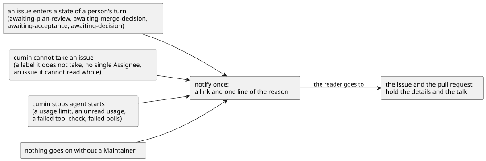

# 通知

cumin が、いつ、何を通知するかを決める。通知は「見に来てほしい」と伝えるだけで、やりとりは Issue と Pull Request で行う。通知先は Host の設定で決まり、誰が読むかはその設定による。そのため、文書には相手の名前を書かない。

## 全体像

通知するのは、人の判断が要るとき、異常な状態のとき、利用制限の上限に達したとき、次に処理する Issue がないときの4つである。どれも、同じ原因について1回だけ知らせる。

図の元ファイル: [overview.puml](overview.puml)

## 要件

### 通知するとき

#### `CWK-NOTIFY-001` 人の判断が要るとき

cumin は、Issue を次の状態に替えたときに、通知する。

| 状態 | 要件 |
|---|---|
| `awaiting-plan-review` | `CWK-PLAN-005`、`CWK-PLAN-009`、`CWK-ACCEPT-004` |
| `awaiting-merge-decision` | `CWK-MERGE-002` |
| `awaiting-acceptance` | `CWK-ACCEPT-003` |
| `awaiting-decision` | `CWK-PLAN-007`、`CWK-IMPL-008`、`CWK-CHECK-005`、`CWK-CHECK-006`、`CWK-REVIEW-007`、`CWK-REVIEW-010`、`CWK-MERGE-011`、`CWK-MERGE-023`、`CWK-ACCEPT-006`、`CWK-AGENT-013` |

`awaiting-blocker-merge` は、通知しない。待っているのは blocked by の Issue の Pull Request のマージ判断で、そちらの通知がすでに届いているからである。

- 検証: `test` 各要件の場面で、状態が替わったときに通知が1回届く。`awaiting-blocker-merge` に替わったときは届かない

---

#### `CWK-NOTIFY-002` 異常な状態のとき

cumin は、次の異常な状態のときに、通知する。

| 場面 | 要件 |
|---|---|
| 扱わない状態ラベルが付いた | `CWK-ACCESS-005` |
| assignee が1人の Maintainer でない | `CWK-ACCESS-007` |
| 要求Issueに Assignee がいない | `CWK-PLAN-008` |
| 全部を読めない Issue がある | `CWK-POLL-012` |
| 使用率を読めない | `CWK-LIMIT-003` |
| ツール動作確認が失敗した | `CWK-AGENT-018.3` |
| 定期確認が続けて失敗した | `CWK-POLL-010` |

- 検証: `test` 各要件の場面で、通知が1回届き、同じ原因のまま定期確認を3回行っても増えない

---

#### `CWK-NOTIFY-003` 利用制限の上限に達したとき

cumin は、利用制限の上限に達して Agent起動を止めたときに、通知する (`CWK-LIMIT-008`)。再開したときは通知しない。

- 検証: `test` 利用制限で止めたときに通知が1回届き、再開したときには届かない

---

#### `CWK-NOTIFY-004` 次に処理する Issue がないとき

Maintainer が動かなければ何も進まなくなったとき、cumin は、待っていることを1回だけ通知する。次のすべてが成り立つときである。

- 動いている Agent がない
- 人なしで進む Issue がない (下の表)
- 利用制限かツール動作確認だけで待っている Issue がない。止めた原因は `CWK-NOTIFY-002` か `CWK-NOTIFY-003` で知らせているからである
- 前に待っていることを知らせたあとに、cumin が何かアクションをした

| Issue | 人なしで進むか |
|---|---|
| `ready` で、着手できるが、空きを待っている | 進む |
| `ready` で、blocked by の Issue が開いている | 進まない |
| 実装Issueで、`implementing`、`checking`、`reviewing`、`merging`。要求Issueで、`planning`、`accepting` | 進む。Agent が動いていなくても、次の定期確認で cumin が決める |
| `implementing` の要求Issue | sub-issue のどれかが進むときだけ進む |
| `awaiting-plan-review` で、sub-issue がすべて閉じている | 進む。cumin が受け入れ確認を始める |
| そのほかの `awaiting-` で始まる状態 | 進まない |
| `cumin/type/owner-task` の Issue、状態ラベルのない Issue | 進まない |

- 検証: `test` 進められる Issue がなくなり、動いている Agent もないとき、通知が1回届く。cumin が何かアクションをするまで、同じ通知は繰り返さない
- 検証: `test` 必須チェックを待つ実装Issueだけがあるときは、通知しない
- 検証: `test` `awaiting-blocker-merge` の実装Issueと、その blocked by の Issue の `awaiting-merge-decision` の実装Issueだけがあるとき、通知が1回届く
- 検証: `test` `implementing` の要求Issueの sub-issue が、すべて `awaiting-decision` のとき、通知が1回届く

---

### 通知の中身と送り方

#### `CWK-NOTIFY-005` 通知の中身

通知には、対象の Issue か Pull Request へのリンクと、理由の1行を入れる。詳しい理由は、Issue のコメントにある。Agent が書いた文が入っても、通知先で全員への呼び出し (`@everyone` など) が起きないようにする。

- 検証: `test` 通知に対象へのリンクがある
- 検証: `test` `blocked_reason` に `@everyone` を含む通知で、全員への呼び出しが起きない

---

#### `CWK-NOTIFY-006` 通知を送らない設定

`notify.discord.enabled` が `false` のとき、cumin は通知だけを送らず、ラベルの付け替えとコメントはふだんどおり行う。リポジトリの設定で決めると、そのリポジトリについての通知に効く。通知先は Host の1つだけで、リポジトリからは変えられない。

- 検証: `test` リポジトリの設定で `false` にすると、そのリポジトリの Issue の通知だけが送られず、状態ラベルはふだんどおり替わる

---

#### `CWK-NOTIFY-007` 通知の失敗

通知が失敗しても、cumin はログに残すだけで、コメントもラベルも元に戻さない。アクションを決めるのは GitHub の事実で、通知ではないからである。

- 検証: `test` 通知先が失敗を返しても、状態ラベルは替わったままで、エラーのログが残る

---

#### `CWK-NOTIFY-008` 通知の手段

通知の手段は、今は Discord の webhook だけである。手段ごとの違いは、cumin の中の1か所に閉じ込め、手段を替えても、通知を決める側は変えない。

- 検証: `inspection` Discord の API の型と URL が、通知の手段のパッケージの外にない

---

## 受け入れテスト

| # | 場面 | 期待する結果 |
|---|---|---|
| 1 | 計画が完了し、要求Issueが `awaiting-plan-review` になる | 要求Issueへのリンクのある通知が1回届く (`CWK-NOTIFY-001`、`CWK-NOTIFY-005`) |
| 2 | 利用制限で Agent起動が止まり、そのあと再開する | 止めたときだけ通知が1回届く (`CWK-NOTIFY-003`) |
| 3 | `awaiting-` で始まる状態の Issue だけが残り、動いている Agent もない | 待っていることの通知が1回届き、cumin がアクションをするまで繰り返さない (`CWK-NOTIFY-004`) |
| 4 | 通知先が使えない間に、Issue が `awaiting-decision` になる | 状態ラベルとコメントはふだんどおりで、通知の失敗がログに残る (`CWK-NOTIFY-007`) |

## 未決事項

なし
