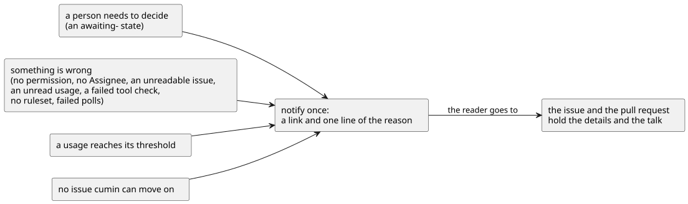

# 通知

cuminが、いつ、何を通知するかを決める。通知は「見に来てほしい」と伝えるだけで、やりとりはIssueとPull Requestで行う。通知先はHostの設定で決まり、誰が読むかはその設定による。そのため、文書には相手の名前を書かない。

## 全体像

通知するのは、人の判断が要るとき、異常な状態のとき、利用制限の上限に達したとき、次に処理するIssueがないときの4つである。どれも、同じ原因について1回だけ知らせる。

図の元ファイル: [overview.puml](overview.puml)

## 要件

### 通知するとき

#### `CWK-NOTIFY-001` 人の判断が要るとき

cuminは、Issueを次の状態に替えたときに、通知する。

| 状態 | 要件 |
|---|---|
| `awaiting-plan-review` | `CWK-PLAN-004`、`CWK-PLAN-008`、`CWK-ACCEPT-004` |
| `awaiting-merge-decision` | `CWK-MERGE-002` |
| `awaiting-acceptance` | `CWK-ACCEPT-003` |
| `awaiting-decision` | `CWK-PLAN-006`、`CWK-IMPL-007`、`CWK-CHECK-005`、`CWK-CHECK-006`、`CWK-REVIEW-008`、`CWK-REVIEW-010`、`CWK-MERGE-013`、`CWK-IMPL-008.6`、`CWK-ACCEPT-006`、`CWK-AGENT-014` |

`awaiting-blocker-merge`は、通知しない。待っているのはblocked byのIssueのPull Requestのマージ判断で、そちらの通知がすでに届いているからである。

- 検証: `test` GitHub mockでテスト

---

#### `CWK-NOTIFY-002` 異常な状態のとき

cuminは、次の異常な状態のときに、通知する。

| 場面 | 要件 |
|---|---|
| 権限外のアカウントが状態ラベルを付けたか、assigneeを替えた | `CWK-ACCESS-013` |
| assigneeが1人のMaintainerでない | `CWK-ACCESS-013` |
| 要求IssueにAssigneeがいない | `CWK-PLAN-007` |
| 全部を読めないIssueがある | `CWK-POLL-012` |
| 使用率を読めない | `CWK-LIMIT-005` |
| ツール動作確認が失敗した | `CWK-AGENT-019.3` |
| rulesetが効いていない | `CWK-ACCESS-015` |
| 定期確認が続けて失敗した | `CWK-POLL-010` |

- 検証: `test` GitHub mockでテスト

---

#### `CWK-NOTIFY-003` 利用制限の上限に達したとき

cuminは、利用制限のしきい値に達してAgent起動を止めたときに、通知する（`CWK-LIMIT-005`）。再開したときは通知しない。

- 検証: `test` GitHub mockとCLI mockでテスト

---

#### `CWK-NOTIFY-004` 次に処理するIssueがないとき

Maintainerが動かなければ何も進まなくなったとき、cuminは、待っていることを1回だけ通知する。次のすべてが成り立つときである。

- 動いているAgentがない
- 人なしで進むIssueがない（下の表）
- 利用制限かツール動作確認だけで待っているIssueがない。止めた原因は`CWK-NOTIFY-002`か`CWK-NOTIFY-003`で知らせているからである
- 前に待っていることを知らせたあとに、cuminが何かアクションをした

| Issue | 人なしで進むか |
|---|---|
| `ready`で、着手できるが、同時に進めるIssueの数に余裕ができるのを待っている | 進む |
| `ready`で、blocked byのIssueが開いている | 進まない |
| 実装Issueで、`implementing`、`checking`、`reviewing`、`merging`。要求Issueで、`planning`、`accepting` | 進む。Agentが動いていなくても、次の定期確認でcuminが決める |
| `implementing`の要求Issue | sub-issueのどれかが進むときだけ進む |
| `awaiting-plan-review`で、sub-issueがすべて閉じている | 進む。cuminが受け入れ確認を始める |
| そのほかの`awaiting-`で始まる状態 | 進まない |
| `cumin/type/owner-task`のIssue、状態ラベルのないIssue | 進まない |

- 検証: `test` GitHub mockでテスト

---

### 通知の中身と送り方

#### `CWK-NOTIFY-005` 通知の中身

通知には、対象のIssueかPull Requestへのリンクと、理由の1行を入れる。詳しい理由は、Issueのコメントにある。Agentが書いた文が入っても、通知先で全員への呼び出し（`@everyone`など）が起きないようにする。

- 検証: `test` GitHub mockでテスト

---

#### `CWK-NOTIFY-006` 通知を送らない設定

`notify.discord.enabled`が`false`のとき、cuminは通知だけを送らず、ラベルの付け替えとコメントはふだんどおり行う。リポジトリの設定で決めると、そのリポジトリについての通知に効く。通知先はHostの1つだけで、リポジトリからは変えられない。

- 検証: `test` GitHub mockでテスト

---

#### `CWK-NOTIFY-007` 通知の失敗

通知が失敗しても、cuminはログに残すだけで、コメントもラベルも元に戻さない。アクションを決めるのはGitHubの事実で、通知ではないからである。

- 検証: `test` GitHub mockでテスト

---

#### `CWK-NOTIFY-008` 通知の手段

通知の手段は、今はDiscordのwebhookだけである。手段ごとの違いは、cuminの中の1か所に閉じ込め、手段を替えても、通知を決める側は変えない。

- 検証: `inspection` DiscordのAPIの型とURLが、通知の手段のパッケージの外にない

---

## 未決事項

なし
