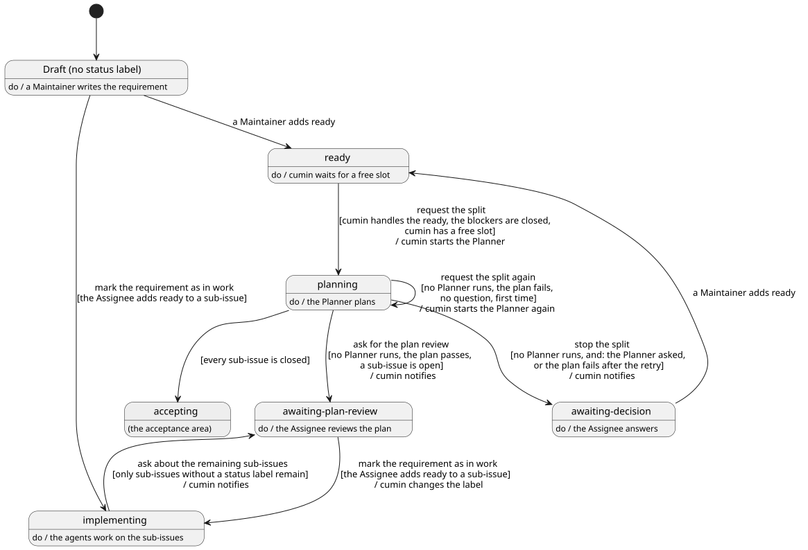

# 計画

要求Issueから具体的な実装計画を立て、実装Issueにするまでの流れを決める。cumin が Planner を起動し、計画の結果を GitHub で確かめ、Assignee の計画結果の確認を待つまでである。受け入れ確認は [受け入れ](../accept/index.md)、Agent起動に共通のことは [Agent](../agent/index.md) で決める。

## 全体像

要求Issueが計画でたどる状態を示す。`accepting` への遷移は受け入れのカテゴリで決める。

図の元ファイル: [overview.puml](overview.puml)

このページで「Planner が動いていない」とは、この cumin が、その要求Issueの Planner の実行を今持っていないことである。

要求Issueの `cumin/status/ready` は、いつも「Planner が要求Issueを読み直す」という1つの意味である。Maintainer は、要求Issueを書き終えたとき、計画が止まって答えたとき、受け入れ確認で Planner が質問して答えたときに、要求Issueに `cumin/status/ready` を付ける。Planner はすでにある sub-issue を確かめて、足りない分だけを作る。作るものがなく、sub-issue がすべて閉じていれば、受け入れ確認に進む。

Maintainer は、Planner を通さずに、自分で sub-issue を書いてもよい。このときは、先に自分を要求Issueの Assignee にしておき、要求Issueには `cumin/status/ready` を付けず、sub-issue にだけ付ける。計画の Agent起動は起きず、実装を始めた印が付く (`CWK-PLAN-008`)。

## 要件

### 計画の Agent起動

#### `CWK-PLAN-001` 計画を始める

`cumin/status/ready` の付いた要求Issueが次のすべてを満たすとき、cumin は状態を `cumin/status/planning` に替えてから、新しいセッションで Planner を起動する。sub-issue がすでにあるかどうかは問わない。

- その `cumin/status/ready` を、cumin が扱う ([権限](../access/index.md) の `CWK-ACCESS-004`)
- 要求Issueの blocked by の Issue が、すべて閉じている (`CWK-PLAN-002`)
- cumin に空きがある

- 検証: `test` 3つを満たす要求Issueに、Planner の Agent起動が1回だけ起き、起動の前に状態が `cumin/status/planning` になっている
- 検証: `test` 3つのどれかを満たさない要求Issueは、`cumin/status/ready` のまま残る

---

#### `CWK-PLAN-002` 先の要求Issueを待つ

要求Issueが他の要求Issueに依存するときは、Maintainer が要求Issueどうしに blocked by を張る。先の要求Issueが閉じるまで、cumin は後の要求Issueの計画を始めない。先の要求の成果がまだ入っていない main ブランチを読んで、Planner が計画してしまうことを防ぐためである。

- 検証: `test` blocked by の要求Issueが開いている間は計画を始めず、閉じたあとの定期確認で始める

---

#### `CWK-PLAN-003` 実行の時間の上限を渡す

cumin は、Planner の Agent起動で渡す事実に、Implementer と Reviewer の1回の実行の時間の上限を入れる。Planner が、1つの実装Issueがそれぞれの1回の実行に収まるように分けるためである。

- 検証: `test` Planner の Agent起動で渡す事実に、Implementer と Reviewer の時間の上限がある

---

### 計画の完了判断

#### `CWK-PLAN-004` 計画の完了を判断する

Planner が動いていないとき、cumin は計画の結果を GitHub で確かめる。cumin は、要求Issueに sub-issue が1つ以上あり、すべての sub-issue にリスクのラベルがちょうど1つ付いているとき、計画が完了したと判断する。Planner が返した結果 (`done` か `blocked` か) は、判断に使わない。

- 検証: `test` sub-issue がない要求Issueと、リスクのラベルがない、または2つ以上ある sub-issue を持つ要求Issueは、計画が完了したと判断されない。Planner が `done` を返しても同じである

---

#### `CWK-PLAN-005` 計画結果の確認を求める

`cumin/status/planning` の要求Issueで、Planner が動いておらず、計画が完了し、開いている sub-issue があるとき、cumin は状態を `cumin/status/awaiting-plan-review` に替えて、通知する。

- 検証: `test` 計画が完了したあとで、要求Issueが `cumin/status/awaiting-plan-review` になり、通知は1回だけである

---

#### `CWK-PLAN-006` 計画をやり直す

`cumin/status/planning` の要求Issueで、Planner が動いておらず、計画が完了しておらず、Planner の質問のコメントがないとき、cumin は Planner をもう一度起動する。やり直すのは、1つの `cumin/status/planning` の間に1回だけである。状態は替えない。

- 検証: `test` 計画が完了しなかったあとで、Planner の Agent起動がもう一度だけ起き、状態は `cumin/status/planning` のままである

---

#### `CWK-PLAN-007` 計画を止める

`cumin/status/planning` の要求Issueで、Planner が動いておらず、次のどちらかが成り立つとき、cumin は状態を `cumin/status/awaiting-decision` に替えて、通知する。質問のコメントでないときは、止めた理由を要求Issueのコメントに書く。

- Planner の質問のコメントが、要求Issueが `cumin/status/planning` になったあとに書かれている
- 計画が完了しておらず、`CWK-PLAN-006` のやり直しを済ませている

- 検証: `test` Planner が `blocked` を返すと、やり直さずに `cumin/status/awaiting-decision` になる
- 検証: `test` やり直しのあとも計画が完了しないと、理由のコメントが付いて `cumin/status/awaiting-decision` になる

---

### 計画結果の Maintainer の確認

#### `CWK-PLAN-008` 実装を始めた印を付ける

要求Issueの Assignee が、その要求Issueの sub-issue のどれかに `cumin/status/ready` を付けたとき、cumin は要求Issueの状態を `cumin/status/implementing` に替える。替えるのは、要求Issueが `cumin/status/awaiting-plan-review`、`cumin/status/awaiting-acceptance`、状態ラベルなしのどれかのときだけである。

要求Issueに Assignee がいないときは、cumin は要求Issueを進めず、通知を1回だけ送る。Planner を通さずに sub-issue を書いた要求Issueでは、cumin が Assignee を付ける機会 ([権限](../access/index.md) の `CWK-ACCESS-006`) がないからである。

要求Issueに状態ラベルがあるときは、その `cumin/status/ready` が、要求Issueが今の状態になったあとに付いたものに限る。前の計画で `cumin/status/ready` が付いたまま残っている sub-issue で、Assignee が新しい sub-issue を確かめる前に要求Issueが進むことを防ぐためである。

- 検証: `test` Assignee が sub-issue に `cumin/status/ready` を付けると、要求Issueが `cumin/status/implementing` になる。Agent起動は起きない
- 検証: `test` Assignee のいない要求Issueの sub-issue に Maintainer が `cumin/status/ready` を付けると、要求Issueの状態は替わらず、通知は1回だけである
- 検証: `test` 計画をやり直して新しい sub-issue が増えた要求Issueは、前から `cumin/status/ready` の付いた sub-issue があっても、Assignee が新しく `cumin/status/ready` を付けるまで `cumin/status/awaiting-plan-review` のままである

---

#### `CWK-PLAN-009` 残りの sub-issue の確認を求める

`cumin/status/implementing` の要求Issueで、開いている sub-issue が1つ以上あり、そのすべてに状態ラベルがないとき、cumin は状態を `cumin/status/awaiting-plan-review` に替えて、通知する。Assignee が計画結果の確認で一部の sub-issue にだけ `cumin/status/ready` を付け、残りを忘れたまま要求Issueが黙って止まることを防ぐためである。

- 検証: `test` `cumin/status/ready` を付けた sub-issue がすべて閉じ、状態ラベルのない sub-issue だけが残ると、要求Issueが `cumin/status/awaiting-plan-review` になり、通知は1回だけである

---

### Planner の成果物

#### `CWK-PLAN-010` 実装Issue

Planner は、要求Issueを実装Issueに分け、それぞれを要求Issueの sub-issue として作る。1つの実装Issueが、1つの Pull Request になる。本文は [implementation-issue.md](../../../../templates/implementation-issue.md) の節で書く。

- 検証: `demo` 内容のはっきりした要求Issueで計画すると、実装Issueが sub-issue として作られ、どの本文もテンプレートの節を持つ

---

#### `CWK-PLAN-011` 実装Issueの大きさ

Planner が作る実装Issueは、どれも [実装Issueの大きさの基準](../../reference/issue-sizing.md) を満たし、合わせると要求Issueの範囲をすべて覆う。

- 検証: `inspection` 計画結果の確認で、Assignee が基準と範囲を確かめる

---

#### `CWK-PLAN-012` 実装の方法を決めてから分ける

Planner は、コードと外部の文書を調べて、それぞれの実装Issueがそのまま実装できることを確かめてから、実装Issueに分ける。あとで決まる設計を前提にした実装Issue (「設計がそう決めれば」のような条件を持つもの) は作らない。設計文書を書く実装Issueを作るときも、その中身は計画で決めて、計画の全体像のコメントに書く。自分で方法を決められないときは、`CWK-PLAN-021.3` で止まる。

- 検証: `demo` 設計の判断が要る要求Issueで計画すると、どの実装Issueにも、設計の結果を条件にした範囲や完了の条件がない

---

#### `CWK-PLAN-013` 依存関係

Planner は、実装Issueどうしの依存関係を blocked by で記録する。blocked by は同じ要求Issueの sub-issue の間だけに張り、循環させない。他の要求Issueへの依存は、Maintainer が要求Issueどうしに張る (`CWK-PLAN-002`)。

- 検証: `demo` 順番の決まった変更を含む要求Issueで計画すると、sub-issue の間に blocked by が張られ、他の要求Issueの Issue には張られない

---

#### `CWK-PLAN-014` リスクを仮に付ける

Planner は、それぞれの実装Issueに、リスクのラベルをちょうど1つ付ける。基準は、Planner と Reviewer が受け取るリスクの基準の文章である ([Agent](../agent/index.md))。迷ったら高いほうを付ける。`cumin/risk/high` に当たる変更は、それだけの最小の実装Issueに分ける。

- 検証: `demo` データベースのマイグレーションを含む要求Issueで計画すると、マイグレーションだけの実装Issueが分けて作られ、`cumin/risk/high` が付く

---

#### `CWK-PLAN-015` マイルストーンを写す

要求Issueにマイルストーンが付いていれば、Planner は、それぞれの実装Issueに同じマイルストーンを付ける。

- 検証: `demo` マイルストーンの付いた要求Issueで計画すると、どの実装Issueにも同じマイルストーンが付く

---

#### `CWK-PLAN-016` Assignee が手で行う作業

Implementer が変えられないファイルの変更が要るときは、Planner は、その変更を Assignee が手で行う sub-issue として作る。`cumin/type/owner-task` と `cumin/risk/high` を付け、状態ラベルは付けない。Context に、Assignee が行う理由を書く。それに依存する実装Issueに blocked by を張り、計画の全体像のコメントの Please check に書く。

- 検証: `demo` 保護されたパスの変更を含む要求Issueで計画すると、その変更が `cumin/type/owner-task` と `cumin/risk/high` の付いた、状態ラベルのない sub-issue になる

---

#### `CWK-PLAN-017` 計画の全体像のコメント

Planner は、要求Issueに、計画の全体像を書いたコメントを1つ残す。形式は [plan-summary.md](../../../../templates/plan-summary.md) に従う。

- 検証: `demo` 計画のあとで、要求Issueに計画の全体像のコメントが1つだけある

---

#### `CWK-PLAN-018` 実装Issueの図

Planner は、どの実装Issueにも、「Where this fits」に図の画像を入れる。図は、その実装Issueが変える箇所に色を付け、ラベルを英語で書いた SVG である。Planner は、図をブランチ `cumin/diagrams` の `issue-<要求Issueの番号>/` に新しいファイルとして足し、コミットを指定した画像として示す。Planner がリポジトリに書くのは、この図だけである。

- 検証: `demo` 計画のあとで、どの実装Issueの「Where this fits」にも、`cumin/diagrams` の SVG がコミットを指定して示され、対象の箇所が色で分かる

---

#### `CWK-PLAN-019` 二重に作らない

Planner は、実装Issueを作る前に、要求Issueにすでに付いている sub-issue を確かめ、同じものを二重に作らない。計画のやり直しや、途中で止まった計画のあとでも、結果が変わらないようにするためである。

- 検証: `demo` 実装Issueを途中まで作ったところで Planner を止め、もう一度計画させても、同じ実装Issueが二重に作られない

---

#### `CWK-PLAN-020` 要求Issueを変えない

Planner は、要求Issueの本文を書き換えず、要求Issueに書かれていないことを実装Issueに足さない。伝えたいことや、要ると考えたことは、要求Issueへのコメントで提案する。

- 検証: `demo` 計画のあとで、要求Issueの本文が変わっていない

---

### Planner が判断を求めるとき

#### `CWK-PLAN-021` 推測で計画しない

Planner は、次のどれかに当たったら、推測で計画せずに `blocked` を返す。止める理由は、cumin が要求Issueのコメントに書く ([Agent](../agent/index.md))。

##### `CWK-PLAN-021.1` 曖昧な要求

要求が曖昧で、実装Issueの完了の条件を書けないときは、止まる。理由には、何が決まっていないかを書く。

- 検証: `demo` 完了の条件を書けないほど曖昧な要求Issueで計画すると、実装Issueは作られず、結果は `blocked` で、何が決まっていないかが理由に書いてある

---

##### `CWK-PLAN-021.2` 食い違う要求

要求の中に食い違いがあるときは、止まる。理由には、どこが食い違うかを書く。

- 検証: `demo` 食い違う2つの決まりを持つ要求Issueで計画すると、実装Issueは作られず、結果は `blocked` である

---

##### `CWK-PLAN-021.3` いくつもの設計案

意味のある設計案が複数あり、どれを選ぶかで計画が変わるときは、止まる。理由には、選択肢とそれぞれの得失を書く。

- 検証: `demo` 設計案が2つに分かれる要求Issueで計画すると、結果は `blocked` で、2つの案と得失が理由に書いてある

---

##### `CWK-PLAN-021.4` 大きすぎる要求

実装Issueの見込みが、[要求Issueの大きさの基準](../../reference/requirement-sizing.md) の上限を超えるときは、止まる。理由には、要求Issueの分け方の案を書く。

- 検証: `demo` 実装Issueが上限を超える見込みの要求Issueで計画すると、実装Issueは作られず、結果は `blocked` で、分け方の案が理由に書いてある

---

## 受け入れテスト

| # | 場面 | 期待する結果 |
|---|---|---|
| 1 | Maintainer が要求Issueを書き、`cumin/status/ready` を付ける。Planner が計画し、Assignee が sub-issue のすべてに `cumin/status/ready` を付ける | 計画が始まり (`CWK-PLAN-001`)、計画結果の確認を求める通知が1回届き (`CWK-PLAN-005`)、要求Issueが `cumin/status/implementing` になる (`CWK-PLAN-008`) |
| 2 | Planner が質問して止まる。Assignee が要求Issueに答えを書き、`cumin/status/ready` を付け直す | 要求Issueが `cumin/status/awaiting-decision` になり (`CWK-PLAN-007`)、付け直すと、Planner がすでにある sub-issue を確かめて計画をやり直す (`CWK-PLAN-001`、`CWK-PLAN-019`) |
| 3 | Assignee が計画結果の確認で、sub-issue の一部にだけ `cumin/status/ready` を付ける。それらがすべて閉じる | 要求Issueが `cumin/status/awaiting-plan-review` に戻り、通知が1回届く (`CWK-PLAN-009`)。Assignee が残りを閉じると、受け入れ確認に進む |
| 4 | Maintainer が Planner を通さずに sub-issue を書き、自分を要求Issueの Assignee にして、sub-issue にだけ `cumin/status/ready` を付ける | Planner は起動されず、要求Issueが `cumin/status/implementing` になる (`CWK-PLAN-008`) |

## 未決事項

- 「Planner が動いていない」の意味は、ほかのカテゴリでも同じなので、[Agent](../agent/index.md) か [定期確認](../poll/index.md) に移す。どちらに書くかは、そのカテゴリを書くときに決める。
