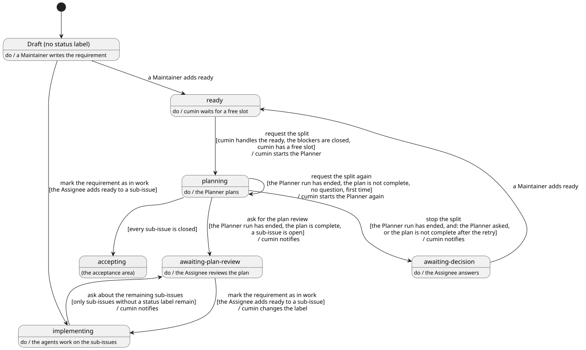

# 計画

要求Issueから具体的な実装計画を立てるまでの流れを決める。
cuminがPlannerを起動し、計画の結果をGitHubで確かめ、Assigneeの計画結果の確認を待つまでである。
受け入れ確認は[受け入れ](../accept/index.md)、Agent起動に共通の要件は[Agent](../agent/index.md)で決める。

## 全体像

要求Issueが計画でたどる状態を示す。`accepting`への遷移は受け入れのカテゴリで決める。

図の元ファイル: [overview.puml](overview.puml)

要求Issueの`cumin/status/ready`は、いつも「Plannerが要求Issueを読み直す」という意味である。Maintainerは、要求Issueを書き終えたときと、Plannerの質問に答えたときに付ける。Plannerはすでにあるsub-issueを確かめて、足りない分だけを作る。作るものがなく、sub-issueがすべて閉じていれば、受け入れ確認に進む。

Maintainerは、Plannerを通さずに自分でsub-issueを書いてもよい。このときは、自分を要求IssueのAssigneeにし、sub-issueにだけ`cumin/status/ready`を付ける（`CWK-PLAN-007`）。

## 要件

### 計画のAgent起動

#### `CWK-PLAN-001` 計画を始める

`cumin/status/ready`の付いた要求Issueが次のすべてを満たすとき、cuminは状態を`cumin/status/planning`に替えてから、新しいセッションでPlannerを起動する。sub-issueがすでにあってもよい。

- Maintainerが`cumin/status/ready`をつけている（[権限](../access/index.md)の`CWK-ACCESS-012`）
- blocked byのIssueが、すべて閉じている
- 同時に進めるIssueの数に余裕がある

- 検証: `test` GitHub mockとCLI mockでテスト

---

#### `CWK-PLAN-002` 計画のためにPlannerに渡す情報

cuminはPlannerに以下の情報を渡す。

- ImplementerとReviewerに許可されている作業時間の上限

- 検証: `test` GitHub mockとCLI mockでテスト

---

### 計画の完了判断

#### `CWK-PLAN-003` 計画の完了を判断する

cuminは以下を満たすとき、計画が完了したと判断する。

- 状態ラベルが`cumin/status/planning`
- Plannerの実行が終わっている
- 要求Issueにsub-issueが1つ以上ある
- すべてのsub-issueにリスクのラベルが1つ付いている

- 検証: `test` GitHub mockとCLI mockでテスト

---

#### `CWK-PLAN-004` 計画結果の確認を求める

cuminは計画の完了を判定したあと、未完了の実装Issueが1つ以上あるとき、Assigneeに計画結果の確認を求める。

- `cumin/status/awaiting-plan-review`にラベルを変更する
- 通知する

補足: 計画完了のタイミングで未完了の実装Issueがないときは、受け入れ確認の要件（`CWK-ACCEPT-001`）に従う。

- 検証: `test` GitHub mockでテスト

---

#### `CWK-PLAN-005` 計画をやり直す

`cumin/status/planning`の要求Issueで、Plannerが動いておらず、計画が完了しておらず、Plannerの質問のコメントもないとき、cuminは状態を替えずにPlannerをもう一度起動する。やり直しは、1つの`cumin/status/planning`の間に1回だけである。

- 検証: `test` GitHub mockとCLI mockでテスト

---

#### `CWK-PLAN-006` 計画を止める

`cumin/status/planning`の要求Issueで、Plannerが動いておらず、次のどちらかが成り立つとき、cuminは状態を`cumin/status/awaiting-decision`に替えて、通知する。質問のコメントがないときは、止めた理由をコメントに書く。

- `cumin/status/planning`になったあとに、Plannerの質問のコメントがある
- やり直し条件に2回以上到達した

- 検証: `test` GitHub mockとCLI mockでテスト

---

### 計画結果の確認

#### `CWK-PLAN-007` Assigneeによる計画確認の完了判定

要求IssueのAssigneeがsub-issueのどれかに`cumin/status/ready`を付けたとき、cuminは要求Issueを`cumin/status/implementing`に替える。
要求Issueが`awaiting-plan-review`、`awaiting-acceptance`、状態ラベルなしのどれかのときだけである。

- 要求Issueに状態ラベルがあるときは、要求Issueが今の状態になったあとに付いた`cumin/status/ready`だけを使う。前の計画の`cumin/status/ready`が残っていても、新しいsub-issueを確かめる前に進まないためである。
- 要求IssueにAssigneeがいなければ、進めずに、通知を1回だけ送る。Plannerを通さない要求Issueでは、cuminがAssigneeを付ける機会（`CWK-ACCESS-010`）がないからである。

- 検証: `test` GitHub mockとCLI mockでテスト

---

#### `CWK-PLAN-008` 残りのsub-issueの確認を求める

`cumin/status/implementing`の要求Issueで、開いているsub-issueがあり、そのすべてに状態ラベルがないとき、cuminは状態を`cumin/status/awaiting-plan-review`に替えて、通知する。Assigneeが一部のsub-issueにだけ`cumin/status/ready`を付けたとき、要求Issueが黙って止まらないためである。

- 検証: `test` GitHub mockでテスト

---

### Plannerの成果物

#### `CWK-PLAN-009` 実装Issue

Plannerは、要求Issueを実装Issueに分け、要求Issueのsub-issueとして作る。1つの実装Issueが、1つのPull Requestになる。本文は[implementation-issue.md](../../../../templates/implementation-issue.md)の節で書く。

- 検証: `demo` テスト用の実リポジトリでPlannerを動かして確認

---

#### `CWK-PLAN-010` 実装Issueの大きさ

実装Issueは、どれも[実装Issueの大きさの基準](../../reference/issue-sizing.md)を満たし、合わせると要求Issueの範囲をすべて覆う。

- 検証: `inspection` 計画結果の確認で、Assigneeが基準と範囲を確かめる

---

#### `CWK-PLAN-011` 実装Issueのフィジビリティ確認

Plannerは、コードと外部の文書を調べ、どの実装Issueもそのまま実装できることを確かめてから計画する。調べるだけで決められないときは、Agent作業ディレクトリで小さく試してよい。試しのコードは残さず、結果を計画の全体像のコメントに書く。あとで決まる設計を条件にした実装Issueは作らない。設計文書を書く実装Issueも、その中身は計画で決める。決められないときは、`CWK-PLAN-020.3`で止まる。

- 検証: `demo` テスト用の実リポジトリでPlannerを動かして確認

---

#### `CWK-PLAN-012` 依存関係

Plannerは、実装Issueどうしの依存をblocked byで記録する。blocked byは同じ要求Issueのsub-issueの間だけに張り、循環させない。

- 検証: `demo` テスト用の実リポジトリでPlannerを動かして確認

---

#### `CWK-PLAN-013` リスクを仮に付ける

Plannerは、実装Issueごとにリスクのラベルを1つだけ付ける。基準は、Plannerが受け取るリスクの基準である（`CWK-AGENT-006`）。迷ったら高いほうを付ける。`cumin/risk/high`に当たる変更は、それだけの最小の実装Issueに分ける。

- 検証: `demo` テスト用の実リポジトリでPlannerを動かして確認

---

#### `CWK-PLAN-014` マイルストーンを写す

要求Issueにマイルストーンがあれば、Plannerは実装Issueに同じマイルストーンを付ける。

- 検証: `demo` テスト用の実リポジトリでPlannerを動かして確認

---

#### `CWK-PLAN-015` Assigneeが手で行う作業

Implementerが変えられないファイルの変更が要るときは、Plannerはそれを、`cumin/type/owner-task`と`cumin/risk/high`を付けた、状態ラベルのないsub-issueにする。ContextにAssigneeが行う理由を書き、依存する実装Issueにblocked byを張り、計画の全体像のコメントのPlease checkに書く。

- 検証: `demo` テスト用の実リポジトリでPlannerを動かして確認

---

#### `CWK-PLAN-016` 計画の全体像のコメント

Plannerは、要求Issueに、計画の全体像のコメントを1つ書く。形式は[plan-summary.md](../../../../templates/plan-summary.md)に従う。

- 検証: `demo` テスト用の実リポジトリでPlannerを動かして確認

---

#### `CWK-PLAN-017` 実装Issueの図

Plannerは、どの実装Issueの「Where this fits」にも、変える箇所に色を付けたSVGの図を入れる。ラベルは英語で書く。図はブランチ`cumin/diagrams`の`issue-<要求Issueの番号>/`に新しいファイルとして足し、コミットを指定して示す。Plannerがリポジトリに書くのは、この図だけである。

- 検証: `demo` テスト用の実リポジトリでPlannerを動かして確認

---

#### `CWK-PLAN-018` 二重に作らない

Plannerは、すでにあるsub-issueを確かめてから作り、同じ実装Issueを二重に作らない。

- 検証: `demo` テスト用の実リポジトリでPlannerを動かして確認

---

#### `CWK-PLAN-019` 要求Issueを変えない

Plannerは、要求Issueの本文を書き換えず、書かれていないことを実装Issueに足さない。
要求Issueの変更が必要だと判断したときは、`CWK-PLAN-020`で止め、Assigneeに判断を求める。

- 検証: `demo` テスト用の実リポジトリでPlannerを動かして確認

---

### Assigneeに判断を求めるとき

#### `CWK-PLAN-020` 推測で計画しない

Plannerは、次のどれかに当たったら、推測で計画せずに`blocked`を返す。`blocked_reason`は、[decision-request.md](../../../../templates/decision-request.md)の形式で、Assigneeに決めてほしいことを書く。cuminは、それを要求Issueのコメントに書く（`CWK-AGENT-013`）。

##### `CWK-PLAN-020.1` 曖昧な要求

要求が曖昧で、実装Issueの完了の条件を書けないときはAssigneeに判断を求める。理由には、何が決まっていないかを書く。

- 検証: `demo` テスト用の実リポジトリでPlannerを動かして確認

---

##### `CWK-PLAN-020.2` 食い違う要求

要求の中に食い違いがあるときはAssigneeに判断を求める。理由には、どこが食い違うかを書く。

- 検証: `demo` テスト用の実リポジトリでPlannerを動かして確認

---

##### `CWK-PLAN-020.3` いくつもの設計案

意味のある設計案が複数あり、どれを選ぶかで計画が変わるときはAssigneeに判断を求める。理由には、選択肢と得失を書く。

- 検証: `demo` テスト用の実リポジトリでPlannerを動かして確認

---

##### `CWK-PLAN-020.4` 大きすぎる要求

実装Issueの見込みが[要求Issueの大きさの基準](../../reference/requirement-sizing.md)の上限を超えるときはAssigneeに判断を求める。理由には、要求Issueの分け方の案を書く。

- 検証: `demo` テスト用の実リポジトリでPlannerを動かして確認

---

## 未決事項

なし
