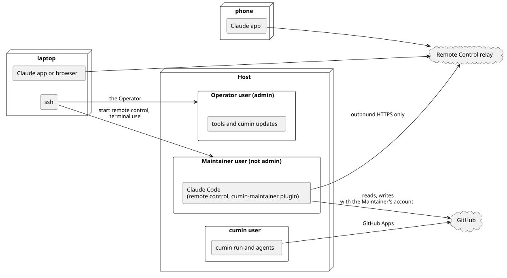

# plugin

人が使うClaude Codeに入れるplugin `cumin-maintainer`の配り方と、cuminとのバージョンの比べ方を決める。このページでのClaude Codeは、このpluginを入れて人が使うもので、Agentではない。

## 全体像

次の図は、参考にする使い方である。HostでClaude Codeを動かし続け、ノートPCとスマホから、Claude CodeのRemote Controlで操作する。ノートPCを閉じていても、スマホから判断を続けられる。この使い方は要件ではない。Claude Codeを、手元のPCだけで動かしてもよい。

図の元ファイル: [overview.puml](overview.puml)

- Hostには、cuminを動かすユーザアカウント、Operatorのユーザアカウント、Maintainerのユーザアカウントを分けて作る。Maintainerのユーザアカウントは管理者にしない。
- pluginは、Hostを変える操作（cuminの入れ替え、設定の変更）をしない。Hostの操作は、OperatorがOperatorのユーザアカウントで行う。
- Maintainerは、最初の準備と、Hostの再起動のあとに、sshでMaintainerのユーザアカウントに入り、Remote Controlを起動する。チャットを始めるのと閉じるのは、スマホかノートPCから行う。
- 作業の文脈の引き継ぎには、Claude Codeのメモリを使う

## 要件

#### `CWK-PLUGIN-001` pluginをmarketplaceで配る

cumin-worksのリポジトリをClaude Codeのpluginのmarketplaceとし、plugin `cumin-maintainer`を配る。Maintainerは、marketplaceを`release`ブランチで足す（`cloveclovedev/cumin-works#release`）。入れたpluginは、いつもリリースと同じものになる（[リリース](../release/index.md)の`CWK-RELEASE-006`）。

- 検証: `demo` marketplaceを足してpluginを入れ、バージョンが最新のリリースと同じことを確認

---

#### `CWK-PLUGIN-002` pluginとcuminのバージョンを比べる

Claude Codeは、作業の始めに、pluginのバージョンと、`cumin --version`が表示するcuminのバージョンを比べる。違えば、そのことを最初に言う。`cumin`を実行できず比べられないときは、そう言う。

- 検証: `demo` バージョンが違う組み合わせで動かして確認

---

## 未決事項

- スマホから新しいチャットを始めるとき、どのディレクトリで始めるか。使ってみてから決める
