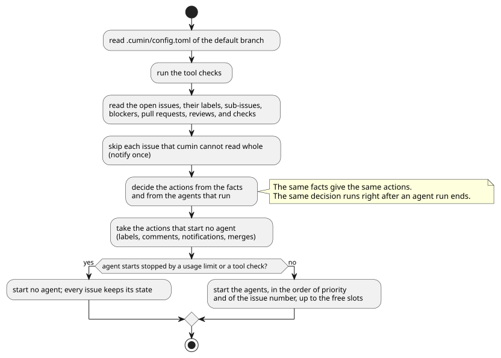

# 定期確認

cumin が GitHub をいつ、どの順に読み、どう次のアクションを決めるかを決める。状態ごとのアクションは各カテゴリのページで、Agent起動を止める条件は [利用制限](../limit/index.md) と [Agent](../agent/index.md) の `CWK-AGENT-018` で決める。

## 全体像

1つのリポジトリの1回の定期確認の流れを示す。

図の元ファイル: [overview.puml](overview.puml)

作業の状態は、すべて GitHub にある。cumin が手元に持つのは、失っても作業を失わないものだけである。そのため、cumin を止めても再起動しても、次の定期確認が GitHub の事実から続きを決める。

## 要件

### 決め方

#### `CWK-POLL-001` 閉じた要求Issueには何もしない

cumin は、閉じた要求Issueを読まず、ラベルを替えず、コメントも書かない。

- 検証: `test` 閉じた要求Issueに、cumin は GitHub への書き込みをしない

---

#### `CWK-POLL-002` 事実から決める

cumin は、GitHub の事実と、Agent が動いているか (`CWK-AGENT-001`) だけで、次のアクションを決める。同じ事実からは、いつも同じアクションを決める。決めるのは、定期確認のときと、Agent の実行が終わった直後で、どちらも同じ決め方をする。

- 検証: `test` 実行が終わった直後に GitHub を読めなかったときも、次の定期確認で、読めたときと同じアクションになる

---

#### `CWK-POLL-003` 手元に持つもの

cumin が Host の手元に持つのは、失っても作業を失わないものだけである。Agent のセッションの番号、チェックの修正を頼んだ回数、使用率とリセット時刻、5時間制限を使い切る許可、ツール動作確認の結果、止める予約、やり直しの回数、通知を送った記録がこれに当たる。レビューのラウンドの数は手元に持たず、Pull Request のレビューから読む。

- 検証: `test` 手元の状態をすべて消して cumin を再起動しても、作業中の Issue が続きから進み、同じ Agent起動が二重に起きない。Maintainer が `cumin/status/ready` を付け直す必要はない

---

### 間隔

#### `CWK-POLL-004` 定期確認の間隔

cumin は、作業中のリポジトリを `poll_interval` (初期値は60秒) ごとに、作業中でないリポジトリを `idle_poll_interval` (初期値は5分) ごとに確かめる。作業中とは、次のどれかが成り立つことである。

- そのリポジトリで Agent が動いている
- 状態が `ready`、`planning`、`accepting` の要求Issueがある
- 状態が `ready`、`implementing`、`checking`、`reviewing`、`merging` の実装Issueがある
- 前回の定期確認で、アクションをしたか、失敗した

人の番の Issue しかないリポジトリは、作業中でない。そのため、Maintainer の操作には `idle_poll_interval` のうちに気付く。

- 検証: `test` 作業中のリポジトリと作業中でないリポジトリを同時に扱うと、それぞれの間隔で確かめる。作業中でないリポジトリで Maintainer が `cumin/status/ready` を付けると、`idle_poll_interval` のうちに着手する

---

### 着手

#### `CWK-POLL-005` 同時に進める Issue の数

1つのリポジトリで同時に進める Issue の数は、`max_issues_in_progress` (初期値は1) までである。含めるのは、状態が `planning`、`accepting` の要求Issueと、`implementing`、`checking`、`reviewing`、`merging` の開いている実装Issueである。`implementing` の要求Issue、人の番の Issue、`ready` と `awaiting-base` の Issue は含めない。違うリポジトリの Issue は、並行して進めてよい。

- 検証: `test` `max_issues_in_progress` が1のリポジトリで、`implementing` の実装Issueがある間は、別の `ready` の実装Issueに着手しない。`awaiting-base` の実装Issueしかなければ着手する

---

#### `CWK-POLL-006` 着手の順番

空きより多くの Issue に着手できるとき、cumin は優先度の高い順に着手する。同じ優先度なら、Issue の番号の小さい順である。

- 優先度のラベル ([ラベル](../label/index.md) の `CWK-LABEL-008`) のない Issue は、ラベルのある Issue のあとに着手する。
- 優先度のラベルのない実装Issueは、その要求Issueの優先度を使う。
- 優先度のラベルが2つ以上付いた Issue は、高いほうを使う。
- 優先度は、着手できる Issue の間の順番だけを決める。blocked by の Issue、同時に進める Issue の数、利用制限を越えて着手することはなく、動いている Agent を止めることもない。

- 検証: `test` 番号の大きい Issue に高い優先度のラベルがあると、そちらから着手する。同じ優先度なら番号の小さい順、ラベルのない Issue は最後である
- 検証: `test` 要求Issueだけに優先度のラベルがあると、その実装Issueはその優先度で着手される

---

### GitHub の呼び出しの失敗

#### `CWK-POLL-007` 一時的な失敗のやり直し

一時的な失敗は、ネットワークの誤り、5xx の応答、二次のレート制限、一次のレート制限を使い切ったことの4つである。ネットワークの誤りと 5xx の応答は、読み取りに限り、数秒あけて3回までやり直す。書き込みはやり直さない。答えが届かなかった書き込みを、二重にしないためである。

- 検証: `test` 読み取りが1回だけネットワークの誤りで失敗しても、やり直しで成功し、そのまま進む
- 検証: `test` 書き込みが 5xx で失敗しても、やり直さない

---

#### `CWK-POLL-008` レート制限

レート制限に当たると、cumin は GitHub が返す時刻まで、その GitHub App のインストールで GitHub を呼ばない。一次のレート制限はリセットの時刻まで、二次のレート制限は `retry-after` の分、なければ1分待つ。呼び出しの中では待たず、その時刻のあとの定期確認でやり直す。待つ間も、ほかのリポジトリは進める。

- 検証: `test` 一次のレート制限を使い切ると、リセットの時刻まで GitHub を呼ばず、そのあとの定期確認で続きから進む

---

#### `CWK-POLL-009` 失敗のあとは何も持たない

やり直しても一時的な失敗で終わったとき、cumin は何も持っておかない。Issue は今の状態のまま残り、次の定期確認が同じ事実から同じアクションを決める。すでに済んだ書き込みは読み直しで見えるので、二重にはしない。

- 検証: `test` Agent の実行のあとで読み取りが失敗し続けても、Issue はラベルを保ち、あとの定期確認で、失敗しなかったときと同じアクションをする。書き込みは二重にならない

---

#### `CWK-POLL-010` 続けて失敗したら知らせる

同じリポジトリの定期確認が、同じ理由で3回続けて失敗したら、cumin は通知する。次に知らせるのは、その間に定期確認が成功したあとである。一次のレート制限を使い切ったことも、この通知で分かる。

- 検証: `test` 同じ理由で5回続けて失敗しても、通知は1回だけである。成功したあとに、また3回続けて失敗すると、もう一度通知する

---

### 全部を読めない Issue

#### `CWK-POLL-011` 読む数の上限

cumin は、1つの Issue について読む数に上限を持つ。sub-issue は12件ずつ、3ページの36件までを読む。sub-issue が36件を超えた Issue は、全部を読めない Issue である。ラベル、blocked by の Issue、結び付いた Pull Request が cumin の読む数を超えた Issue も、同じである。sub-issue の1つが全部を読めない Issue なら、その要求Issueも全部を読めない Issue とする。

- 検証: `test` 閉じたものを含めて sub-issue が20件ある要求Issueは、全部を読み、今までどおり進む
- 検証: `test` sub-issue が37件ある要求Issueは、全部を読めない Issue になる

---

#### `CWK-POLL-012` 全部を読めない Issue には何もしない

全部を読めない Issue には、cumin は何もせず、ラベルも替えない。ほかの Issue は今までどおり進める。cumin は、Issue と超えた上限を書いて、1回だけ通知する。次に知らせるのは、その Issue を全部読めたあとである。

- 検証: `test` 全部を読めない要求Issueと、別の `ready` の実装Issueがあると、別の実装Issueには着手し、全部を読めない要求Issueとその sub-issue には何もしない
- 検証: `test` 全部を読めない Issue があるまま定期確認を3回行っても、通知は1回だけである。sub-issue を36件以下に減らすと、次の定期確認から今までどおり進む

---

## 受け入れテスト

| # | 場面 | 期待する結果 |
|---|---|---|
| 1 | `ready` の実装Issueを1つ置き、定期確認を2回以上またぐ | Implementer の起動は1回だけである (`CWK-POLL-002`、`CWK-AGENT-002`) |
| 2 | cumin を止めて、手元の状態を消し、起動し直す | GitHub を読み直して、続きから進む。同じ Agent起動は二重に起きない (`CWK-POLL-003`) |
| 3 | 着手できる Issue が2つあり、番号の大きいほうに高い優先度のラベルがある | 優先度の高いほうから着手する (`CWK-POLL-006`) |
| 4 | Agent の実行のあとで、GitHub の読み取りがやり直しても失敗する | Issue はラベルを保ち、あとの定期確認で同じアクションをする (`CWK-POLL-007`、`CWK-POLL-009`) |
| 5 | sub-issue が36件を超える要求Issueがある | その要求Issueには何もせず、通知が1回届く。ほかの Issue は進む (`CWK-POLL-011`、`CWK-POLL-012`) |

## 範囲外

- 同じリポジトリを、2つの cumin で同時に扱うこと。Agent が動いているか (`CWK-AGENT-001`) は、1つの cumin の中の事実である。

## 未決事項

なし
