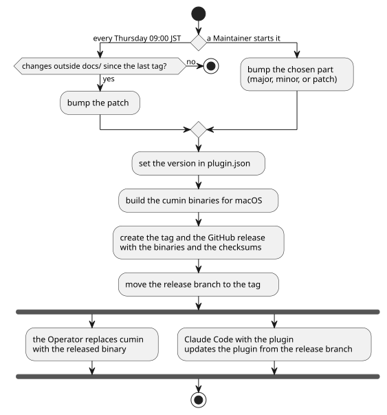

# リリース

cumin-worksのバージョンの付け方、リリースする時期、リリースに含めるものを決める。

## 全体像

定期リリースと手動リリースは、同じ手順でリリースを作る。Operatorはリリースのバイナリでcuminを入れ替え（[Hostでの動かし方](../host/index.md)の`CWK-HOST-014`）、MaintainerのClaude Codeは`release`ブランチからpluginを更新する（[plugin](../plugin/index.md)の`CWK-PLUGIN-001`）。

図の元ファイル: [overview.puml](overview.puml)

## 要件

### バージョン

#### `CWK-RELEASE-001` バージョンの形

バージョンは`v<メジャー>.<マイナー>.<パッチ>`の形で、Semantic Versioningに従う。ただし1.0.0より前は、互換性のない変更でもマイナーを上げる。

- 検証: `inspection` タグの一覧

---

#### `CWK-RELEASE-002` マイナーとパッチ

マイナーは、フェーズのマイルストーンを終えたときに上げる（[要求仕様書](../overview.md)のフェーズ）。ほかのリリースでは、パッチを上げる。

- 検証: `inspection` タグとマイルストーンの一覧

---

### リリースする時期

#### `CWK-RELEASE-003` 定期リリース

毎週木曜日の9時（日本時間）に、前のリリースのタグから`docs/`の外が変わっていれば、パッチを上げてリリースする。変わっていなければ、リリースしない。

- 検証: `test` 変更があるかを判断する処理をテスト
- 検証: `inspection` ワークフローの起動の時刻

---

#### `CWK-RELEASE-004` 手動リリース

Maintainerは、メジャー、マイナー、パッチのどれを上げるかを選んで、いつでもリリースできる。

- 検証: `demo` 手でワークフローを動かして確認

---

### リリースに含めるもの

#### `CWK-RELEASE-005` GitHubのリリース

リリースは、GitHubのリリースとして、バージョンのタグ、macOS向けのcuminのバイナリ、バイナリのchecksumを持つ。

- 検証: `demo` リリースのワークフローを動かして確認

---

#### `CWK-RELEASE-006` pluginのバージョン

リリースのコミットでは、plugin `cumin-maintainer`の`plugin.json`の`version`を、リリースのバージョンから先頭の`v`を除いたものにする。リリースのあと、`release`ブランチをそのコミットまで進める。

- 検証: `test` タグと`plugin.json`の`version`が食い違えば、リリースのワークフローが失敗する

---

#### `CWK-RELEASE-007` cuminのバージョンの表示

`cumin --version`は、リリースのバイナリではリリースのバージョンを表示する。リリース以外から作ったバイナリでは、そう分かる表示にする。

- 検証: `test` 表示を単体テスト

---

## 未決事項

なし
