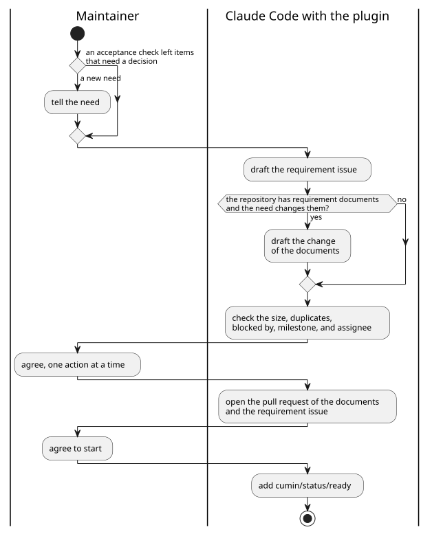

# 要求

Maintainerが要求Issueを立てるときに、Claude Codeがすることを決める。ここでのClaude Codeは、plugin `cumin-maintainer`（[plugin](../plugin/index.md)）を入れて人が使うもので、Agentではない。要件の文書の書き方は、対象のリポジトリの決まりに従う。

## 全体像

図の元ファイル: [overview.puml](overview.puml)

## 要件

### 要求Issueを書く

#### `CWK-REQUIRE-001` 要求Issueの前に要件の文書を直す

対象のリポジトリが要件の文書を持ち、要求が要件を変えるときは、Claude Codeは、要求Issueを立てる前に、要件の文書を直すPull Requestを作る。中身はMaintainerが会話の中で決める。1つの話題を1つのPull Requestにする。

- 検証: `demo` 要件の文書を持つリポジトリで動かして確認

---

#### `CWK-REQUIRE-002` 要求Issueに書くこと

Claude Codeは、要求Issueを[requirement-issue.md](../../../../templates/requirement-issue.md)の形式で書く。要件の文書を直したとき（`CWK-REQUIRE-001`）は、そのPull Requestへのリンクと、変わった要件のIDを書く。要件にIDがなければ、IDは書かない。

- 検証: `demo` 要求Issueを書かせて確認

---

#### `CWK-REQUIRE-003` 要求Issueの規模を確かめる

Claude Codeは、要求Issueを[要求Issueの分割基準](../../reference/requirement-sizing.md)で確かめ、超えていれば分け方の案を出す。この基準はcuminに入っていて、対象のリポジトリからは変えられない。

- 検証: `demo` 基準を超える要求で動かして確認

---

#### `CWK-REQUIRE-004` 要求Issueを立てる前に重複と依存を確かめる

Claude Codeは、要求Issueを立てる前に、同じ中身のIssueが開いていないかを確かめ、blocked byにするIssue、マイルストーン、assigneeの案を示す。

- 検証: `demo` 似た要求Issueが開いているリポジトリで動かして確認

---

#### `CWK-REQUIRE-005` 受け入れ確認の残課題から要求Issueを作る

Claude Codeは、受け入れ確認でPlannerが「判断が必要」に仕分けた残課題（[受け入れ](../accept/index.md)の`CWK-ACCEPT-011`）から、要求Issueの文案を作る。

- 検証: `demo` 判断が必要な残課題がある要求Issueで動かして確認

---

### GitHubに書く

#### `CWK-REQUIRE-006` GitHubに書く前に1件ずつ確かめる

Claude Codeは、Issueの作成、Pull Requestの作成、push、マージの前に、何をどこに書くかを示して、Maintainerの言葉を得る。1つの言葉で行う操作は1つである。

- 検証: `demo` GitHubに書く前に、毎回Maintainerに聞くことを確認

---

#### `CWK-REQUIRE-007` 要求Issueにreadyを付ける

Claude Codeは、要求Issueの中身をMaintainerと確かめ終え、Maintainerの言葉を得てから、`cumin/status/ready`を付ける。

- 検証: `demo` 要求Issueを立ててreadyを付けるまで動かして確認

---

## 未決事項

なし
