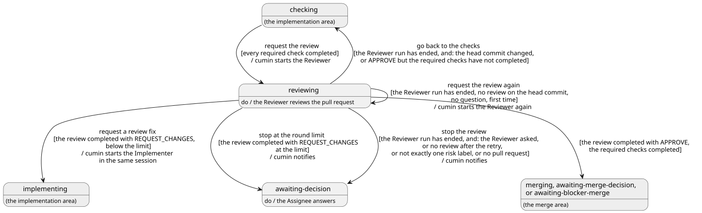

# レビュー

必須チェックが完了したPull RequestをReviewerがレビューし、指摘をImplementerが直すまでの流れを決める。cuminがReviewerを起動し、レビューをGitHubで確かめ、ラウンドを数え、上限でAssigneeに回すまでである。マージとマージ判断は[マージ](../merge/index.md)、Agent起動に共通のことは[Agent](../agent/index.md)で決める。

## 全体像

実装Issueがレビューでたどる状態を示す。灰色の状態は、ほかのカテゴリで決める。

図の元ファイル: [overview.puml](overview.puml)

ReviewerとImplementerは、セッションを共有しない。Reviewerが見るのは、GitHubに出ているものとリポジトリの中身だけである。

## 要件

### レビューのAgent起動

#### `CWK-REVIEW-001` レビューを始める

`cumin/status/checking`の実装Issueで、必須チェックが先頭のコミットで完了したとき（`CWK-CHECK-002`）、cuminは状態を`cumin/status/reviewing`に替えてから、Reviewerを起動する。1ラウンド目は新しいセッションで、2ラウンド目からはReviewerの直前のセッションで起動する。

- 検証: `test` GitHub mockとCLI mockでテスト

---

#### `CWK-REVIEW-002` Reviewerに渡す事実

cuminは、Reviewerに次の事実を渡す。

- 何ラウンド目かと、ラウンドの上限
- 先頭のコミット
- 2ラウンド目からは、前のラウンドでレビューしたコミット
- ReviewerがこのPull Requestを承認したことがあれば、最後に承認したコミット

- 検証: `test` GitHub mockとCLI mockでテスト

---

#### `CWK-REVIEW-003` リポジトリのレビューの指針

対象のリポジトリの最上位に`REVIEW.md`があれば、Reviewerはそれに従う。`REVIEW.md`には、Maintainerが、そのリポジトリで何が失敗にあたるか、見なくてよいパス、指摘の根拠の示し方などを書く。

- 検証: `demo` テスト用の実リポジトリでReviewerを動かして確認

---

### レビューの完了判断

#### `CWK-REVIEW-004` レビューの完了を判断する

cuminは、次のすべてが成り立つとき、レビューが完了したと判断する。

- Reviewerの実行が終わっている
- `cumin-reviewer`が今の先頭のコミットに`APPROVE`か`REQUEST_CHANGES`のレビューを出している

古いコミットへのレビュー、`COMMENT`だけのレビュー、Reviewerの結果は使わない。

- 検証: `test` GitHub mockでテスト

---

#### `CWK-REVIEW-005` 指摘を修正する

`cumin/status/reviewing`の実装Issueで、レビューが完了し（`CWK-REVIEW-004`）、そのレビューが`REQUEST_CHANGES`で、ラウンドが上限（`max_review_rounds`、初期値は5）に達していないとき、cuminは状態を`cumin/status/implementing`に替えて、Implementerの直前のセッションで指摘の修正を頼む。

- 検証: `test` GitHub mockとCLI mockでテスト

---

#### `CWK-REVIEW-006` チェックに戻る

`cumin/status/reviewing`の実装Issueで、Reviewerの実行が終わっていて、次のどちらかが成り立つとき、cuminは状態を`cumin/status/checking`に替える。古いコミットへのレビューも、ラウンドに含めたままにする。

- レビューの間に、先頭のコミットが変わった
- `APPROVE`が出ているが、必須チェックが今の先頭のコミットで完了していない

- 検証: `test` GitHub mockとCLI mockでテスト

---

#### `CWK-REVIEW-007` レビューをやり直す

`cumin/status/reviewing`の実装Issueで、Reviewerの実行が終わっていて、今の先頭のコミットにReviewerのレビューも質問のコメントもないとき、cuminは状態を替えずにReviewerをもう一度起動する。やり直しは、1つの`cumin/status/reviewing`の間に1回だけである。

- 検証: `test` GitHub mockとCLI mockでテスト

---

#### `CWK-REVIEW-008` レビューを止める

`cumin/status/reviewing`の実装Issueで、Reviewerの実行が終わっていて、次のどれかが成り立つとき、cuminは状態を`cumin/status/awaiting-decision`に替えて、通知する。

- `cumin/status/reviewing`になったあとに、Reviewerの質問のコメントがある。質問ではやり直さない
- やり直しのあとも、今の先頭のコミットにレビューがない
- リスクのラベルがないか、2つ以上ある
- 実装Issueを閉じる開いているPull Requestがない

- 検証: `test` GitHub mockとCLI mockでテスト

---

### ラウンド

#### `CWK-REVIEW-009` ラウンドの数え方

ラウンドは、次の2つの新しいほうよりあとに出た`cumin-reviewer`のレビューの数とする。cuminはラウンドの数をローカルに持たない。

- 実装Issueに最後に`cumin/status/ready`が付いたとき
- `cumin-reviewer`が最後に`APPROVE`を出したとき

`APPROVE`のあとで数え直すのは、衝突の解消やAssigneeの`REQUEST_CHANGES`（`CWK-MERGE-006`）で先頭のコミットが変わり、レビューをやり直すからである。

- 検証: `test` GitHub mockとCLI mockでテスト

---

#### `CWK-REVIEW-010` ラウンドの上限で止める

`cumin/status/reviewing`の実装Issueで、レビューが完了し（`CWK-REVIEW-004`）、そのレビューが`REQUEST_CHANGES`で、ラウンドが上限に達したとき、cuminは状態を`cumin/status/awaiting-decision`に替えて、通知する。

- 検証: `test` GitHub mockとCLI mockでテスト

---

### Reviewerの成果物

#### `CWK-REVIEW-011` レビュー

Reviewerは、今の先頭のコミットにGitHubのレビューを1つ出す。修正が必要な指摘が残っておらず、提案のすべてにImplementerの返答があるときだけ`APPROVE`にし、それ以外は`REQUEST_CHANGES`にする。元からある問題（`CWK-REVIEW-013`）は、この判断に使わない。`COMMENT`だけのレビューにはしない。指摘とまとめは[review.md](../../../../templates/review.md)の形式で書き、まとめにラウンドと上限を書く。

- 検証: `demo` テスト用の実リポジトリでReviewerを動かして確認

---

#### `CWK-REVIEW-012` 修正が必要な指摘

Reviewerは、指摘を、修正が必要なもの`(blocking)`と提案`(non-blocking)`に分ける。修正が必要な指摘には、何が問題か、なぜ直すか、どう直すかを書く。修正が必要な指摘にしてよいのは、次のものだけである。

- 完了の条件を満たしていない
- 動作が正しくない。テストが足りず、正しさを確かめられない
- 不具合の修正が、根本の原因ではなく症状だけを抑えている
- 実装Issueの範囲を超えた変更がある
- 直すべき文書が直されていない
- リポジトリにある指示（`CLAUDE.md`、`AGENTS.md`など）に反している
- セキュリティの問題がある
- 計算の手間が、現実的なデータ量で明らかに問題になる。完了の条件の性能の目標を満たしていない場合も含む
- 読んでも正しさを確かめられないほど入り組んでいる

同じ種類の誤りがいくつもの箇所にあれば、1つの指摘にまとめ、すべての箇所を挙げる。直さなくても正しく動く改善案は、提案にする。書き方の好み、言い回し、片付けだけのことは、提案にもしない。

- 検証: `demo` テスト用の実リポジトリでReviewerを動かして確認

---

#### `CWK-REVIEW-013` 元からある問題

Reviewerは、Pull Requestが持ち込んだのではなく、前からmainブランチにある問題に気づいたら、元からある問題`(pre-existing)`として書く。元からある問題は`APPROVE`を止めず、Implementerは直さず、返答も要らない。マージのあとにcuminがフォローアップノートに書き（[マージ](../merge/index.md)）、受け入れ確認でPlannerが扱いを決める（[受け入れ](../accept/index.md)）。

- 検証: `demo` テスト用の実リポジトリでReviewerを動かして確認

---

#### `CWK-REVIEW-014` ラウンドごとに見る範囲

Reviewerは、1ラウンド目でできる限り洗い出し、2ラウンド目からは指摘が直ったかと返答だけを見る。毎回一から見直すと、新しい指摘がなくならないためである。

##### `CWK-REVIEW-014.1` 1ラウンド目

Reviewerは、AgentのCLIに組み込みのコードレビューとセキュリティレビューのskill（Claude Codeでは`code-review`と`security-review`）を実行する。`code-review`の深さは`CWK-REVIEW-015`で決める。GitHubに投稿する、ファイルを変える、クラウドで動く使い方はしない。skillが挙げた候補は、コードを読んで確かめてから指摘にする。skillが見ないこと（完了の条件、範囲、文書、リポジトリにある指示、専門知識のファイルのセキュリティの観点）は、Reviewerが確かめる。skillがないか失敗したときは、同じ観点を自分で確かめる。

- 検証: `demo` テスト用の実リポジトリでReviewerを動かして確認

---

##### `CWK-REVIEW-014.2` 承認のあとの1ラウンド目

ReviewerがこのPull Requestを承認したことがあれば、最後に承認したコミット（`CWK-REVIEW-002`）から今の先頭のコミットまでの差分だけを、1ラウンド目と同じ深さで見る。skillもその差分に対して実行する。承認したことがなければ、全体を見る。マージ判断での`REQUEST_CHANGES`や衝突の解消のたびに、全体をレビューし直さないためである。

- 検証: `demo` テスト用の実リポジトリでReviewerを動かして確認

---

##### `CWK-REVIEW-014.3` 2ラウンド目から

Reviewerは、前の指摘と返答、前のラウンドのコミットから今の先頭のコミットまでの差分だけを見る。新しく指摘してよいのは、直し方の誤り、納得できない返答、その差分の中の動作の誤りとセキュリティの問題だけである。同じ指摘を繰り返さず、skillも実行しない。

- 検証: `demo` テスト用の実リポジトリでReviewerを動かして確認

---

#### `CWK-REVIEW-015` レビューの深さ

Reviewerは、リスクのラベルに合わせて、コードレビューのskillの深さ（Claude Codeではeffort）を選ぶ。対応は、専門知識のファイルに書く。初期の専門知識`software-engineering`では、`cumin/risk/low`と`cumin/risk/medium`は`high`、`cumin/risk/high`は`xhigh`である。

- 検証: `inspection` Reviewerが受け取る専門知識のファイルに、リスクのラベルごとの深さがある
- 検証: `demo` テスト用の実リポジトリでReviewerを動かして確認

---

#### `CWK-REVIEW-016` チェックに任せること

秘密の値の検出、脆弱性のある依存、静的解析、書式、命名、複雑さのしきい値のように機械で確かめられることは、必須チェックに任せ、Reviewerは見ない。

- 検証: `inspection` Reviewerが受け取る専門知識のファイルに、チェックに任せることがある

---

#### `CWK-REVIEW-017` 上限のラウンドの原因の整理

上限のラウンドで`REQUEST_CHANGES`を出したReviewerは、続けて`blocked`を返し、Assigneeに判断を求める（[判断の依頼](../ask/index.md)）。`blocked_reason`には、何が決まっていないために指摘が直らないかとそれをどこに書くべきか、指摘ごとのReviewerとImplementerの立場を書く。

- 検証: `demo` テスト用の実リポジトリでReviewerを動かして確認

---

#### `CWK-REVIEW-018` 直さない

Reviewerは、コードを変えず、pushせず、Pull Requestをマージせず、閉じず、Issueの本文を書き換えない。pushは権限でも止まる（`CWK-ACCESS-005`）。

- 検証: `demo` テスト用の実リポジトリでReviewerを動かして確認

---

### Implementerの指摘の修正

#### `CWK-REVIEW-019` 指摘への返答

Implementerは、修正が必要な指摘と提案のすべてに返答する。元からある問題には返答しなくてよい。形式は[review-reply.md](../../../../templates/review-reply.md)に従う。

- 検証: `demo` テスト用の実リポジトリでImplementerを動かして確認

---

#### `CWK-REVIEW-020` 提案の扱い

Implementerは、提案を次の3つに分け、1行の理由を付けて返答する。

- このPull Requestで直す: 範囲の中で直せるもの。直して`Fixed`と返答する
- 判断が必要: 変えずに`Deferred`と返答する
- 対応しない: 変えずに`Not changed`と返答する

提案を`Follow-up`に写さない。直されなかった提案は、マージのあとにcuminがフォローアップノートに書く（[マージ](../merge/index.md)）。

- 検証: `demo` テスト用の実リポジトリでImplementerを動かして確認

---

### Reviewerが判断を求めるとき

#### `CWK-REVIEW-021` 推測でレビューしない

Reviewerは、次のどれかに当たったら、レビューを出さずに`blocked`を返し、Assigneeに判断を求める（[判断の依頼](../ask/index.md)）。cuminは、やり直さずに止める（`CWK-REVIEW-008`）。

##### `CWK-REVIEW-021.1` 合わないリスク

リスクのラベルが実際の変更と合わないときは、止まる。例えば`cumin/risk/low`なのに、データベースのマイグレーションを含む。認証、暗号、セッションの処理を変える変更は、リスクの基準の初期値では`cumin/risk/high`である。リスクを決め直すのはAssigneeなので、Implementerには回さない。

- 検証: `demo` テスト用の実リポジトリでReviewerを動かして確認

---

##### `CWK-REVIEW-021.2` 関係のないPull Request

Pull Requestの内容が、実装Issueとほとんど関係がないときは、止まる。

- 検証: `demo` テスト用の実リポジトリでReviewerを動かして確認

---

##### `CWK-REVIEW-021.3` 曖昧な完了の条件

完了の条件が曖昧で、満たしたかを判定できないときは、止まる。

- 検証: `demo` テスト用の実リポジトリでReviewerを動かして確認

---

## 未決事項

なし
