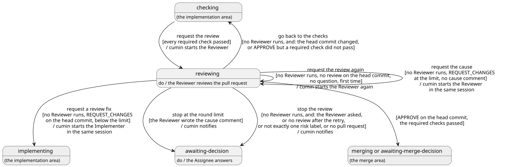

# レビュー

必須チェックの通った Pull Request を Reviewer がレビューし、指摘を Implementer が直す段階を決める。cumin が Reviewer を起動し、レビューを GitHub で確かめ、ラウンドを数え、上限で Assignee に回すまでである。承認のあとのマージとマージ判断は [マージ](../merge/index.md)、Agent起動に共通のことは [Agent](../agent/index.md) で決める。

## 全体像

実装Issueがレビューの段階でたどる状態を示す。灰色の状態は、ほかのカテゴリで決める。

図の元ファイル: [overview.puml](overview.puml)

このページで「Reviewer が動いていない」とは、この cumin が、その実装Issueの Reviewer の実行を今持っていないことである。

Reviewer のセッションと Implementer のセッションは、共有しない。Reviewer が見るのは、GitHub に出ているものと、リポジトリの中身だけである。

## 要件

### レビューの Agent起動

#### `CWK-REVIEW-001` レビューを始める

`cumin/status/checking` の実装Issueで、必須チェックが Pull Request の先頭のコミットですべて通ったとき ([実装](../impl/index.md) の `CWK-IMPL-010`)、cumin は状態を `cumin/status/reviewing` に替えてから、Reviewer を起動する (request the review)。1ラウンド目は新しいセッションで、2ラウンド目からは Reviewer の直前のセッションで起動する。

- 検証: `test` 必須チェックが通ると、実装Issueが `cumin/status/reviewing` になり、Reviewer の Agent起動が1回だけ起きる
- 検証: `test` 指摘の修正のあとのレビューでは、Reviewer の直前のセッションで起動する

---

#### `CWK-REVIEW-002` Reviewer に渡す事実

cumin は、Reviewer の Agent起動で、次の事実を渡す。

- 何ラウンド目かと、ラウンドの上限
- Pull Request の先頭のコミット
- 2ラウンド目からは、前のラウンドでレビューしたコミット
- Reviewer がこの Pull Request の前のコミットを承認しているときは、最後に承認したコミット

- 検証: `test` 2ラウンド目の Agent起動で渡す事実に、ラウンド、上限、先頭のコミット、前のラウンドのコミットがある
- 検証: `test` 承認のあとの1ラウンド目では、最後に承認したコミットがある。一度も承認していない Pull Request では、それがない

---

### レビューを確かめる

#### `CWK-REVIEW-003` レビューが確認を通る

cumin が数えるレビューは、`cumin-reviewer` が Pull Request の今の先頭のコミットに出した、結果が `APPROVE` か `REQUEST_CHANGES` のレビューである。古いコミットへのレビューと、`COMMENT` だけのレビューは数えない。Reviewer が返した結果も使わない。

- 検証: `test` 古いコミットへの `APPROVE` と、今の先頭のコミットへの `COMMENT` では、レビューがないものとして扱う

---

#### `CWK-REVIEW-004` 指摘の修正を頼む

`cumin/status/reviewing` の実装Issueで、Reviewer が動いておらず、Reviewer の最新のレビューが今の先頭のコミットへの `REQUEST_CHANGES` で、ラウンドが上限に達していないとき、cumin は状態を `cumin/status/implementing` に替えて、Implementer の直前のセッションで指摘の修正を頼む (request a review fix)。

- 検証: `test` `REQUEST_CHANGES` のあとで、実装Issueが `cumin/status/implementing` になり、Implementer の直前のセッションで Agent起動が1回起きる

---

#### `CWK-REVIEW-005` チェックに戻る

`cumin/status/reviewing` の実装Issueで、Reviewer が動いておらず、次のどちらかが成り立つとき、cumin は状態を `cumin/status/checking` に替える (go back to the checks)。古いコミットへのレビューは、ラウンドに数えたまま残る。

- レビューの間に、先頭のコミットが変わった
- `APPROVE` が出ているが、必須チェックのどれかが今の先頭のコミットで通っていない

- 検証: `test` レビューの間に push された実装Issueは、`cumin/status/checking` に戻り、チェックが通るともう一度レビューされる

---

#### `CWK-REVIEW-006` レビューをやり直す

`cumin/status/reviewing` の実装Issueで、Reviewer が動いておらず、今の先頭のコミットに Reviewer のレビューがなく、Reviewer の質問のコメントもないとき、cumin は Reviewer をもう一度起動する (request the review again)。やり直すのは、1つの `cumin/status/reviewing` の間に1回だけである。状態は替えない。

- 検証: `test` レビューを出さずに終わった Reviewer のあとで、Reviewer の Agent起動がもう一度だけ起き、状態は `cumin/status/reviewing` のままである

---

#### `CWK-REVIEW-007` レビューを止める

`cumin/status/reviewing` の実装Issueで、Reviewer が動いておらず、次のどれかが成り立つとき、cumin は状態を `cumin/status/awaiting-decision` に替えて、通知する (stop the review)。質問のコメントでないときは、止めた理由をコメントに書く。

- Reviewer の質問のコメントが、実装Issueが `cumin/status/reviewing` になったあとに書かれている。Reviewer の質問では、やり直さない
- 今の先頭のコミットにレビューがなく、`CWK-REVIEW-006` のやり直しを済ませている
- 実装Issueのリスクのラベルが、ちょうど1つでない
- 実装Issueを閉じる開いている Pull Request がない。このときもリスクのラベルがちょうど1つでなければ、そちらを理由にする

- 検証: `test` Reviewer が `blocked` を返すと、やり直さずに `cumin/status/awaiting-decision` になる
- 検証: `test` リスクのラベルを外した実装Issueと、Pull Request が閉じられた実装Issueは、それぞれの理由のコメントが付いて止まる

---

### ラウンド

#### `CWK-REVIEW-008` ラウンドの数え方

ラウンドは、次の2つのうち新しいほうよりあとに出た、`cumin-reviewer` のレビューの数で数える。cumin はラウンドの数を手元に持たない。

- 実装Issueに最後に `cumin/status/ready` が付いたとき
- `cumin-reviewer` が最後に `APPROVE` を出したとき

`APPROVE` のあとで数え直すのは、衝突の解消や Assignee の差し戻しで先頭のコミットが変わり、レビューをやり直すことになるためである。

- 検証: `test` `cumin/status/ready` の付け直しのあとと、Reviewer の `APPROVE` のあとで、ラウンドが1から数え直される

---

#### `CWK-REVIEW-009` 原因の整理を頼む

`cumin/status/reviewing` の実装Issueで、Reviewer が動いておらず、最新のレビューが今の先頭のコミットへの `REQUEST_CHANGES` で、ラウンドが設定の上限 (`max_review_rounds`、初期値は3) に達し、Reviewer の原因の整理のコメントがまだないとき、cumin は Reviewer の直前のセッションで、何が決まっていないことが原因かの整理を頼む (request the cause)。状態は替えない。

- 検証: `test` 上限のラウンドで `REQUEST_CHANGES` が出ると、指摘の修正ではなく、原因の整理の Agent起動が1回起きる

---

#### `CWK-REVIEW-010` ラウンドの上限で止める

`cumin/status/reviewing` の実装Issueで、Reviewer の原因の整理のコメントが Pull Request に書かれているとき、cumin は状態を `cumin/status/awaiting-decision` に替えて、通知する (stop at the round limit)。

- 検証: `test` 原因の整理のコメントが付いたあとで、実装Issueが `cumin/status/awaiting-decision` になり、通知は1回だけである

---

### Reviewer が残すもの

#### `CWK-REVIEW-011` レビュー

Reviewer は、Pull Request の今の先頭のコミットに、GitHub のレビューを1つ出す。修正が必要な指摘が1つもなければ `APPROVE`、1つ以上あれば `REQUEST_CHANGES` にする。`COMMENT` だけのレビューにはしない。指摘とまとめは [review.md](../../../../templates/review.md) の形式で書き、まとめにラウンドと上限を書く。

- 検証: `demo` 完了の条件を満たした正しい Pull Request で、今の先頭のコミットに `APPROVE` が出る
- 検証: `demo` 完了の条件を満たしていない Pull Request で、`REQUEST_CHANGES` が出て、修正が必要な指摘に、場所と理由が書いてある

---

#### `CWK-REVIEW-012` 修正が必要な指摘

Reviewer は、指摘を、修正が必要なもの `(blocking)` と、提案 `(non-blocking)` に分ける。`REQUEST_CHANGES` の理由になるのは、修正が必要な指摘だけである。修正が必要な指摘には、何が問題か、なぜ直す必要があるか、どう直すかを書く。修正が必要な指摘にしてよいのは、次のものである。

- 実装Issueの完了の条件を満たしていない
- 動作が正しくない。テストが足りず、正しさを確かめられない
- 実装Issueの範囲を超えた変更が入っている
- 変更に合わせて直すべき文書が、直されていない
- リポジトリにある指示 (`CLAUDE.md`、`AGENTS.md` など) に反している
- セキュリティの問題がある (`CWK-REVIEW-014`)
- 計算の手間が、現実的なデータ量で明らかに問題になる。完了の条件にある性能の目標を満たしていない場合も含む
- 読んでも正しさを確かめられないほど、コードが入り組んでいる

好みの問題や、直さなくても正しく動く改善案は、提案にする。

- 検証: `demo` 正しく動くが書き方に好みの分かれる Pull Request で、提案は書かれるが、結果は `APPROVE` になる

---

#### `CWK-REVIEW-013` ラウンドごとに見る範囲

Reviewer は、1ラウンド目でできる限り洗い出し、2ラウンド目からは指摘が直ったかだけを見る。2ラウンド目から一から見直すと、そのたびに新しい指摘が見つかり、ラウンドを重ねても指摘がなくならないためである。

##### `CWK-REVIEW-013.1` 1ラウンド目

Reviewer は、Agent の CLI に組み込みのコードレビューとセキュリティレビューの skill があれば、両方を実行する。Claude Code では `code-review` (effort は `high`) と `security-review` である。GitHub に投稿する、ファイルを変える、クラウドで動く、のどの使い方もしない。skill が挙げた候補は、Reviewer がコードを読んで確かめてから指摘にする。skill が見ないこと (完了の条件、範囲、文書、リポジトリにある指示、セキュリティの問い) は、Reviewer が自分で確かめる。skill がないか失敗したときは、同じ観点を自分で確かめて続ける。

- 検証: `demo` 1ラウンド目で、2つの skill が実行され、レビューのまとめに実行した skill が書いてある

---

##### `CWK-REVIEW-013.2` 承認のあとの1ラウンド目

Reviewer がこの Pull Request の前のコミットを承認しているときは、最後に承認したコミット (`CWK-REVIEW-002`) から今の先頭のコミットまでの差分だけを見る。承認したコミットを自分で探さない。深さは1ラウンド目と同じで、skill もその差分に対して実行する。一度も承認していない Pull Request は、全体を見る。承認した変更を毎回一から見直すと、差し戻しや衝突の解消のたびに、全体のレビューをやり直すことになるためである。

- 検証: `demo` 承認のあとに新しいコミットが入った Pull Request で、承認したコミットからの差分だけを見て、skill もその差分に対して実行する

---

##### `CWK-REVIEW-013.3` 2ラウンド目から

Reviewer は、前に出した修正が必要な指摘と、前のラウンドでレビューしたコミットから今の先頭のコミットまでの差分だけを見る。修正が必要な指摘を新しく足してよいのは、その差分の中の、動作の誤りとセキュリティの問題だけである。ほかに気づいたことは、正しい指摘でも提案にする。skill はもう実行しない。

- 検証: `demo` 2ラウンド目で、前の指摘が直ったことを確かめて `APPROVE` を出す
- 検証: `demo` 2ラウンド目で、前の差分の外にある問題に気づくと、提案として書き、`REQUEST_CHANGES` の理由にしない

---

#### `CWK-REVIEW-014` セキュリティの問い

Reviewer は、1ラウンド目ではすべての変更に、2ラウンド目からは修正に、次の6つを問う。

1. 新しい入口や操作のすべてで、サーバの側で権限を確かめているか
2. 外から来る入力をすべて検証し、出力するときに無害な形にしているか
3. 秘密の値、token、個人情報が、コード、ログ、エラーの文面に入っていないか
4. エラーが起きたとき、許可しない側に倒れるか
5. 新しい依存を足しているなら、それは必要で、保守されているものか
6. 認証、暗号、セッションの処理を変えていないか

秘密の値の検出、既知の脆弱性のある依存、静的解析、書式、命名、複雑さのしきい値のように、機械で確かめられることは、対象のリポジトリの必須チェックに任せ、Reviewer は見ない。

- 検証: `inspection` Reviewer が受け取る専門知識のファイルに、6つの問いと、チェックに任せることがある

---

#### `CWK-REVIEW-015` 原因の整理のコメント

Reviewer は、原因の整理を頼まれたら (`CWK-REVIEW-009`)、Pull Request に Assignee 向けのコメントを1つ書く。形式は [decision-request.md](../../../../templates/decision-request.md) に従う。決めてほしいことを1文で書き、何が決まっていないために指摘が直らないのかと、それをどこに書くべきか、残っている指摘ごとの Reviewer と Implementer の立場、選べる決め方とそれぞれの得失、勧める案を書く。

- 検証: `demo` 上限のラウンドで指摘が残った Pull Request で、決められた形式のコメントが付き、1行目に決めてほしいことがあり、選択肢と勧める案が書いてある

---

#### `CWK-REVIEW-016` 直さない

Reviewer は、コードを変えず、push せず、指摘を自分で直さない。Pull Request をマージせず、閉じず、Issue の本文を書き換えない。push は権限でも止まる ([権限](../access/index.md) の `CWK-ACCESS-012`)。

- 検証: `demo` レビューのあとで、Pull Request のコミット、状態、Issue の本文が変わっていない

---

### Implementer の指摘の修正

#### `CWK-REVIEW-017` 指摘への返答

Implementer は、指摘の修正を頼まれたら、修正が必要な指摘のすべてに返答する。形式は [review-reply.md](../../../../templates/review-reply.md) に従う。

- 検証: `demo` 指摘の修正のあとで、修正が必要な指摘のすべてに返答がある

---

#### `CWK-REVIEW-018` 提案の扱い

Implementer は、提案のうち、数行で直せて実装Issueの範囲の中にあるものだけを、同じラウンドで直してよい。直したら `Fixed` と返答する。それ以外は直さずに残し、Pull Request の `Follow-up` に写さない。対応されなかった提案は、マージのあとに cumin がフォローアップノートとして要求Issueに書く ([マージ](../merge/index.md))。

- 検証: `demo` 範囲の外の提案は直されず、`Follow-up` にも写されない

---

### Reviewer が止まるとき

#### `CWK-REVIEW-019` 推測でレビューしない

Reviewer は、次のどれかに当たったら、レビューを出さずに `blocked` を返す。cumin は、やり直さずに止める (`CWK-REVIEW-007`)。

##### `CWK-REVIEW-019.1` 合わないリスク

実装Issueのリスクが、実際の変更と合っていないときは、止まる。例えば `cumin/risk/low` なのに、データベースのマイグレーションを含む。セキュリティの問いの6に当たる変更は、リスクの基準の初期値では `cumin/risk/high` である。リスクを決め直すのは Assignee なので、Implementer ではなく Assignee に回す。

- 検証: `demo` `cumin/risk/low` の実装Issueに、マイグレーションを含む Pull Request でレビューを頼むと、レビューは出ず、結果は `blocked` で、リスクが合わないことが理由に書いてある

---

##### `CWK-REVIEW-019.2` 関係のない Pull Request

Pull Request の内容が、実装Issueとほとんど関係がないときは、止まる。

- 検証: `demo` 実装Issueと関係のない変更の Pull Request でレビューを頼むと、結果は `blocked` である

---

##### `CWK-REVIEW-019.3` 曖昧な完了の条件

実装Issueの完了の条件が曖昧で、満たしたかどうかを判定できないときは、止まる。

- 検証: `demo` 完了の条件が曖昧な実装Issueでレビューを頼むと、結果は `blocked` で、判定できない条件が理由に書いてある

---

## 受け入れテスト

| # | 場面 | 期待する結果 |
|---|---|---|
| 1 | 必須チェックが通り、Reviewer が `REQUEST_CHANGES` を出し、Implementer が直し、2ラウンド目で `APPROVE` が出る | レビューが始まり (`CWK-REVIEW-001`)、指摘の修正を頼み (`CWK-REVIEW-004`)、チェックを通って2ラウンド目が直前のセッションで起動され、前の指摘と差分だけを見て承認する (`CWK-REVIEW-013.3`)。そのあとはマージに進む |
| 2 | 上限のラウンドでも指摘が残る | 原因の整理を頼み (`CWK-REVIEW-009`)、コメントが付くと `cumin/status/awaiting-decision` になって通知が1回届く (`CWK-REVIEW-010`、`CWK-REVIEW-015`) |
| 3 | Reviewer が承認したあとに衝突が起き、Implementer が解消する | ラウンドが1から数え直され (`CWK-REVIEW-008`)、承認したコミットからの差分だけがレビューされる (`CWK-REVIEW-002`、`CWK-REVIEW-013.2`) |
| 4 | レビューの間に、誰かがブランチに push する | `cumin/status/checking` に戻り、チェックが通るともう一度レビューされる (`CWK-REVIEW-005`) |

## 未決事項

- 「Reviewer が動いていない」の意味は、[計画](../plan/index.md) と [実装](../impl/index.md) と同じく、[Agent](../agent/index.md) か [定期確認](../poll/index.md) に移す。
