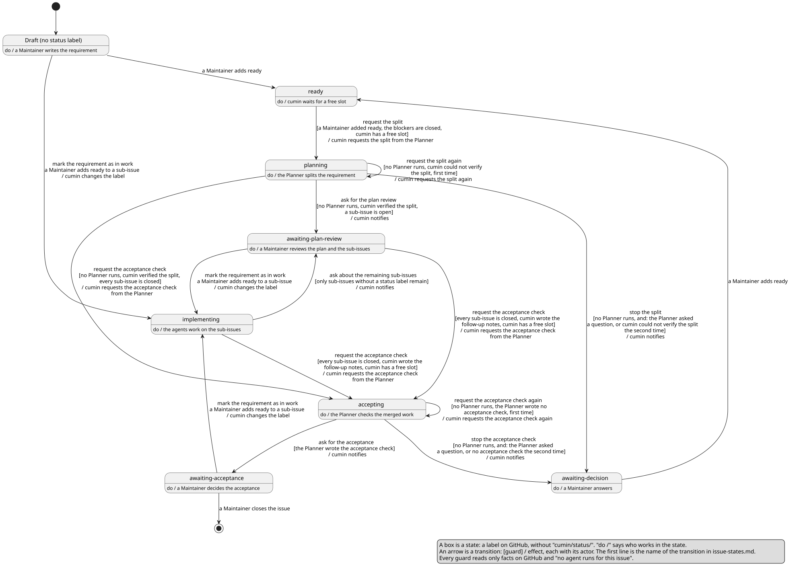
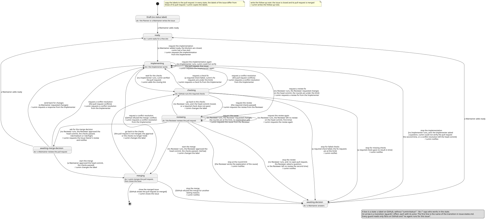

# 状態とラベル

要求Issueと実装Issueの状態を、どのラベルで表し、誰がそのラベルを付けてよいかを決める。状態ごとのアクションは、計画、実装、レビュー、マージ、受け入れの各カテゴリで決める。

## 全体像

要求Issueの状態遷移:

図の元ファイル: [requirement-issue-states.puml](requirement-issue-states.puml)

実装Issueの状態遷移:

図の元ファイル: [implementation-issue-states.puml](implementation-issue-states.puml)

状態は3つの種類に分かれ、名前で見分けられる。

- 人なしで進む状態: 名前が `-ing` で終わる。Agent、GitHub、cumin のどれかが作業している。
- 人の番の状態: 名前が `awaiting-` で始まる。Assignee が動くまで進まない。
- 順番を待つ状態: `ready`。Maintainer が進めてよいと合図し、cumin が空きを待っている。

## 要件

### ラベル

#### `CWK-STATE-001` 状態の一覧

Issue の状態は、次のどれかである。状態ラベルの名前は、`cumin/status/` のあとに状態の名前を付けたものである。

| 状態 | 付く対象 | その状態で進むこと |
|---|---|---|
| `ready` | 要求Issue、実装Issue | cumin が空きを待つ |
| `planning` | 要求Issue | Planner が計画する |
| `awaiting-plan-review` | 要求Issue | Assignee が計画結果を確かめる |
| `implementing` | 要求Issue | sub-issue の作業が進む。要求Issueそのものには、誰も作業しない |
| `accepting` | 要求Issue | Planner が受け入れ確認をする |
| `awaiting-acceptance` | 要求Issue | Assignee が、受け入れるか差し戻すかを決める |
| `implementing` | 実装Issue | Implementer が作業する (修正を含む) |
| `checking` | 実装Issue | GitHub が必須チェックを動かす |
| `reviewing` | 実装Issue | Reviewer が Pull Request をレビューする |
| `awaiting-merge-decision` | 実装Issue | Assignee が Pull Request を見て、マージ判断をする |
| `merging` | 実装Issue | cumin が Pull Request をマージし、実装Issueを閉じる |
| `awaiting-decision` | 要求Issue、実装Issue | Assignee が答える。cumin が先に進めない理由は、Issue のコメントにある |

- 検証: `test` cumin が作るラベルの一覧が、この表の状態と一致する

---

#### `CWK-STATE-002` 状態ラベルは1つ

1つの Issue に付く状態ラベルは、常に1つだけである。状態ラベルを替えるのは cumin である。例外は `cumin/status/ready` で、これは Maintainer が付ける。

- 検証: `test` cumin がラベルを替えたあと、どの Issue にも状態ラベルが1つだけ付いている

---

#### `CWK-STATE-003` 種類のラベル

`cumin/type/requirement` は、その Issue が要求Issueであることを表す。Maintainer が付け、閉じるまで付けたままにする。`cumin/type/requirement` の付いた Issue の sub-issue が、実装Issueである。実装Issueを表すラベルは作らない。

`cumin/type/owner-task` は、その実装Issueの作業を Assignee が手で行うことを表す。Implementer が変えられないファイル (保護されたパス、GitHub App の権限で書けないファイル) の変更が要るときに、Planner か Maintainer が付ける。cumin は、`cumin/status/ready` が付いていても、この Issue に着手しない。

- 検証: `test` `cumin/type/owner-task` と `cumin/status/ready` の付いた実装Issueに、Agent起動をしない

---

#### `CWK-STATE-004` リスクのラベル

実装Issueには、`risk/low`、`risk/medium`、`risk/high` のどれか1つが付く。Planner が仮に付け、Maintainer が確かめて、必要なら替える。

- 検証: `test` リスクのラベルがないか、2つ以上ある実装Issueがあると、計画が確認を通らない

---

#### `CWK-STATE-005` ラベルを Pull Request に写す

cumin は、実装Issueの状態ラベルとリスクのラベルを、その Issue を閉じる Pull Request にも写す。写したラベルは、Maintainer が Pull Request の一覧で状態とリスクを見分けるためのもので、cumin は読まない。Pull Request の側でラベルを替えても、cumin が実装Issueのラベルで上書きする。この写しは、どの状態でも行い、状態を変えない (copy the labels to the pull request)。

- 検証: `test` cumin が実装Issueのラベルを替える、Maintainer が実装Issueのリスクを替える、Maintainer が Pull Request の側のラベルを替える、のどれのあとでも、次の定期確認で Pull Request のラベルが実装Issueと同じになる。cumin のアクションは、Pull Request のラベルに左右されない

---

#### `CWK-STATE-006` ラベルを作る

cumin は、対象のリポジトリに足りないラベルを作る。すでにあるラベルの色と説明は変えない。

- 検証: `test` ラベルのないリポジトリで、cumin がこのページのラベルを作る。すでにあるラベルの色と説明は変わらない

---

### 扱う Issue

#### `CWK-STATE-007` ドラフトは扱わない

状態ラベルのない Issue (ドラフト) は、cumin が扱わない。

- 検証: `test` 状態ラベルのない Issue に、cumin は何もしない

---

#### `CWK-STATE-008` 閉じた要求Issueには何もしない

cumin は、閉じた要求Issueを読まず、ラベルを替えず、コメントも書かない。

- 検証: `test` 閉じた要求Issueに、cumin は GitHub への書き込みをしない

---

### 数える状態ラベル

#### `CWK-STATE-009` 状態ラベルを付けたアカウント

cumin は、今付いている状態ラベルを最後に付けたアカウントを確かめ、次のときだけ、その状態ラベルを数える。付けたアカウントは、GitHub が Issue のタイムラインに残すラベルのイベントから読む。

| 状態ラベル | 数えるのは、誰が付けたときか |
|---|---|
| `cumin/status/ready` | Maintainer |
| ほかのすべての状態ラベル | `cumin-core` の GitHub App か、Maintainer |

- 検証: `test` triage の権限のアカウントが `cumin/status/planning` や `cumin/status/merging` を付けても、cumin は Agent起動もマージもせず、ラベルも替えない。`cumin-core` か Maintainer が付けた状態ラベルでは、今までどおり動く

---

#### `CWK-STATE-010` 数えない状態ラベル

数えない状態ラベルの付いた Issue では、cumin は何もしない。Agent起動をせず、マージせず、ラベルも替えない。ログと通知を1回だけ残し、同じラベルについて、定期確認のたびに繰り返さない。Maintainer が正しいラベルを付け直すと、今までどおり進む。

- 検証: `test` Maintainer でないアカウントが `cumin/status/ready` を付けても着手せず、通知は1回だけである。Maintainer が付け直すと着手する

---

### Assignee

#### `CWK-STATE-011` Assignee を付ける

`cumin/status/ready` の付いた Issue に assignee がいなければ、cumin は、その `cumin/status/ready` を付けた Maintainer を assignee にする。

- 検証: `test` assignee のない Issue に Maintainer が `cumin/status/ready` を付けると、その人が assignee になる

---

#### `CWK-STATE-012` Assignee は1人の Maintainer

Issue を進められるのは、assignee がちょうど1人で、その人が Maintainer のときだけである。assignee が2人以上いるとき、または assignee が Maintainer でないとき、cumin はその Issue を進めず、通知を1回だけ送る。

- 検証: `test` assignee が2人いる Issue と、Maintainer でない assignee の Issue に、cumin は着手せず、それぞれ通知は1回だけである

---

#### `CWK-STATE-013` Assignee を替える

担当を替えるときは、Maintainer が assignee を替える。cumin は、Maintainer が替えた assignee だけを数える。替えたアカウントは、GitHub が Issue のタイムラインに残す assignee のイベントから読む。assignee を替えても、Agent は動き直さない。

- 検証: `test` Maintainer が assignee を替えると、次の判断はその人に求める。Agent起動は増えない
- 検証: `test` Maintainer でないアカウントが assignee を替えたときは、数えない

---

## 受け入れテスト

| # | 場面 | 期待する結果 |
|---|---|---|
| 1 | Maintainer でないアカウントが、assignee のない Issue に `cumin/status/ready` を付ける。そのあと Maintainer が付け直す | 最初は着手せず、ラベルも assignee も替わらず、通知は1回だけ (`CWK-STATE-010`)。付け直すと、その Maintainer が assignee になり (`CWK-STATE-011`)、着手する |

## 未決事項

- このカテゴリの全体像の図 (`overview.puml`) は、ほかのカテゴリの要件を書いてから描く。それまでは、旧版の状態遷移の図を置く。
